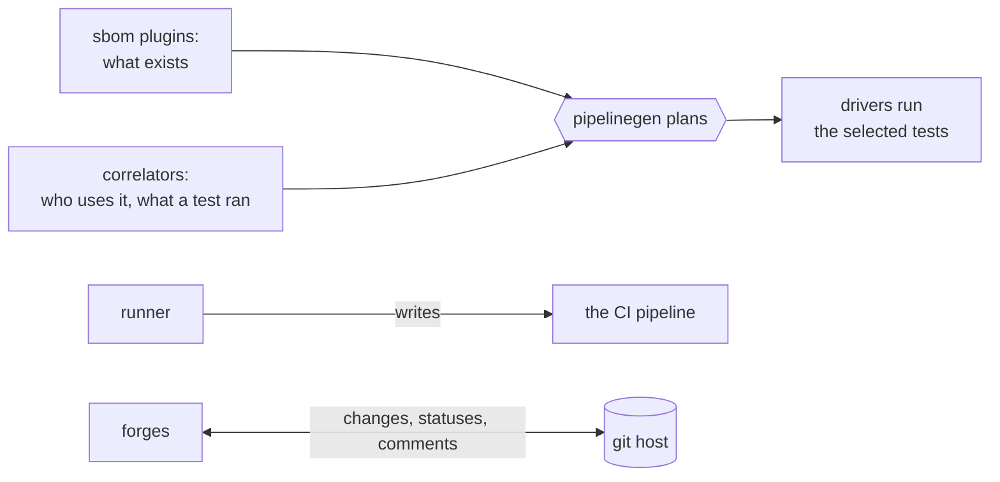

# pipelinegen plugins

<p align="center">
  The plugins of <a href="https://github.com/sideways-works/pipelinegen">pipelinegen</a>:
  programs that read code, record what tests executed, run tests, write the
  CI pipeline and talk to git hosts.
</p>

<p align="center">
  <a href="LICENSE"></a>
</p>

pipelinegen runs only the tests a change can reach. It knows which ones
through these plugins. Each is a program of its own, which pipelinegen
fetches from its release, checks against its pinned checksum and calls
with JSON. This repository holds all of them, one directory each.

## Why these plugins

- **One program, any language.** pipelinegen calls a plugin with a JSON
  request on stdin and reads a JSON answer on stdout. The plugins here are
  Go modules and Node packages.
- **Released and pinned one by one.** Each plugin has its own tags,
  `<kind>/<name>/vX.Y.Z`, and a config pins it by version and the checksum
  of its release's `SHA256SUMS`.
- **Releases are reproducible.** A release is built twice, and fails
  unless both builds give the same bytes.
- **Forges hold no token.** A forge answers with the HTTP requests it wants
  sent, as data. pipelinegen checks them and adds the token itself.
- **Checked by a conformance kit.** `pipelinegen plugin test` calls a
  plugin as pipelinegen would and checks every answer. The templates pass
  it, so a new plugin starts from one that does.
- **Tested by pipelinegen.** This repository's own CI is made by
  pipelinegen: a change runs the tests of the plugins it touches.

## The plugins

| Plugin | Program | What it does |
|---|---|---|
| [sbom/go](sbom/go) | `go-sbom` | a Go repository's declarations and modules |
| [sbom/locale](sbom/locale) | `locale-sbom` | the keys of a repository's message catalogs |
| [sbom/npm](sbom/npm) | `npm-sbom` | the packages an npm or pnpm workspace installs |
| [sbom/openapi](sbom/openapi) | `openapi-sbom` | an OpenAPI contract's operations and components |
| [sbom/pg](sbom/pg) | `pg-sbom` | the PostgreSQL database a repository's migrations build |
| [sbom/ts](sbom/ts) | `ts-sbom` | the functions, components and styles of TypeScript, JavaScript and CSS |
| [correlator/go](correlator/go) | `go-correlator` | who uses which Go declaration, and what a Go test ran |
| [correlator/gorm](correlator/gorm) | `gorm-correlator` | which PostgreSQL tables Go code reaches through GORM |
| [correlator/locale](correlator/locale) | `locale-correlator` | which message catalog keys a test looked up |
| [correlator/oapi-codegen](correlator/oapi-codegen) | `oapi-codegen-correlator` | which API operations oapi-codegen's generated code serves |
| [correlator/react](correlator/react) | `react-correlator` | who uses and who runs which unit of a TypeScript frontend |
| [correlator/sql](correlator/sql) | `sql-correlator` | which database objects a test's statements touched |
| [driver/bazel](driver/bazel) | `bazel-driver` | runs slices that are Bazel test targets |
| [driver/go](driver/go) | `go-driver` | runs slices that are Go test files |
| [driver/playwright](driver/playwright) | `playwright-driver` | runs slices that are Playwright spec files |
| [driver/shell](driver/shell) | `shell-driver` | runs a suite's steps written as shell |
| [runner/concourse](runner/concourse) | `concourse-runner` | writes the Concourse pipeline |
| [forge/git](forge/git) | `git-forge` | changes from a plain git server's branches |
| [forge/github](forge/github) | `github-forge` | pull requests, statuses and comments on GitHub |

## How it works



Every plugin answers `describe` with who it is and what it reads. Here is
the shell driver's answer:

```console
$ echo '{"protocol": 1}' | ./shell-driver describe
{"verbs":["prepare","setup","run"],"routes":{"files":["**"],"kinds":["*"]},"settings":{"caches":"list","checks":"list","command":"list","dir":"string","env":"map","functions":"string","script":"string","shell":"list","stop":"string","timeout":"duration"},"results":"exit","protocol":1,"kind":"driver","name":"shell-driver","version":"dev","capabilities":null,"needs":["sh"]}
```

## Quick start

You need [pipelinegen](https://github.com/sideways-works/pipelinegen/blob/main/docs/tutorial/install.md),
Go 1.27 and git.

**Use a plugin.** In a repository with a `pipelinegen.yaml`, `plugin add`
finds a plugin's newest release, checks its files and writes the pin:

```console
$ pipelinegen plugin add https://github.com/sideways-works/pipelinegen-plugins driver/go
added go-driver (driver) from https://github.com/sideways-works/pipelinegen-plugins at driver/go: v0.4.0, 4 files checked
```

```yaml
plugins:
  - repository: https://github.com/sideways-works/pipelinegen-plugins
    with:
      - {name: go-driver, kind: driver, path: driver/go, release: {version: v0.4.0, sums: 9a666c360d7f001477588e54823aa4b46df4117d853ec41e53c1d9b147a81887}}
```

Each plugin's README lists its settings.

**Call one by hand.** Build a plugin and ask it to describe itself:

```sh
git clone https://github.com/sideways-works/pipelinegen-plugins.git
cd pipelinegen-plugins/driver/shell
go build -o shell-driver ./cmd/shell-driver
echo '{"protocol": 1}' | ./shell-driver describe
```

**Start your own.** `plugin new` copies the released template of a kind,
renamed, and `plugin test` runs the conformance kit on it:

```sh
pipelinegen plugin new driver rust
cd rust-driver
go build -o rust-driver ./cmd/rust-driver
pipelinegen plugin test ./rust-driver --tree testdata/kit
```

## Documentation

| | |
|---|---|
| Each plugin's README, such as [driver/shell](driver/shell/README.md) | what it does, its settings, what its tests need |
| [templates/](templates) | a minimal plugin of each kind that passes the conformance kit |
| [The plugin protocol](https://github.com/sideways-works/pipelinegen/blob/main/docs/plugins.md) | calls, answers and the conformance kit, in pipelinegen's book |
| [Writing plugins](https://github.com/sideways-works/pipelinegen/tree/main/docs/writing-plugins) | a guide for each kind |
| [CONTRIBUTING](CONTRIBUTING.md) | the layout, adding a plugin here, manifests and releases |
| [RELEASING](RELEASING.md) | the order the plugins are released in |

## Building and contributing

Every command uses the Go SDK, golangci-lint, Node and gh that
`MODULE.bazel` pins, so the only thing to install is Bazel through
bazelisk, which reads `.bazelversion`:

| Command | What it does |
|---|---|
| `bazel run //tools:hooks` | once per clone: the commit-msg hook |
| `bazel run //driver/go:test` | one plugin's tests: `go test` in each of its modules, or `npm test` |
| `bazel run //driver/go:lint` | its lint: golangci-lint, or the package's lint script |
| `bazel run //:test` | every plugin's, template's and the tools' tests |
| `bazel run //:lint` | every lint, then the checks of the whole repository |
| `bazel run //:checks` | those checks alone: tool versions, `pipelinegen check`, commit subjects |
| `bazel run //:templates` | every template built and run through the conformance kit |

Commits are one conventional subject line of at most 72 characters,
scoped to the plugin's directory when the change is one plugin's.
[CONTRIBUTING](CONTRIBUTING.md) says how to add a plugin and cut a
release, and [SECURITY](SECURITY.md) how to report a vulnerability.

## License

The plugins belong to Sideways Works and are licensed under the
[Apache License, Version 2.0](LICENSE), every folder of this repository. Each plugin carries a copy of the LICENSE
and its own NOTICE; the repository's is [NOTICE](NOTICE).
