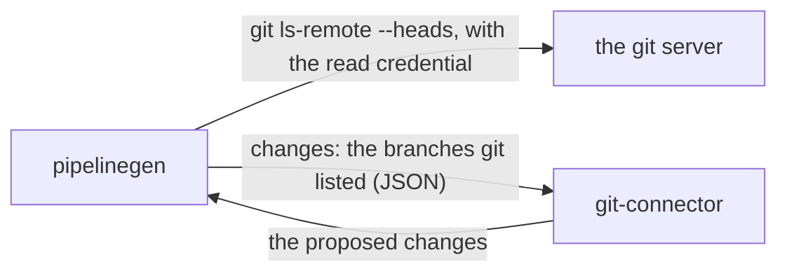

# git-connector

A pipelinegen connector for a plain git server with no host API: cgit,
gitweb, a bare repository over ssh, or GitLab and Gitea used as plain git.
[pipelinegen](https://github.com/sideways-works/pipelinegen) runs only the
test slices a change can break; a connector tells it where the code lives.
On a plain git server the proposed changes are branches whose names match
the config's patterns, such as `review/*`.



The connector sends nothing and holds no token: pipelinegen lists the
remote's branches with git and hands them in as `heads`, and the connector
picks the changes among them. It reports nowhere. A run's state is in its
records, which `pipelinegen status <commit or branch>` reads.

## Using it

A config's `connectors` entry of plugin `git` uses it with no line of its
own: pipelinegen pins a release of it and fetches that release, checked by
its checksum.

```yaml
git:
  remote: https://git.example.com/group/example.git
connectors:
  - name: git
    plugin: git
    changes: {branches: ["review/*"]}
    links: https://git.example.com/cgit/example/tree/{path}?id={commit}
runs:
  review:
    trigger: {changes: {base: main}}
```

A `plugins` entry named `git` pins another release:

```yaml
plugins:
  - repository: https://github.com/sideways-works/pipelinegen-plugins
    with:
      - {name: git, kind: connector, path: connector/git, release: {version: v0.1.0, sums: ...}}
```

## What it answers

| Call | What it does |
|---|---|
| `describe` | the capabilities changes and forks; no API host and no token |
| `identify` | the configured remote and no other |
| `changes` | the branches among `heads` whose names match one of `branches` (`path.Match`), but the base, in branch order, each `branch-<name>` with the name written as one ref part (`branch-review%2Fcart`), as pipelinegen's records name it |
| `links` | the config's `links` template with `{commit}`, `{branch}` and `{path}` filled in; nothing without one |

`status`, `statuses`, `comment` and `subject` are refused: a plain git
server keeps no statuses or comments, and pipelinegen's config refuses a
run that asks for them, or filters on drafts, labels or readiness, with
this connector.

A plain git server has no forks: every branch is the repository's own, so
every change comes from it (`same`). pipelinegen runs a change only at a
branch it listed itself, at the commit it saw.

## Checking it

```sh
go test ./...
```

runs pipelinegen's conformance kit on the built connector with the fixture
in `connector/testdata/kit`, whose config holds the `heads` pipelinegen
would list and whose `no_forks` says why it names no fork. By hand:
`pipelinegen plugin test <the built executable> --tree connector/testdata/kit`.
A pipelinegen whose kit predates `no_forks` fails its fork check on a host
without forks; the kit test allows exactly that one failure.

## Developing

The tests and the lint run with the Go, golangci-lint and Node that the
repository pins, as [CONTRIBUTING](../../CONTRIBUTING.md) describes; the
other commands run in this directory.

```sh
bazel run //connector/git:test
bazel run //connector/git:lint
```

- The tests include pipelinegen's conformance kit: `TestTheKit` builds
  the connector and runs `go tool pipelinegen plugin test` on it with the
  fixture in `connector/testdata/kit`, with the pipelinegen that `go.mod` requires as
  a tool. By hand:
  `pipelinegen plugin test ./git-connector --tree connector/testdata/kit`.
- A change to what git-connector answers comes with its docs: the README
  describes git-connector as it is on `main`.
