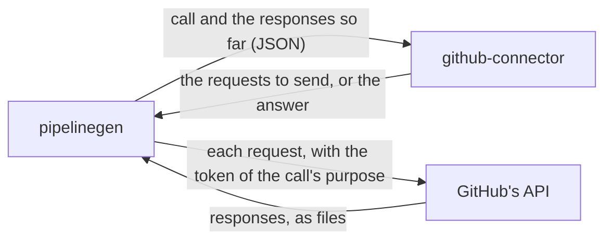

# github-connector

A pipelinegen connector for repositories on GitHub, github.com or GitHub
Enterprise Server. [pipelinegen](https://github.com/sideways-works/pipelinegen)
runs only the test slices a change can break; a connector tells it where
the code lives. This one lists a repository's open pull requests, sets
commit statuses and keeps one comment on each pull request.



It sends nothing itself and never sees a token. Each call answers with the
requests it wants sent, as data. pipelinegen checks them, adds the token
for the call's purpose, sends them only to the API host the step names,
retries, and hands back the responses, round by round, until the
connector gives its answer.

## Using it

A config with a `github` section uses it with no line of its own:
pipelinegen pins a release of it and fetches that release, checked by its
checksum. A `plugins` entry named `github` pins another:

```yaml
plugins:
  - repository: https://github.com/sideways-works/pipelinegen-plugins
    with:
      - {name: github, kind: connector, path: connector/github, release: {version: v0.1.0, sums: ...}}
```

On GitHub Enterprise Server, the step's `PIPELINEGEN_GITHUB_API` names the
API (`https://git.example.com/api/v3`).

## What it answers

| Call | What it does |
|---|---|
| `describe` | the capabilities changes, statuses, comment, draft, labels, ready_since, forks and head_ref; `https://api.github.com` as its API host; `Authorization: Bearer` for the tokens of the read, changes and report purposes; statuses up to 140 characters and comments up to 65536, in Markdown with Mermaid |
| `identify` | a remote on github.com, or on the host of a configured API, by its `owner/name`; a pull request's head is fetched by `refs/pull/{id}/head` |
| `changes` | the open pull requests onto a base, up to ten pages of a hundred, with their head, branch, draft state and labels, narrowed by the run's filters (draft, labels, the head branch's pattern); with `ready_since`, when each was last marked ready, from its timeline, twenty timelines a round |
| `status`, `statuses` | sets a commit status; reads a commit's newest status per context. A commit GitHub doesn't know has none |
| `subject` | a commit's subject line |
| `comment` | keeps one comment on a pull request: the oldest whose body starts with the marker, on a line of its own or alone, is updated when its text differs, one is made when there is none, and the others that start with the marker are deleted. A comment that only quotes the marker further down is someone else's and stays |
| `links` | a commit's, a file's and a pull request's page |

A pull request runs only when its head's repository is the base
repository by id. A fork, or a repository deleted and made again under
the same name by someone else, has another id and is reported as a fork; a
pull request whose head repository is gone is reported as unknown. Neither
runs.

## Checking it

```sh
go test ./...
```

runs pipelinegen's conformance kit on the built connector with the fixture
in `connector/testdata/kit`: two pull requests, one of them from a fork, a
status, a commit and an empty comment thread. By hand:
`pipelinegen plugin test <the built executable> --tree connector/testdata/kit`.

The requests pipelinegen's own GitHub clients sent before this connector
replaced them are kept in `connector/testdata/requests.json`; a test holds
the connector to them, request by request.

## Developing

The tests and the lint run with the Go, golangci-lint and Node that the
repository pins, as [CONTRIBUTING](../../CONTRIBUTING.md) describes; the
other commands run in this directory.

```sh
bazel run //connector/github:test
bazel run //connector/github:lint
```

- The tests include pipelinegen's conformance kit: `TestTheKit` builds
  the connector and runs `go tool pipelinegen plugin test` on it with the
  fixture in `connector/testdata/kit`, with the pipelinegen that `go.mod` requires as
  a tool. By hand:
  `pipelinegen plugin test ./github-connector --tree connector/testdata/kit`.
- A change to what github-connector answers comes with its docs: the README
  describes github-connector as it is on `main`.
