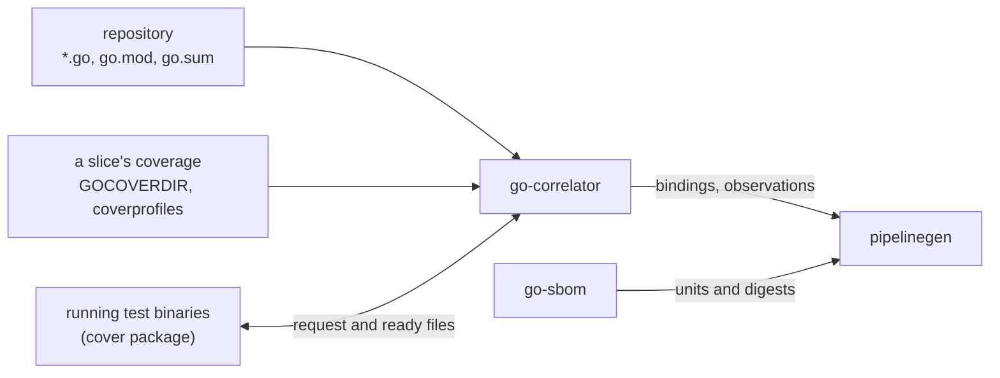

# go-correlator

go-correlator is a correlator plugin for
[pipelinegen](https://github.com/sideways-works/pipelinegen), which runs
only the test slices a change can break. In a Go repository it records who
uses what: which declarations each declaration references, which methods
each type has, which implementations an interface call may reach, which
modules each package links, and, from a test's coverage, which
declarations the test ran.

It owns no units. The declarations and modules it names are the units
[go-sbom](../../sbom/go) lists, and both
plugins spell ids through go-sbom's `goid` package, so they always agree:
`go:internal/notes#func:Create`, `dep:go:golang.org/x/text`. A repository
configures the two together.

Type-checked knowledge is too large to hand to pipelinegen as plain links:
a backend of about 20,000 declarations takes hundreds of MB in memory. So
go-correlator answers `bind` instead of `links`. It binds each slice
itself and gives every bound unit with the reason it is there.



## An example

A repository has a package `internal/notes` with a function `Create`, and
a package `internal/search`. In their last recorded run, the backend slice
`internal/notes/notes_test.go` ran `Create`, and the browser slice
`e2e/search.spec.ts` ran code in `internal/search` on a started server but
never `Create`.

A change to the body of `Create` changes its digest in go-sbom's answer.
go-correlator bound `Create` to the first slice, because the slice ran
it, and not to the second. In a suite that follows what ran, the plan
runs `internal/notes/notes_test.go` and leaves `e2e/search.spec.ts`
untouched.

A new function in `internal/notes` that nothing calls yet selects no slice
while the `unreached-new` narrowing is on. From level 3 it runs every slice
whose binaries link `internal/notes`.

## Setting it up

Name the plugin in `pipelinegen.yaml` next to go-sbom, each pinned by a
release and its checksum:

```yaml
plugins:
  - repository: https://github.com/sideways-works/pipelinegen-plugins
    with:
      - name: go
        kind: sbom
        path: sbom/go
        release: {version: vX.Y.Z, sha256: ...}
      - name: go-uses
        kind: correlator
        path: correlator/go
        release: {version: vX.Y.Z, sha256: ...}
```

The checksum is the `go-correlator-linux-amd64` line of the release's
`SHA256SUMS`. Or pin the release by the checksum of its `SHA256SUMS`
itself, `sums: ...` in place of `sha256`: one pin then serves every
platform, a Mac's binary checked by its own line of the list.
A new pin selects nothing by itself. List `pipelinegen.yaml`
under `everything_on`, so that a pin change, like any other change to the
config, runs every slice.

For a repository whose tests run in-process with `go test`, that is all.
A suite that starts long-running binaries (a server that browser tests
talk to) needs one more key, `cover_dir`; see
[Recording a run](#recording-a-run).

### The files it claims

`describe` names the candidates `**/*.go`, `**/go.mod` and `**/go.sum`.
`detect` reads them and claims, with go-sbom's rules:

| File | Role |
|---|---|
| a `.go` file with a `package` clause | `source` |
| a `.go` file whose header says `// Code generated ... DO NOT EDIT.` | `generated` |
| `go.mod` | `manifest` |
| `go.sum` | `lockfile` |

It never claims files under `testdata`, `vendor` or `node_modules`, under a
directory whose name starts with `.`, `_` or `bazel-`. The modules it
reads are the directories of the `go.mod` files it claimed. The `include`
and `exclude` patterns of the plugin's entry widen or narrow that, for
example `exclude: ["tools/**"]`.

### Config

Every key is optional. `cover_dir` is the only run-time location; the
others override what the plugin would find or assume.

```yaml
    config:
      cover_dir: coverage/ctl
      modules: [backend]
      pure_calls: [errors.New, fmt.Errorf, example.com/notes/internal/problem.New]
      build: {goos: linux, goarch: amd64, cgo: false, tags: [pipelinegen_cover]}
      wait_seconds: 8
```

| Key | Default | What it does |
|---|---|---|
| `cover_dir` | none | the directory a stack's binaries talk through, relative to the batch task's working directory |
| `modules` | the claimed `go.mod` directories | reads only these modules |
| `pure_calls` | `errors.New`, `fmt.Errorf`, `fmt.Sprintf`, `fmt.Sprint`, `regexp.MustCompile`, `strings.NewReplacer`, `time.Date` | the functions an initialiser may call and still bind only through the code that uses its variable (see `pure-initialisers`); a list replaces the default, so repeat the defaults you keep; names are `import/path.Name`. The repository's own constructors need no entry while `pure-functions` is on |
| `build` | linux, amd64, cgo off, the tag `pipelinegen_cover` | the build context every file is read under; it must be the same as go-sbom's |
| `wait_seconds` | 8 | how long `collect` waits for the binaries; keep it under pipelinegen's 10-second bound |
| `stack` | false | makes `collect` treat every suite as a stack; leave it unset, since pipelinegen passes each suite's own `stack: true` with every request |

Both Go plugins read every file under the one build context of `build`,
never the machine's, so their answers can be shared between machines.

### Toolchain and caches

`describe` declares `needs: ["go>=go.mod"]`: the go command that `PATH`
resolves in each module's directory must be at least as new as that
module's `go` line, because
the type checker loads export data through it and `observe` reads a
GOCOVERDIR with `go tool covdata`. With an older one, `bind` and `why`
answer "can't tell" with `"cacheable": false` and a message that names the
toolchain, the `go.mod` and both versions, so a planner with the right go
asks again. It declares the
caches `gocache` and `gomodcache`, which the runner keeps with the
planning job. Every go command the plugin runs gets the build's `GOOS`,
`GOARCH` and `CGO_ENABLED`, `GOFLAGS=-trimpath`, `GOPROXY=off` and
`GOTOOLCHAIN=local`. It downloads nothing, so the module cache must
already hold the repository's modules (the planner's prepare command fills
it).

`describe` also reports `toolchains`, the go its own go commands resolve,
as `go env GOVERSION` prints it (`{"go": "go1.27.1"}`); pipelinegen keys
cached `bind` answers by it. A version manager's shim picks the go by the
working directory's version file, so describe, which gets no tree, asks in
the directory pipelinegen starts it in, with the environment above, and
`bind` asks again in that directory and in every module directory it
loads. If any of them differ, `bind` still answers, marked `"cacheable":
false`: on a machine where the working directory and a module resolve
different Go versions, bind answers are never cached, which is correct,
only slower; in a CI image with one Go they always are. When no usable go
resolves in the working directory (none at all, or one whose `GOROOT`
holds another release, whose compiler refuses it), `toolchains` is left
out, so nothing is cached; in a module directory the same makes `bind`
answer "can't tell" as above.

## What it produces

go-correlator produces bindings, not units. For each slice and each width
it answers the units the slice is bound to, each with a reason:

| Reason | The unit is bound because |
|---|---|
| `executed` | the slice's list holds it: the slice ran it |
| `test` | it is declared in one of the slice's test files |
| `references` | a bound declaration references it |
| `method` | it is a method of a bound type |
| `implements` | a bound declaration may call it through an interface |
| `init` | it runs when a linked package starts |
| `whole` | its package is bound whole |
| `module` | a package the slice's binaries link belongs to that module |

The `executed` width holds what the slice ran, the declarations of its
test files, and what coverage can't see of them:

- the types, constants and variables they reference, closed over type
  definitions; a type brings along each alias of it that declares methods
  (`type Cash = Amount; func (Cash) String() string`), since those are the
  type's methods too;
- methods and functions without statements;
- the initialisers of every package the binary links;
- the whole of a package the analysis can't follow (cgo, `go:linkname`,
  reflection by name, assembly);
- the declarations of other packages a `go:linkname` directive pulls in
  (`//go:linkname over example.com/shop/money.ErrOver`), wherever the
  package holding the directive is linked: it uses them without a
  reference;
- each file the build leaves out, as one unit: no recording sees its
  declarations, so a change to it selects every slice that links its
  package, while the files the build compiles are bound like any other
  package's (of a pair such as `log_record.go` and `log_release.go`, the
  compiled file binds by what ran, and the left-out file, unit
  `go:<dir>#file:log_release.go`, binds every slice linking the package);
- the modules whose packages the binary links.

A package bound whole for a reason in its own code binds its own
declarations to every slice whose binaries link it, and its test files'
declarations as any package's: only its test binary holds them, and the
type checker reads them in full. A browser spec bound to a test function
of a package its server links would be a binding no test can observe, so a
test added to such a package selects its own slice and the tests that use
what it declares, not every slice that links the package. When the reason
is in a test file (`go:linkname` there), its test files' declarations are
bound whole to the slices of its test binary. A lookup by name in a test
file does the same while `interface-methods` is off; with it on, the
per-site rule below reads the lookup.

The `dependents` width adds everything reachable from those through
references, method sets and interface implementations, up to the slice's
`depth`.

A type, constant or variable never shows in coverage, so it is bound
through what references it, and its record names every referrer in the
slice: the declarations that name it, a type's methods among them, and,
for a type closed over its definition, the other types that hold it.
pipelinegen uses that list to tell a type bound only through code every
slice ran from one the slice's own code uses.

A declaration nobody binds, a new one above all, reaches every slice that
links its package. go-correlator reports those unbound names per package,
and each slice binds the unbound names of the packages its binaries link.

A test type that never reaches an interface is bound as
`go:<dir>#typedecl:T@test` while `test-method-sets` is on: its declaration
without the method set. A helper method added to a shared test harness
then reaches only the tests that call it.

What a batch's setup ran is bound as a slice of its own, `_setup`, while
`setup-split` is on; while it is off, it joins every slice's list.

## Recording a run

A task writes a slice's coverage straight into `coverage/<slice>/`, as
pipelinegen's batch contract says; it doesn't need to know the plugin
entry's name. At `setup-end` and `slice-end`, `collect` moves the Go
coverage it finds there into its own directory, `coverage/<slice>/<plugin>`
(`go-uses` above): text coverprofiles (`*.coverprofile` whose first line
starts with `mode:`) at the top of the slice's directory, and a GOCOVERDIR's
`covmeta.*` and `covcounters.*` files, at the top or in `gocoverdir/`. It
looks no deeper and leaves every other file for other plugins. A slice that
runs more than once in one batch (a retry, a suite recorded on two
configurations) writes every run into the same `coverage/<slice>/`, and
pipelinegen names each later part's directory apart,
`coverage/.pipelinegen/part-<k>/<slice>/<plugin>`: that part's `collect`
takes what is still lying in `coverage/<slice>/`, which is its own run,
since each earlier part moved its files out. Within one part, a name
written again gets a numbered one and the files add up. Files already in
the plugin's own directory stay and are read too.

`observe` turns that coverage into the declarations the slice ran.
pipelinegen calls it with the batch's setup directory first and then the
slice's parts, each in the directory pipelinegen named for it.

### Tests that run in their own process

A `go test` slice writes its own coverprofile into its directory. Build
with `-cover -covermode=atomic -coverpkg=<module>/...` for each module of
the repository and the tag `pipelinegen_cover`, then run the test binary
once per slice, by test name:

```sh
mkdir -p coverage/internal/notes/notes_test.go
./notes.test -test.run '^TestCreate$' \
  -test.coverprofile=coverage/internal/notes/notes_test.go/tests.coverprofile
```

### A server started per slice

When the server starts in a second or two, a browser or API suite can
start it afresh for each slice instead, and needs no change to the
repository. Build it with `go build -cover -coverpkg=<module>/...` (and
the build tags the plugin's config names), start it at the beginning of
each slice with `GOCOVERDIR=coverage/<slice>/gocoverdir`, run the slice's
spec file against it, and stop it before the slice ends:

```sh
mkdir -p coverage/web/notes.spec.ts/gocoverdir
GOCOVERDIR=coverage/web/notes.spec.ts/gocoverdir ./server & pid=$!
npx playwright test web/notes.spec.ts
kill -TERM $pid; wait $pid
```

A binary built with `-cover` writes its counters only when it exits normally:
from `main` returning or `os.Exit`, not from a signal it doesn't handle.
So the server must turn SIGTERM into a clean exit (most servers do, to
shut down gracefully). A server that was killed leaves no counters, and
`observe` can't tell for that slice. At `slice-end`, `collect` moves the
files from `gocoverdir/` into its own directory, as above. The suite
leaves `stack` out and the config needs no `cover_dir`: nothing runs
between slices, so there is nothing to ask. Each slice also ran the
server's start-up code, so a change there selects every slice of the
suite, which is what such a change does.

### A running stack

A browser test or an API test against a started server needs the server's
counters between slices, without restarting it. That is the way when the
stack is slow to start or is several processes. Each binary of the stack
links the `cover` package, in coverage builds only, through one file of
its own:

```go
//go:build pipelinegen_cover

package main

import _ "github.com/sideways-works/pipelinegen-plugins/correlator/go/cover"
```

and is built with `-tags pipelinegen_cover -cover -covermode=atomic
-coverpkg=<module>/...`. The `cover` package is a module of its own with no
dependencies beyond the standard library. It is released with the plugin,
under the same version and the tag `correlator/go/cover/vX.Y.Z`:

```sh
go get github.com/sideways-works/pipelinegen-plugins/correlator/go/cover@vX.Y.Z
```

While the repository is private, the go command needs
`GOPRIVATE=github.com/sideways-works/*` and a GitHub login, as for any
private module.

The suite sets `stack: true` and the plugin's config sets `cover_dir`.
pipelinegen runs plugins in a minimal environment without `PIPELINEGEN_*`
variables, so `collect` learns the directory from `cover_dir` alone. The
task gives the binaries the same directory in their environment:

| Variable | Meaning |
|---|---|
| `PIPELINEGEN_COVER_DIR` | the directory the binaries talk through; without it the package does nothing |
| `PIPELINEGEN_COVER_NAME` | the binary's name in that directory and in errors; its program name when unset |

They talk through files only. At start a binary writes
`<name>-<pid>.ready` and touches it on every poll. Every 100 ms it reads
`request`, which holds a sequence number and a target directory. For a
sequence number it hasn't seen, it writes its meta-data and counters into
the target, clears its counters, and writes `<name>-<pid>.done.<seq>`
holding `ok` or the error. This works whatever starts the binary (a shell,
a supervisor, a container sharing the directory as a volume) and needs no
socket and no signal. A binary built without `-covermode=atomic` can't
clear its counters, so it answers its first request with an error and
exits.

At `setup-end` and `slice-end`, after moving what the task wrote, `collect`
writes a request and waits for every ready binary's answer; the binaries
write into the plugin's own directory. Background work during the slices (timers,
polling loops) lands in whichever slice is current, so a stack's periodic
jobs should be off or run on request. A binary that is killed loses its
counters since the last snapshot.

### When it can't tell

`observe` answers "can't tell" (exit 3), with the reason on stderr, when:

- a slice part has no coverage files;
- a covered block in one of the tree's packages lies in no declaration of
  the tree (a file the tree lacks, a line outside every declaration); the
  message counts the blocks and names the first files;
- the slice's coverage holds no block of the tree's packages at all,
  whether or not any ran: a nested module the config leaves out, or a
  build from another checkout or module path. The message names the
  packages it saw and the tree's modules;
- the tree has no `go.mod`.

pipelinegen then marks the slice, and the slice runs on every change until
a recording tells again. The one empty answer is coverage of the tree's
packages whose counts are all zero: positive evidence of a recording that
ran nothing. A setup directory without coverage is fine; it is a batch of
plain test binaries. A coverprofile that can't be parsed fails (exit 1).

`touched` holds every top-level function, method and init with a covered
block, what only the setup ran included. `setup_like` is that setup-only
part plus init functions. Covered blocks of other modules and of the
standard library, which a wide `-coverpkg` brings in, are left out:
third-party code is bound by module, through the packages that import it.

## Narrowings

Each narrowing binds a slice to less than the wide rule would.
pipelinegen's level decides which are on: a narrowing is on at every level
below its "off from" level and off from that level up, and with it off the
binding falls back to the wide rule.

| Narrowing | Off from level | Narrow rule | Wide rule | What it can miss |
|---|---|---|---|---|
| `setup-split` | 3 | what the setup ran binds a `_setup` slice, which pipelinegen samples | it joins every slice | code that starts lazily (a once, a warmed cache) shows in whichever slice ran first, and a change to setup-only code can break any slice; the sample and the nightly run catch it |
| `unreached-new` | 3 | a new declaration nothing reaches selects nothing | it selects every slice linking its package | a new declaration reached only through reflection or a registry filled elsewhere runs unseen until something that selects changes |
| `interface-methods` | 4 | a type outside the tests binds its declaration without its methods (go-sbom's `typedecl` unit), the signatures (`methodsig`) of the methods whose names some interface of the program, a lookup by a constant name or template text names, and the signature of every method a selection resolves to; the whole type binds where reflection or a template the analysis can't read may reach it | every type binds its whole method set | a method name the scan misses: an interface only a build the config doesn't read declares, or reflection by a name the analysis takes for a constant |
| `method-sets` | 5 | a type binds its methods' signatures (in go-sbom's digest) and its methods without statements | every method of every type the slice uses | nothing: dynamic dispatch depends on the method set, and a body matters only where it ran, and then the list holds it |
| `test-method-sets` | 5 | a test type no value of which reaches an interface binds its own declaration (go-sbom's `typedecl` unit) and the methods its tests call | a test type binds its whole method set and every method, since a test's code has no coverage to show which ran | a method reached through an interface the check missed. Any interface-typed slot counts: a parameter (a type parameter's included), a field, an element, a return value, a send, a conversion. A test type embedded in a named test type escapes only when that type does, and embedded anywhere else it escapes. A method value such as `f := e.send` or a promoted call names its method and binds it |
| `pure-initialisers` | 5 | a variable binds through the code that uses it, unless its initialiser calls outside `pure_calls` or can panic or block when its package starts (an index or a slice that can be out of range, a dereference, a type assertion, an integer division, a shift by a signed count, a comparison of interface values, a receive, a slice converted to an array, a `make` of a computed size, a map literal whose computed key may not hash, a method value of an interface), which binds every slice linking its package | every variable whose initialiser calls anything binds every slice linking its package | a call in `pure_calls` that acts beyond building its value or panics. The default list holds three kinds that can: `regexp.MustCompile` panics on a bad pattern and `time.Date` on a nil location, and `fmt.Errorf`, `fmt.Sprintf` and `fmt.Sprint` call the `Error`, `String` and `Format` methods of their arguments, which may do anything |
| `pure-functions` | 5 | a call of a function of the repository that only builds its result counts as a pure call, so a variable built by the repository's own constructor (`var ErrGone = problem.New(http.StatusGone, "gone", "Gone.")`) binds through the code that uses it. The proof reads only the function's syntax, the same whether its package was loaded from source or not: a plain function whose body is one `return` of literals, names, composite literals (with field names, constant indexes or literal map keys), `&` of a composite literal, `+ - * & \| ^ &^ && \|\|` and calls of pure functions with pure arguments. A method, a conversion, a builtin, a generic function, a function literal, division, a shift, a comparison, a field through a value, a cycle, and a function in a file with cgo or a `go:linkname` directive act. The files declaring the functions and types a proof read are inputs of the variable's package set (every file of a package where it found no function of the name), and asking about one of them answers every set that names it, so a constructor that changes is asked about again | only `pure_calls` count | a construct the proof wrongly admits |
| `pure-test-variables` | 5 | a test file's variable binds through the tests that use it, unless its initialiser may act | every test file variable with an initialiser binds every slice of its package, since it is set up for every test | the same as `pure-initialisers` |
| `referenced-new` | 5 | a new declaration a bound one references counts as reached | it counts as unreached | nothing: it runs only through that referrer, whose change selects the slice already |
| `module-bumps` | 5 | a slice binds the modules of the packages its binaries link, transitively, from `go list -deps -test` | it binds every module its main modules require | nothing: a binary runs a module's code only by linking one of its packages |

### What `pure-functions` admits

`pure-functions` rests on one assumption: what its proof admits neither
acts nor panics when a package starts. The proof reads a function's
syntax, not its types, and admits a function of the repository only when
all of the following hold. It has no receiver and no type parameters, a
body, and no cgo or `go:linkname` directive in its file. Its package is
built from the directory its module path names, not from another one a
`replace` or a workspace points at. Its body is a single `return` whose
values are literals, names, composite literals whose keys are field names,
constant indexes or literal map keys, `&` of a composite literal, unary
`+ - ! ^`, binary `+ - * & | ^ &^ && ||`, and calls with such arguments of
`pure_calls` entries or of functions the proof admits in turn. Everything
else is refused, and a variable whose initialiser calls a refused function
binds every slice linking its package, as without the narrowing: a method,
a conversion, a builtin, a function literal or value, division, remainder
and shifts, comparisons, an index, a slice, a dereference, a field or
method through a value, a type assertion, a receive, a cycle of calls, and
a name the proof can't find. The files the proof read, the module's
`go.mod` among them, are inputs of the variable's set, and asking about
one answers every set whose proof read it.

### Which tests can see a change to a type

A method added to, removed from or changed on a type outside the tests
reaches code whose text didn't change in only three ways, and
`interface-methods` binds each:

- An interface the program declares with a method of that name: the type
  may start or stop satisfying it, in a conversion, an assertion, a type
  switch or a generic constraint. Every method name of every interface the
  linked program can see is collected into one set, N. It comes from the
  tree's own files (test files and function bodies included), from the
  sources of every package a binary links, the standard library included
  (interface literals in function bodies too, such as the one `errors.Is`
  checks), plus the predeclared `error`. A reference to the type binds its
  declaration (`typedecl`), and the declaration binds the signature
  (`methodsig`) of each of its methods whose name is in N.
- A lookup by name: `MethodByName` with a constant, and a template, which
  looks up `.Name` by reflection. The constant's name, and every exported
  name after a dot in the tree's string literals and embedded files, join
  N.
- A selection that resolves elsewhere: a caller of `u.M()` whose embedded
  chain gains a shallower `M`. Every selection binds the signature of the
  method it resolves to, so the caller's link moves to the new method's
  signature, a unit that changed.

Any other code that uses the type can't observe its methods without naming
one, and a method's body matters only to the slices that ran it, whose
lists hold it. So a server type that gains an exported method no interface
names selects only the slices that run the changed code.

Reflection that reads methods in a way no name tells, and template text the
scan can't read, cost a whole method set only for the types that can reach
them. In the tree's own code, a function that enumerates methods or looks
one up by a name that isn't a constant of its file costs the whole method
set of the types it hands to `reflect.ValueOf`, `TypeOf` or `TypeFor`, and
of what their values reach, for the binaries that link its package; a
lookup by the name of an interface's own method
(`MethodByName(api.Method(i).Name)` with `api` the `reflect.Type` of an
interface) costs nothing. A dependency can't import the tree's packages, so
the only values of the tree's types it ever holds are the ones the tree's
code hands to it: the arguments of the calls the tree makes into it that
land in a parameter able to hold one (an interface, a type parameter, or
what is made of them), the values the tree assigns to its variables and to
fields of its types, the func values handed to it, and the type arguments it
is instantiated with. When a dependency enumerates methods, looks them up by
a computed name or parses template text the scan can't read, or imports one
that does, what the tree hands it, and what those values reach (fields,
elements, the results of their methods, and for an interface every type of
the tree with its methods), owes its whole method set. A registry the tree
writes into is no exception: an assignment to a dependency's variable, or a
call of its register function, is a hand-off like any other. When the tree
itself parses template text the scan can't read, the template can be
executed by any package it is handed to, so `text/template` and
`html/template` count as such a dependency in every module, and so does
every dependency that imports one: this widens what such a dependency is
handed to its whole method set, even one that parses no template itself.

A template the tree executes itself looks up what its text names on the
data it is handed. Only where the code shows that the template's text is
text the scan read does that data bind through N: a template made with
`template.New` and parsed from string literals, a constant of the package
made of them, or a file the package embeds, and kept in a local variable,
an unexported package variable or an unexported field, or returned by a
function of the same package, with every use of it one the reading follows
(its methods called, compared with nil, returned from a local variable).
A file the build leaves out doesn't count: it is in no binary the tests
run, and it binds every slice that links its package on its own.
Any other template counts as one whose text the scan did not read: one a
dependency returns, one another package may write or parse into, one
parsed from files or from text built at run time. What a call of its
`Execute` or `ExecuteTemplate` hands it binds its whole method set in
every binary that links the code making the call, and the plugin says so
once, naming the place. So does what is handed to an interface's method
with a template's `Execute` signature, and to `Execute` taken as a value.

A hand-off is code, and code runs only in the binaries that link it. What a
package's code hands over owes the whole method set only in the binaries
that link that package (a value it passes to a dependency that passes it
on is still its own hand-off); a binary that links the template package
but not the package that hands it a type owes that type nothing. What a
test file hands over owes it only in that file's own test binary, the one
binary that compiles it, and only when that binary links such a
dependency. A value handed to an interface's method or to a func value
may land in any dependency the tree links with such a method, so those
hand-offs count in every binary that links one.

A value handed over whose type is an interface, or a slice or a map of
interfaces, holds what the code around it puts there, and the plugin reads
that where it can be proved: the concrete types written into it in the
same function (a composite literal's elements, an `append`, an
assignment, an element written by index, a range over a local map of
slices filled that way), the arguments of the calls of a local closure that
hands its parameter on (bound once with `:=` and only ever called), and
an unexported package variable, read in every file of its package, test
files included. A method's parameter that can hold anything and that the
method hands on as it is holds what the method's calls pass: the tree's
own calls of it, whose arguments are read the same way at each call, and
what is passed to an interface's method of its name. A dependency calling
it through an interface passes only what it holds, its own values or
what the tree handed it, which binds whole already; a method taken as a
value adds what calls of func values pass. Any use that could write the value unseen makes it
unknown: its address taken, a slice or a map handed to another call that
may fill it, or stored where the reading can't follow (a field, another
container, a return). So does a value that comes from outside the
function in any other way: a parameter of a function others can call, a
field, a call's result, a channel, a lookup in a map handed in, an
exported variable, a type switch's variable. An unknown value binds as its
static type does; for an interface without methods that is every type's
whole method set, and the plugin says so once, naming the place and the
reason.

What this can't see: a value the tree stores in a container of the
standard library (a context's value, a `sync.Map`) that a dependency reads
back with a key of its own, and values sent on a channel a dependency made.
A dependency whose source isn't in the module cache can't be read; the
plugin says so, binds what the tree hands it whole, and the answer isn't
cached.

Binding by module follows what a binary links, never what ran:
third-party code runs through callbacks and its own initialisers, which
coverage of the repository's code doesn't show.

### Proving a narrowing on a real change

A narrowing is judged on a real pull request of a repository that records
its slices, against the plan the release before made of the same change.
`tools/proof` reads both commits from the repository with `git archive`,
takes every link set of each tree (`Tree.LinkSets` and `Names.Set`) and
go-sbom's units (`decls.Read`), and walks each recorded slice as the
planner does: from the units of its list and of its own test file, along
the links of the `executed` width that hold under the narrowings in force
at the plan's level. A slice is selected when it reaches a node that
differs between the trees: a unit whose digest differs or that one tree
lacks, or a node one of whose links in force only one tree has. It walks
once with the narrowing on and once with it off, and compares both with
the release's plan:

```sh
go run ./tools/proof -repo <repository> -base <base commit> -head <head commit> \
  -lists <lists> -plan <plan.json> -modules backend -json walk.json
```

`-lists` is a directory with one file per recorded slice,
`<suite>/<slice>.txt`, a unit id per line, as an export of the lists
holds them; `-plan` is what `pipelinegen affected --json` wrote for the
change with the release before. The report counts, per suite, the slices
the release selected for a reason outside Go (a Bazel target, another
plugin's unit, a slice without a recording), which the narrowing can't
leave out; those the walk selects by changed code; those it selects only
through a whole type, with the path; and, with the narrowing off, whether
it selects exactly the slices the release selected for a Go reason,
reaching the units the release named. That last line must hold before a
smaller selection with the narrowing on counts as the narrowing's doing.
A node counts as changed by its links as pipelinegen's planner counts it
since v0.1.13-rc.6: only where a link the `executed` width follows (any
kind but `dependents-only`) differs and leads to a node, or to a unit both
trees hold with the same digest. `-any-link` counts any link only one tree
has, as earlier planners did, for comparison. `-explain <node>` lists the
links of a node that only one tree has.

On a repository of 805 backend test files and 241 browser specs, a pull
request that adds exported methods to its server type, and turns one of
its unexported methods into a function, was planned with `pipelinegen
affected` v0.1.13-rc.6 at narrowing level 2, with only the Go plugins
configured. With go-correlator v0.1.8-rc.9 and go-sbom v0.1.3-rc.3 it
selected 557 backend test files and 208 browser specs for a Go reason;
with this version and go-sbom v0.1.3-rc.4, 106 and 12. Each of those ran a
changed method: the unexported method turned into a function (101 and 11),
another method of the server (3) or a handler (2 and 1); none is a slice
the release left out. At level 4, where `interface-methods` is off,
both select the same slices, slice for slice. The measure leaves
out what no Go plugin decides: the repository's own plan of the change
also selects 113 browser specs through a changed frontend target, and 8
backend test files and 33 browser specs have no recording yet, so they run
on any change. `tools/proof` on the same change, against that plan, counts
127 backend test files and 152 browser specs in all, of which 23 and 146
for those reasons.

The narrowing needs pipelinegen v0.1.13-rc.6 or later. An earlier planner
counts a type's declaration as changed whenever a method is added to or
removed from the type, through the declaration's links to its methods,
and so selects again every slice the narrowing leaves out. It needs
go-sbom v0.1.3-rc.4 or later, which lists the `typedecl` and `methodsig`
units it binds; with an earlier go-sbom the links to them dangle and bind
wide.

### Proving a go-sbom release through the planner

A go-sbom release that changes what it lists must be safe to take on its
own, next to the go-correlator release a repository already pins. That is
shown through pipelinegen's planner. A small Bazel workspace holds one Go
module: a package `orders` with a type `Order`, its methods `Price` and
`Label`, an unexported helper `round` that `Label` calls for a refund, and
an unexported `check` that makes `Order` satisfy an interface of its
package; and a package `report` that uses `Order`. `pipelinegen record`
records its tests once. Each change is a commit on the recorded one,
planned with `pipelinegen affected --local --json` twice: with the pinned
go-correlator and the earlier go-sbom, and with the same go-correlator and
the new go-sbom (`--plugins` names the directory holding each pair). Each
pair needs a `--cache` of its own: answers are cached by the pin in the
config, which is the same for both, not by the binary that answered. The
requirement is one way: no slice the earlier go-sbom selects may be left
out with the new one.

For go-sbom v0.1.3-rc.4 against v0.1.3-rc.3, under go-correlator
v0.1.8-rc.9, twelve changes were planned at narrowing levels 1 to 5, in
the `executed` and the `dependents` width: a method's body, its signature,
a field, an unexported method added, an exported method added, the body of
`check`, `check`'s receiver turned into a pointer, `round`'s body (which one
test ran and another didn't), `round`'s receiver turned into a pointer, the
same where a call of `round` on a map element then no longer compiles, the
same for a helper no test ever ran, and `round`'s receiver change where an
interface of an internal test file names `round`.

Every plan selected the same slices with either go-sbom but one: `round`'s
receiver turned into a pointer, where the package still compiles, at levels
1 to 4 in the `executed` width. The earlier go-sbom held the helper's
receiver in `type:Order`'s digest and selected every slice that uses
`Order`; the new one selects the one slice that ran `round`. That is the
`unexported-methods` narrowing, and it is safe: an unexported method whose
name no interface, field or method of its package bears, changed in a way
that still compiles, is observable only by the slices that ran it.
Reflection and templates see exported methods only, other packages can't
name it, and no interface holds it. A change that breaks the package's
compilation is caught by go-correlator's type check of the head, which
binds the package wide: every slice of it was selected in those plans,
whether or not one had run the method. At level 5, and in the `dependents` width, the
two releases agree.

## What it can't see

- Code reached by name at run time. Reflection by method or field name
  binds the package whole, but a registry filled from strings, or a plugin
  loaded at run time, isn't followed.
- Struct fields one by one: a type binds as a whole.
- Coverage of a process that was killed: its counters since the last
  snapshot are lost.
- Code outside the repository's modules: third-party code is bound by
  module, through go-sbom's `dep:go` units.
- Packages of the tree that don't build: every file behind build tags
  the config's `build` doesn't set, a file that doesn't parse, or code the
  type checker refuses (a stale test helper). Each is bound wide on its
  own, and the rest of the tree stays exact:
  - `bind` binds a slice to everything, in a width, when that width binds
    a unit of such a package, links it (its initialisers can't be told),
    or the slice's own files are in it. An importer's references into it
    count, since what the package declares can't be trusted; an importer
    that never reaches it is unaffected.
  - `links` answers its set as usual, binding every unit go-sbom lists for
    it to the package, and marks each of those units under `cannot_tell`:
    "package apps/cli/test/e2e does not build with tags [pipelinegen_cover]:
    build constraints exclude all Go files in apps/cli/test/e2e; tests that
    reach it run on every change until it builds or is excluded".
  - A package whose own code builds but whose tests don't (a helper in a
    `_test.go` file) is wide only for its tests: slices that run them, or
    bind one of their declarations. Code that imports it binds as usual.

  Give the tags in `build`, fix the package, or leave its files out with
  the plugin entry's `exclude` (a broken package none of whose files is
  claimed is left out, with no set) to make those tests exact again.
- A module that fails as a whole binds every package of it wide on its
  own, the same way, and the tree's other modules stay exact: a go.mod the
  go command refuses, a replace to a directory that isn't there,
  inconsistent vendoring, an import outside the tree that fails for a
  reason of the tree's. Two such failures depend on the machine, so the
  answer is also marked not cacheable: a module whose `go.mod` asks for a
  newer go than the one run there, and cgo without a C compiler (with
  `cgo: true` in `build`). A module root without Go files is no package
  and is never loaded as one; nested modules load as modules of their own.
- A tree the type checker can't read at all (a module missing from the
  module cache, no `go.mod`, every module asking for a newer go than the
  machine's): `bind` and `links` answer "can't tell" and pipelinegen binds
  by the build graph alone. A missing module would make nearly every
  package wide and depends on the machine, so it stays a "can't tell" that
  names the module, which shows the cache needs filling.

## The calls

The requests and answers follow pipelinegen's
[plugin protocol](https://github.com/sideways-works/pipelinegen/blob/main/docs/plugins.md).
This section adds what is particular to go-correlator. Its capabilities are
`detect`, `bind`, `observe`, `collect` and `why`; `inputs` declares
`detect` per file and `bind` per set. It answers no `links` and declares no
namespace. A tree may be a symlink: every call reads the directory it
points at.

### `bind`

`bind` type-checks the modules once, test files included, and writes
`units.jsonl`, `bind.jsonl` and `unbound.jsonl` into the work directory.
A slice's `roots` from other correlators that start with `go:` join its
list.

In `bind.jsonl`, each record of a slice and width has:

- `whole_groups`: package directories bound with every unit go-sbom lists
  for them;
- `units`: `[index, reason, via index]`, and for a type, constant or
  variable a fourth element, the indexes of every bound declaration that
  references it;
- `linked`: the package directories whose unbound names the slice binds,
  which are every package its binaries link, and none while
  `unreached-new` is on;
- `dropped` and `dropped_groups`: per narrowing in force, the units the
  wide rule would add, and the linked packages whose unbound names the
  narrowing rules the slice out of. They record what a narrowing left out,
  for the plan and `pipelinegen why`, and never change what a slice binds;
- `everything: true` for a slice without a list.

`unbound.jsonl` is written whichever narrowings are in force. Each line is
`{"group", "width", "names", "narrowed"}` for one package directory and
width. `names` are the declarations of the package that no slice binds
under the request's narrowings; `unreached-new` doesn't change them.
`narrowed` maps a narrowing in force to the declarations that narrowing
alone counts as reached, and is left out when there are none. Only
`referenced-new` adds any, in the `executed` width: declarations a bound
one references. Under a narrowing's wide rule the unbound names are
`names` plus its `narrowed` list, so a package in a slice's
`dropped_groups` under a narrowing has changed for it when that union
differs between the two trees.

### `collect`

`setup-end` and `slice-end` ask every ready binary for its counters into
the request's `dir` and wait for each answer. `slice-start` does nothing,
since the last snapshot cleared the counters. The answer is
`{"answered": [...], "gone": [...]}`.

- A binary that answers with an error, or a live one that doesn't answer,
  fails the call by name.
- A binary whose ready file went untouched for 2 seconds before the
  request, and that doesn't answer, has exited. It is reported as gone and
  its ready file removed. Its last counters reach disk only if it stopped
  cleanly with `GOCOVERDIR` set.
- No ready file at all succeeds with nothing to do for a plain test batch.
  When the suite runs a stack it fails and names the build tag, so a
  forgotten tag can't quietly leave every slice without coverage. A stack
  without `cover_dir` fails too.

### `why`

`{"from": "go:internal/notes#func:Create", "to": "go:internal/money#const:Rate"}`
answers the shortest path over references, method sets and interface
implementations, each step with a note (`referenced`, `a method of the
type`, `may run through an interface call`). A `to` of `dep:go:<module>`
ends at the first declaration whose package links that module. No path is
an empty `path`.

```json
{"path": [{"unit": "go:internal/notes#func:Create", "note": ""},
          {"unit": "go:internal/money#func:Gross", "note": "referenced"},
          {"unit": "go:internal/money#const:Rate", "note": "referenced"}]}
```

## Developing and releasing

The Go version and golangci-lint version are in `.tool-versions`. Before a
push, run `go test ./...` and `golangci-lint run` in the root module
and again in `cover/`, which is a module of its own.

The conformance kit checks the plugin the way pipelinegen calls it, on the
fixture tree in `graph/testdata` (its `.pipelinegen-kit.json` names the
slices to bind and the recording in `coverage/` that observe reads):

```sh
go build -trimpath -o go-correlator ./cmd/go-correlator
pipelinegen plugin test ./go-correlator --tree graph/testdata
```

Releases are built and published with `bazel run //correlator/go:release`, which
runs pipelinegen's release command as its [release guide](https://github.com/sideways-works/pipelinegen/blob/main/docs/releases.md)
describes: static `go-correlator-linux-amd64`, `-linux-arm64`, `-darwin-amd64` and
`-darwin-arm64`,
`plugin.json` (the plugin's own `describe`), `LICENSE`, `NOTICE` and `SHA256SUMS`. Each release
tags the commit `vX.Y.Z` and the `cover` module `cover/vX.Y.Z` on the same
commit. A published release never changes; a wrong one gets a new
version.

## Developing

The tests and the lint run with the Go, golangci-lint and Node that the
repository pins, as [CONTRIBUTING](../../CONTRIBUTING.md) describes; the
other commands run in this directory. go-sbom
([sbom/go](../../sbom/go)), built or taken from a release, runs beside
it in the conformance kit.

```sh
bazel run //correlator/go:test
bazel run //correlator/go:lint
go build -trimpath -o go-correlator ./cmd/go-correlator
pipelinegen plugin test ./go-correlator --tree graph/testdata --sbom <go-sbom>
```

- `cover` is a module of its own, which coverage builds of a repository
  link, so `./...` stops at it and it is tested and linted on its own.
  It keeps to the standard library.
- The last line is pipelinegen's conformance kit. It calls the
  go-correlator you built the way pipelinegen does, on the fixture tree
  in `graph/testdata`, whose `.pipelinegen-kit.json` names the slices to
  bind and the recording in `coverage/` that `observe` reads. With go-sbom
  beside it as `--sbom`, the kit also checks that each link changes only
  when one of its ends does. Take `pipelinegen` from
  [its releases](https://github.com/sideways-works/pipelinegen/blob/main/docs/tutorial/install.md).
- Tests type-check fixture trees through the go command, so the go on
  your `PATH` must be at least the version in `go.mod`. They use no
  network: a test that needs modules serves them from a directory.
- A change to what go-correlator binds comes with its docs: the README
  describes go-correlator as it is on `main`, and a narrowing says there
  what it can miss.
