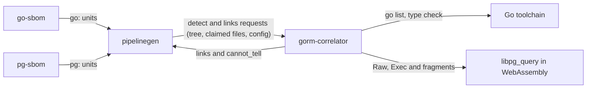

# gorm-correlator

gorm-correlator is a correlator plugin for
[pipelinegen](https://github.com/sideways-works/pipelinegen), which runs
only the test slices a change can break. It finds which PostgreSQL tables
Go code reaches through [GORM](https://gorm.io). It reads the code
statically, with the Go type checker, and links each Go declaration that
runs a GORM statement to the tables and views that statement reads or
writes.

It owns no units. Its links go from Go declarations, which
[go-sbom](../../sbom/go) lists
(`go:<package dir>#<kind>:<name>`, named by go-sbom's `goid` package), to
what [pg-sbom](../../sbom/pg) lists. A relation is
`pg:relation:<schema>.<name>`, the alias pg-sbom gives every table, view
and materialised view, so a link doesn't need to know which one a name
is. Functions and procedures are `pg:routine:<schema>.<name>`, which
stands for every overload of a name.



## An example

A method `Store.CreateNote` in package `store` calls `db.Create(&note)` on
a model `Note` whose table is `notes`. gorm-correlator links
`go:store#method:Store.CreateNote` to `pg:relation:public.notes` with the
kind `writes`.

A migration that changes `notes` changes `pg:table:public.notes`, and
through pg-sbom's alias the relation. The link carries that change to
`Store.CreateNote`, and through go-correlator to the tests that ran it,
even where a test's recorded statements didn't show the table. With
`follow: dependents`, a change to the model `Note` reaches its table, and
the table reaches every declaration that uses it.

## Setting it up

Name the plugin in `pipelinegen.yaml` next to go-sbom and pg-sbom, pinned
by a release and its checksum:

```yaml
plugins:
  - repository: https://github.com/sideways-works/pipelinegen-plugins
    with:
      - name: gorm
        kind: correlator
        path: correlator/gorm
        release: {version: v0.4.0, sums: …}
```

`sums` is the checksum of the release's `SHA256SUMS`, so one pin serves
every platform and each binary is checked by its own line of that list.
To pin one binary alone, put `sha256:` with its line
(`gorm-correlator-linux-amd64`) in place of `sums`. A new pin selects
nothing by itself. List `pipelinegen.yaml` under `everything_on`, so
that a pin change, like any other change to the config, runs every
slice.

### The files it claims

`describe` names the candidates `**/go.mod`, `**/go.sum`, `**/go.work`
and `**/*.go`. `detect` claims a file on its name and content alone,
outside `testdata`, `vendor`, `node_modules` and directories whose names
start with a dot or an underscore:

| File | Role |
|---|---|
| a `go.mod` with a `require` of `gorm.io/gorm` that isn't marked indirect | `manifest` |
| any Go file | `source` |
| any other `go.mod`, a `go.sum`, a `go.work` | `module-file` |

Every Go file is claimed, including those that don't import GORM. Such a
file can still change what a statement reaches (a `TableName` method in a
file of its own), and a new claimed file, which pipelinegen has no answer
for, makes it ask `links` again.

`links` answers for the module of every claimed manifest, or for the
modules the `modules` key names. Without claims in the request, it finds
the same modules by walking the tree, leaving out the same directories.
It loads every package of those modules, including those that don't
import GORM, since a package can run GORM statements on a handle it gets
from another package.

### Config

Every key is optional and overrides what the plugin would find or assume.

```yaml
    config:
      modules: [backend]
      tests: true
      schema: public
      naming: {table_prefix: "", singular_table: false, no_lower_case: false}
      build: {goos: linux, goarch: amd64, cgo: false, tags: [pipelinegen_cover]}
```

| Key | Default | What it does |
|---|---|---|
| `modules` | the claimed modules | the Go modules to load, relative to the root |
| `tests` | true | includes `_test.go` files |
| `schema` | `public` | the schema of unqualified names |
| `naming` | GORM's defaults | the application's GORM `NamingStrategy`: `table_prefix`, `singular_table`, `no_lower_case` |
| `build` | linux, amd64, cgo off, the tag `pipelinegen_cover` | the build context the code is read under, the same as go-sbom's |

The code is read under that one build context, never the machine's, so an
answer doesn't depend on the machine.

### Toolchain and caches

`describe` declares `needs: ["go"]`: the repository's Go toolchain must be
on the path, since the plugin runs `go list` and reads the export data of
dependencies. It declares the caches `gocache` and `gomodcache`, which the
runner keeps with the planning job and which save most of the time. It
needs no database and no network.

The parsed SQL is kept in the request's cache directory, keyed by the
text's hash and the plugin's version, so a run on the next commit parses
only the texts that changed. Deleting that directory only costs the next
run its parse time.

## What it produces

For every top-level declaration (a function, a method, a variable's
initialiser) it reads each GORM call and works out the relations the
statement reaches. Every statement links `reads` to each relation it
reaches; one that changes rows (or a definition) links `writes` as well. A
write depends on the rows already there, so a change to seed data reaches
it too.

### Models

A struct used as a model takes its table from a `TableName()` method, on
the struct or promoted from a struct it embeds, in either form GORM
accepts (`TableName() string` or `TableName(schema.Namer) string`).
Without one, the table comes from GORM's naming strategy, configured the
way the application configures it. The correlator imports GORM's own
`schema` package for this, so the snake case and plural rules are GORM's.
It also reads the columns (fields, `column:` tags, embedded structs and
their prefixes).

### Statements

The correlator reads `Create`, `Save`, `Update`, `Updates`,
`UpdateColumn(s)`, `Delete`, `First`, `Take`, `Last`, `Find`,
`FindInBatches`, `FirstOrInit`, `FirstOrCreate`, `Count`, `Pluck`, `Scan`,
`Row`, `Rows` and `Exec` on `*gorm.DB`, the same calls on the generic API
(`gorm.G[T](db)`), `Association(...).Find` and its siblings, `AutoMigrate`
and the migrator. The table comes from `Table(...)`, else `Model(...)`,
else the destination, as GORM decides it.

It follows a handle built in one place and used in another through local
variables, helper functions that return a handle, scopes (`Scopes(fn)`),
handles stored in struct fields or package variables, subqueries passed as
values, and transactions.

### Associations

`Preload("Comments.Author")`, `Joins("Author")` and `Association("Tags")`
follow the struct fields to the related models' tables, many-to-many join
tables included. Saving a model also writes the tables of the associations
GORM saves with it, unless the value is a literal that sets none of them or
the statement omits them.

### SQL

`Raw`, `Exec`, and SQL fragments given to `Where`, `Or`, `Not`, `Having`,
`Select`, `Order`, `Group`, `Joins`, `Table` and `gorm.Expr` are parsed
with PostgreSQL's own parser, libpg_query, compiled to WebAssembly by
[go-pgquery](https://github.com/wasilibs/go-pgquery) and run in pure Go
with no cgo; sql-correlator uses the same parser. GORM's `?` and `@name`
placeholders are rewritten to `($1)` before parsing, which fits wherever
GORM puts a value, including `IN ?`. The text may be a constant, a local
variable, a concatenation, `fmt.Sprintf` or `strings.Join` over such
values, or a parameter of a plain function whose callers all pass such
values.

A call of a function or procedure in that SQL links to
`pg:routine:<schema>.<name>`, since the text doesn't give the argument
types an exact overload needs. Calls of PostgreSQL's built-in functions are
left out: an unqualified name that PostgreSQL 17 defines in `pg_catalog`
reaches the built-in, because `pg_catalog` comes first on every search
path. The list of built-in names and the rule for system relations come
from pg-sbom's `sqlref` package, so the correlators and pg-sbom agree on
them.

### Hooks and callbacks

A statement on a model links to the model's hook methods that GORM calls
for it (`BeforeSave`, `AfterFind` and the rest), and to the callbacks the
application registers for that kind of statement
(`db.Callback().Create().Register(...)`). These are links of kind `calls`
from one Go declaration to another.

### When it can't tell

Where the code doesn't show which relation a statement reaches, the
correlator puts the declaration under `cannot_tell`, with the reason and
the place, and pipelinegen binds it wide. The usual reasons:

- SQL or a table name built from values the code doesn't fix: a method's
  parameter, a struct field, a value returned by a call other than
  `fmt.Sprintf` and `strings.Join`;
- a model passed as `any` (`db.Save(v)`), so the model is chosen at run
  time;
- a `TableName()` that returns something other than a constant;
- a statement whose table is set outside the declaration (a handle passed
  in as a parameter, with nothing in the declaration naming a model or
  table);
- a `clause` value carrying SQL or a table that the declaration gets from
  elsewhere (`Clauses(e)`); one written in place (`clause.Expr{SQL: ...}`,
  `clause.Table{Name: ...}`) is read like any other SQL;
- SQL the parser refuses in every form the code can build.

On a backend of about 26,000 declarations, 1,700 of them with GORM calls
and about 2,100 `Raw` and `Exec` texts, about 100 declarations end as
can't tell; most build their SQL from a filter or a table name chosen at
run time. A full analysis takes a few seconds once the Go build cache is
warm.

When a dependency is missing from the module cache, the module's
declarations in files that import GORM end as can't tell, and the answer says
`"cacheable": false` so the next plan asks again.

## Narrowings

pipelinegen's level decides which narrowings are on: a narrowing is on at
every level below its "off from" level and off from that level up. Each
narrowing's wide links are in every answer, tagged with its name and
`"while": "off"`, and pipelinegen keeps them from the level that switches
the narrowing off.

| Narrowing | Off from level | Narrow rule | Wide rule | What it can miss |
|---|---|---|---|---|
| `gorm-models` | 5 | a statement with `Table()` binds that table only, and a model's hooks only for the statements that call them (`AfterFind` for a query, `BeforeSave` for a create or an update) | the model's own table joins a statement that sets `Table()`, and every hook of the model joins every statement on it | a wrong reading of `Table()` or of the statement's kind |
| `gorm-associations` | 5 | saving a literal that sets none of the association fields (`db.Model(&Note{}).Update(...)`) binds none of the associations' tables | saving any value writes every associated table, transitively | nothing by GORM's rules, since such a literal saves no association; a misreading of the literal is the risk |
| `gorm-model-types` | 5 | a model's type has no link to its table; call sites link on their own | the type links to its table | nothing while slices bind what they ran: the call sites link to the table on their own. Without the narrowing, a slice that only mentions the type (a JSON response, say) runs for every migration of that table |

Level 5 also follows dependents, and there the wide link of
`gorm-model-types` lets a changed model reach its table and a table reach
every type mapped to it.

Reading SQL needs no narrowing. A link the code shows only adds bindings,
so it holds at every level. The links add to what the tests' recorded
statements already show: sql-correlator records the tables each test
touched while it ran. A wrong reading here costs a missed link only where
the recording missed it too, which means a test that didn't reach that
statement on its last run. The nightly run of everything catches what
both miss.

## What it can't see

The correlator doesn't follow callbacks and plugins registered by code
outside the loaded modules, or the `*sql.DB` under GORM (`db.DB()`), which
is plain `database/sql`. Beyond that, what the reading can miss:

- Models. A handle prepared elsewhere with `Table()` that the correlator
  doesn't see (one passed through an interface method, or built in code
  outside the loaded modules), then used with `Find(&models)`: the link
  goes to the model's table, not the one set elsewhere. A `TableName()`
  that reads a field ends as can't tell; GORM calls `TableName` on a new zero
  value and caches it, so such a name doesn't work in GORM either. Hooks
  found by reflection on embedded types from outside the loaded modules
  aren't seen. Soft delete changes nothing: a `Delete` on a model with
  `gorm.DeletedAt` is an `UPDATE` of the same table, still a write.
- Associations. GORM resolves an association by its struct field, and so
  does the correlator. It can miss one GORM resolves differently (a
  `polymorphic` setup across tables, or a join table set by
  `SetupJoinTable` at run time). A `Joins` on a subquery expression ends
  as can't tell.
- SQL. What a view, function, trigger or rule reaches in turn is pg-sbom's
  link: the statement links to the view or the routine and to the table a
  trigger fires on. Relations named in strings the parser never sees
  (`nextval('seq')`, `'t'::regclass`) are missed. An unqualified name with
  PostgreSQL's reserved `pg_` prefix is taken as a system catalog and left
  out. A common table expression named like a real table, used for both in
  one statement, is taken as the expression. When SQL is built from
  pieces, each appended piece is taken as present once or absent;
  combinations that aren't SQL are dropped, and if none is SQL the
  declaration ends as can't tell. A piece that only makes sense when repeated
  would be missed.
- A function added in a PostgreSQL release after 17 is linked as if the
  schema defined it. The link then points at nothing pg-sbom lists, and
  pipelinegen binds the declaration wide and reports the dangling link.

## The calls

The requests and answers follow pipelinegen's
[plugin protocol](https://github.com/sideways-works/pipelinegen/blob/main/docs/plugins.md).
What follows is particular to gorm-correlator. Its capabilities are
`detect`, `links` and `why`, and `inputs` declares `detect` per file and
`links` per set. It declares no namespace.

### `detect`

```sh
echo '{"protocol": 1, "work": "w", "tree": ".", "paths": ["go.mod", "store/store.go", "web/main.go"]}' |
  gorm-correlator detect
```

```json
{"claims": [{"path": "go.mod", "role": "manifest"}, {"path": "store/store.go", "role": "source"}]}
```

### `links`

```sh
echo '{"protocol": 1, "work": "w", "cache": "c", "tree": ".",
       "claimed": [{"path": "go.mod", "role": "manifest"}], "config": {}}' |
  gorm-correlator links
```

```json
{"sets": [{"group": ".", "inputs": ["go.mod", "go.sum", "models/models.go", "store/store.go"],
  "links": [
   {"from": "go:store#method:Store.CreateNote", "to": "pg:relation:public.notes", "kind": "writes", "ref": true},
   {"from": "go:store#method:Store.CreateNote", "to": "pg:relation:public.note_tags", "kind": "writes", "ref": true},
   {"from": "go:store#method:Store.CreateNote", "to": "go:models#method:Note.BeforeSave", "kind": "calls"},
   {"from": "go:store#method:Store.Purge", "to": "pg:relation:public.drafts", "kind": "writes", "ref": true},
   {"from": "go:models#type:Note", "to": "pg:relation:public.notes", "kind": "uses", "narrowing": "gorm-model-types", "while": "off"}],
  "cannot_tell": [
   {"unit": "go:store#method:Store.Drop", "reason": "SQL returned by fmt.Sprintf at store/store.go:131"}]}]}
```

A link read from the declaration's own source (a statement's table, model
or SQL text, the name a `TableName` method returns) carries `"ref": true`,
because it is a reference in the source. A hook or callback GORM calls on
the statement's behalf is reached through GORM's machinery, as a type's
methods are. A link that only a narrowing's wide rule adds names nothing
the source names. Neither of these carries it.

There is one set per module, cached by the blob hashes of its `inputs`:
the module's Go files, `go.mod` and `go.sum`, the files of the local
directories its `replace` directives point at, and a `go.work` at the
root, all taken from the claimed files (from the tree only when run by
hand without claims). The type checker reads a module's packages
together, so the set is the module. With `paths`, only the modules holding one of them answer, and
a module whose `go.mod` is gone answers an empty set. Past 5,000 links the
sets go to `sets.jsonl` in the work directory, named in `files`.

### `why`

```sh
echo '{"protocol": 1, "work": "w", "tree": ".", "config": {},
       "from": "go:store#method:Store.Purge", "to": "pg:relation:public.drafts"}' |
  gorm-correlator why
```

```json
{"path": [{"unit": "go:store#method:Store.Purge", "note": "writes at store/store.go:118"},
          {"unit": "pg:relation:public.drafts"}]}
```

It answers "can't tell" (exit 3) when there is no such link.

### `inspect`

This call is not part of the protocol. It answers the whole analysis, for
people tuning the config, with every model, its table, columns, associations and hooks, and counts
of what was resolved and why the rest wasn't. Set
`GORM_CORRELATOR_TRACE=1` to print each SQL text the correlator couldn't
read or parse to stderr.

```sh
gorm-correlator inspect < request.json | jq .stats
```

## Developing

`bazel run //correlator/gorm:test` runs the tests and `bazel run
//correlator/gorm:lint` the lint, with the Go, golangci-lint and Node
the repository pins in `MODULE.bazel`
([CONTRIBUTING](../../CONTRIBUTING.md)). The tests type-check the small
modules under `internal/analysis/testdata`, which require GORM, so the
first run fills the module cache with them (`go mod download` in
`internal/analysis/testdata/app`); after that they use no network.

pipelinegen's conformance kit calls the gorm-correlator you built the
way pipelinegen does, on the fixture module
`internal/analysis/testdata/app`, with a module cache of its own that
you fill first. With go-sbom ([sbom/go](../../sbom/go)) beside it as
`--sbom`, the kit also checks that each link changes only when one of
its ends does; pg-sbom ([sbom/pg](../../sbom/pg)) works the same way.
The commands below run it from this directory with the pipelinegen that
`tools/go.mod` pins:

```sh
go build -trimpath -o gorm-correlator ./cmd/gorm-correlator
go build -C ../../sbom/go -trimpath -o "$PWD/go-sbom" ./cmd/go-sbom
kit=$(mktemp -d)
(cd internal/analysis/testdata/app && GOMODCACHE=$kit/gomodcache go mod download)
go -C ../../tools tool pipelinegen plugin test "$PWD/gorm-correlator" --tree "$PWD/internal/analysis/testdata/app" --cache "$kit" --sbom "$PWD/go-sbom"
```

`bazel run //correlator/gorm:release` releases it from a tag
`correlator/gorm/vX.Y.Z` on `main`, as
[CONTRIBUTING](../../CONTRIBUTING.md#releases) describes: static
`gorm-correlator-linux-amd64`, `-linux-arm64`, `-darwin-amd64` and
`-darwin-arm64`, `plugin.json` (its own `describe` answer), `LICENSE`,
`NOTICE` and `SHA256SUMS`. Its first release here is `v0.4.0`
([RELEASING](../../RELEASING.md)), and a published release never
changes.

A change to what gorm-correlator links comes with its docs, so this
README describes gorm-correlator as it is on `main`.
