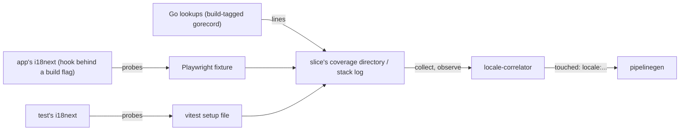

# locale-correlator

locale-correlator, from
[pipelinegen-plugins](../..) (`correlator/locale`),
tells [pipelinegen](https://github.com/sideways-works/pipelinegen)
which keys of the message catalogs each test looked up: every probe
i18next's resource store was asked for, misses included, in each language
it tried, and every lookup a Go program's catalog code made. It answers
them as [locale-sbom](../../sbom/locale)'s
units, so a change to one key runs the tests that rendered it.

Like every plugin it is a pure program: it reads the files the recorders
left behind and answers JSON. The recorders run inside the tests.



## What a recording holds

| Record | Unit it binds |
|---|---|
| a lookup of a key in a language and namespace, hit or miss | `locale:<catalog>#<lang>/<ns>:<key>`, which may not exist yet |
| a lookup that returned an object (`returnObjects`, a whole Go template) | the object's unit, whose digest covers everything below it |
| a check that a namespace or a language is there | `locale:<catalog>#<lang>/<ns>`, `locale:<catalog>#<lang>` |
| the recorder running for a catalog | `locale:<catalog>`, the catalog's own unit |

i18next asks its store for every form it tries, in order, until one holds
a value: `key_male_one`, `key_male`, `key_one`, `key_zero`, `key`, in each
language of the fallback chain and each namespace of `fallbackNS`, and
again for every `$t(...)` it nests. Recording each probe records exactly
what the rendered text depends on: a miss is an id that a later commit may
add, and adding it selects the slice, since the miss would then hit. Keys
built at run time (`` t(`countries.${c}`) ``) are recorded as the concrete
keys they were.

The catalog's own unit says that a recorder ran for the catalog in this
slice, and locale-sbom names it as the anchor of each claim of the
catalog's files. pipelinegen replaces a slice's paths to a changed
catalog file (a label naming it, a filegroup or other rule holding it,
`extra_deps`, an owner's `data`) by the keys the slice recorded only for
a slice whose list holds this unit: a slice whose processes loaded the
catalog without a recorder holds none, and keeps its paths.

## Which tests see a change

| Change to a catalog | Slices that run |
|---|---|
| layout, key order, escapes, a trailing newline | none |
| a value changed | the slices that rendered the key in that language, a fallback through it included |
| a key added that nothing looks up | none |
| a key added where a recorded probe missed it | those slices: the miss now hits |
| a key removed | the slices that looked it up |
| a plural or context variant added or removed | the slices whose probe missed or hit that variant (`zero` probed for a count of 0, `male` for that context), not every slice that used the base key |
| a whole language added or removed | the slices that ran in it or fell back through it |

`TestWhichTestsSeeAChange` holds a test per row, with the probes i18next
26.4.3 makes for each (`TestRowProbesAreI18nexts` checks them against a
real run). The rows a key's absence decides were also planned by
pipelinegen itself, `affected` on a small repository whose slices' only
path to the catalog is their recording: a key added where a probe missed
selected that slice alone, a key added that nothing reads selected none, a
reformatted file none, a changed English value the slice that fell back to
it.

## The recorders

### Go: gorecord

`github.com/sideways-works/pipelinegen-plugins/correlator/locale/gorecord` is a
module of its own inside this repository, with the standard library only,
released by tags of its own (`correlator/locale/gorecord/v<version>`). Product code
calls it from a file that only recording builds compile, behind a build
tag, and routes every read of its catalogs through one function per kind
of read, each recording under a constant the release file sets to false,
so the compiler drops the blocks:

```go
//go:build pipelinegen_cover

package mail

import "github.com/sideways-works/pipelinegen-plugins/correlator/locale/gorecord"

const catalogDir = "backend/internal/mail/locales"
const recording = true

func init()                  { gorecord.Load(catalogDir) }
func probe(lang, key string) { gorecord.Key(catalogDir, lang, "", key) }
```

```go
//go:build !pipelinegen_cover

package mail

const recording = false

func probe(string, string) {}
```

The pair of build-tagged files leaves one file of the product package out
of every build. go-correlator up to v0.1.8-rc.3 then binds the whole
package from its group, so any change to any of its declarations selects
every slice whose binary links it; it was seen on a copy of an adopter's
mail package (a change to one function's body selected a test that never
ran it, through the package's group). Use the pair with a go-correlator
release that binds only a left-out file's own declarations from the
group. The other shape, the tagged pair inside gorecord with the product
calling it under `if gorecord.Enabled`, leaves no file of the product
package out, and inlining removes the calls (a release binary held no
symbol of it), but the release binary's module graph then lists gorecord
(`go version -m`, `go list -deps`), which a check that refuses hook
modules in a release would flag.

Call `Load` where the catalog is loaded, at start: a stack's log needs its
header before the first slice. With `PIPELINEGEN_LOCALE_KEYS_DIR` naming
a slice's coverage directory, the process writes one file of its own there,
each record once. With `PIPELINEGEN_LOCALE_KEYS_LOG` naming a file the
stack shares, each process appends every lookup, and `collect` cuts the log
per slice (the plugin's config `log`). Each record is one write of a whole
line before the call returns.

It was proven in a copy of an adopter's tree through a `replace` to a
local copy. A release binary links none of it: `go tool nm <binary> | grep
-c gorecord` gave 0 for a binary built without the tag and 13 with it, and
`go version -m` lists the module only for the latter.

### JavaScript

`locale-correlator recorder <dir>` writes three files the binary carries,
so a release stays one file: `core.mjs` (wraps a resource store),
`vitest-setup.mjs` and `playwright.mjs`. They import nothing but Node's own
modules and, for vitest, the `i18next` and `vitest` the tests use.

The app names its catalog in one line, which production builds compile
out:

```ts
if (import.meta.env.VITE_PIPELINEGEN_LOCALES)
  (globalThis as { __pipelinegenLocales?: (i: typeof i18n, catalog: string) => void })
    .__pipelinegenLocales?.(i18n, "apps/web/src/locales");
```

Put it before `init`: the hook wraps the store `init` assigns. It assumes
the app adds each file `<catalog>/<lang>/<ns>.json` as its language and
namespace, as an app that loads the files by their names does; a file
transformed before it is added (a language's prefixes marked) keeps its
keys, which is what counts.

A production build must hold neither the function's name nor the flag's.
This check fails a build that does; run it over each app's built assets:

```sh
found=$(grep -rlE '__pipelinegenLocales|VITE_PIPELINEGEN_LOCALES' apps/*/dist || true)
[ -z "$found" ] || { echo "a production build holds the locale recorder's hook: $found" >&2; exit 1; }
```

Proven with Vite 8.3.4 on `testdata/vite` (`check-build.sh`): the build
without the flag passed, the one with `VITE_PIPELINEGEN_LOCALES=1` failed,
naming its chunk.

Playwright: wrap the repository's `test` and give the fixture the apps'
origins:

```ts
const test = withLocaleKeys(base, { out: process.env.E2E_LOCALE_OUT, root: process.cwd(), expect: ["^http://127\\.0\\.0\\.1:7151/"] });
```

The init script defines the hook in every page before the app's code runs,
and sends each new record to the test process as it happens, so a
navigation loses nothing. After each test the fixture writes one file into
`<out>/<spec file>/`. A top-level document or frame whose address matches
`expect` and that never called the hook by its load event makes the spec
can't tell: the app was built without the flag.

vitest: `setupFiles: ["<dir>/vitest-setup.mjs"]`, recording when
`PIPELINEGEN_LOCALE_KEYS_OUT` names the coverage directory. It wraps the
store class of each copy of i18next the tests import, so a test's own
instance needs no change. A bundle is named by the catalog file whose
content it is (a test that imports `locales/en/home.json` and hands it to
i18next looks up keys of that file). A build step may change a catalog's
values as it imports it (soft hyphens put into long words): a bundle with
exactly one file's keys, or with the keys of several files of which its
own language and namespace name one, is that file's. A bundle that matches
no file but shares keys with one (a copy with a key added, two files
merged) makes the test file can't tell. A probe in a language the test loaded no bundle
for binds nothing, since no catalog file can change what it renders.

## Can't tell (exit 3)

Each reason is said once, on stderr, and the slice binds everything until
it is recorded again:

- a slice part with no file of the recorders or of `collect`;
- a file without the recorder's header, of another version, or cut short
  (no whole last line; a JavaScript file without its end line);
- a page that loaded the app without the hook;
- a vitest bundle that matches no catalog file but shares keys with one;
- a record naming a catalog that holds no file the plugin claims, or one
  outside the tree;
- in locale-sbom, a catalog file that is no JSON.

A line that isn't JSON exits 1: the slice errors and its list stays.

A slice whose processes looked nothing up answers an empty list, with
`collect`'s file as the evidence that it ended while recording. Under the
catalog-unit rule above that is safe: such a slice holds no catalog unit
and keeps every path to the catalog. The same holds for a stack whose log
holds no recorder's header at the setup's end (a build without the tag or
without the variable): `collect` says so once on stderr, and its slices
narrow nothing of what the stack looked up.

## What it never sees

- text a test takes from a catalog other than through a recorded lookup:
  a test that parses the file (`os.ReadFile`, `readFileSync`), ranges over
  the map the catalog was loaded into, or inspects an imported catalog
  object. Such a slice needs a declaration that keeps its path to the file;
- a second copy of i18next (another version under `node_modules`) in a
  vitest run: its stores aren't wrapped;
- `store.data` read directly, and `getDataByLanguage`'s bundles, which are
  recorded only as each namespace being there;
- a process of a stack built without the recorder while another process
  of it records: the catalog's unit is there, and the unrecorded process's
  lookups are not. Build every process of a stack the same way.

## Setting it up

```yaml
plugins:
  - repository: https://github.com/sideways-works/pipelinegen-plugins
    with:
      - name: locale
        kind: sbom
        path: sbom/locale
        release: {version: <tag>, sha256: ...}
      - name: locale-uses
        kind: correlator
        path: correlator/locale
        release: {version: <tag>, sha256: ...}
        config: {log: locale-keys.log}   # a stack's shared log, if it has one
```

List `locale-uses` in the `correlators` of every recorded suite whose tests
render catalog text.

## Calls

`detect` claims the same files as locale-sbom, so `observe` gets them in
`claimed` and checks the catalogs a recording names. `collect`: at the
setup's end and each slice's end it moves the recorders' files
(`locale-keys.*.jsonl`) from the slice's coverage directory into its own
and adds its own file. A slice's later parts write into the slice's one
directory as the first did, and `collect` takes from there into the
directory the core names for each part. With `log`, and only in a suite
that runs a stack, `slice-start` marks the log's end and `slice-end` cuts
what came since, whole lines only; a suite without a stack never reads
the log, so one entry serves both kinds of suite. `observe` reads the
setup's directory and the slice's parts, numbered parts included.

## Development

```sh
go build -trimpath -o locale-correlator ./cmd/locale-correlator
go test ./...                       # gorecord: (cd gorecord && go test ./...)
LOCALE_NODE_MODULES=/path/to/node_modules go test ./cmd/locale-correlator   # i18next 26, vitest 4, @playwright/test 1.63
LOCALE_BROWSER=1 LOCALE_NODE_MODULES=... go test ./cmd/locale-correlator -run Playwright   # one headless Chromium
PIPELINEGEN=/path/to/pipelinegen go test ./cmd/locale-correlator -run TestKit
golangci-lint run ./...
```

How it was tested:

- unit tests for every rule: Go records, file records, setup apart, an
  empty recording, each can't-tell path, an unreadable line, parts adding
  up, a symlinked part, a recording against a foreign tree; `collect`
  moving only its files, taking a later part's files from the slice's
  directory, cutting a stack's log per slice (a key a former slice looked
  up appears again), never cutting it for a suite without a stack, a stack
  without the recorder, whole lines only; gorecord's directory and log
  modes;
- the table above, row by row, and those probes against i18next 26.4.3;
- the vitest setup on `testdata/js` with i18next 26.4.3 and vitest 4.1.11:
  fallback, plural, context, nesting, `returnObjects`, a miss, and a test
  of its own texts recording nothing;
- the Playwright fixture with @playwright/test 1.63.0 and one headless
  Chromium, routed pages, no server: the German page's probes with English
  fallback across two navigations, and a page built without the flag
  making its spec can't tell;
- the conformance kit on `testdata/kit` with pipelinegen built from main,
  both record modes (a slice's own files, and a stack with a shared log);
- a golden `observe` answer and a determinism test.

On a copy of an adopter's tree (its Go mail package, 24 test files once
the lookups are routed through four functions, a guard test added and the
recorder in; every rendered mail byte for byte the same before and after,
with and without the tag, 27,874 renders compared), all through
pipelinegen built from main:

- `record` and `affected`, with go-sbom v0.1.3-rc.2 and go-correlator
  v0.1.8-rc.3 beside this pair: the lists hold each slice's keys (112 for
  the booking mails, only the catalog's unit for a test that renders
  none). Three real catalog commits still select 24 of 24 mail slices,
  with and without this pair: today's core reaches every slice through the
  embedding variable's digest, and `why` shows that path
  (`mail.catalogs ... which changed`) for a slice whose keys didn't change,
  and the changed keys for one whose did;
- with the catalog-unit rule applied by hand to the same recordings, the
  last 40 mail catalog commits select 8 to 15 of 24 (12 for 29 of them).
  The 12 are test files that read whole languages (catalog lint tests),
  which can observe any change in them. This part needs the core rule;
- the cost in the planner, the adopter's three catalogs (130,682 units)
  in the tree: a warm plan took 26.6 to 35 s against 19.6 to 21 s without
  the pair, on a machine at a load of about 50, and the planner's peak
  memory rose from 31 to 125 MB to 486 to 701 MB. The local store of the
  29 slices' lists grew from 332 KB to 668 KB (one slice that renders
  every preview holds 19,216 keys). The plugin's answers are 39 MB of the
  core's 40 MB answer cache, uncompressed; each commit that changes a
  catalog file adds that file's answer anew (about 2 MB for a web
  namespace of one language);
- the web app's vitest files and browser specs were not run there: the
  install needs a registry credential.

## Developing

The tests and the lint run with the Go, golangci-lint and Node that the
repository pins, as [CONTRIBUTING](../../CONTRIBUTING.md) describes; the
other commands run in this directory. The recorders' JavaScript tests
also need a `node_modules` with i18next, vitest and @playwright/test,
and one of them a headless Chromium.

```sh
bazel run //correlator/locale:test
bazel run //correlator/locale:lint
go build -trimpath -o locale-correlator ./cmd/locale-correlator
LOCALE_NODE_MODULES=<node_modules> go test ./cmd/locale-correlator
LOCALE_BROWSER=1 LOCALE_NODE_MODULES=<node_modules> go test ./cmd/locale-correlator -run Playwright
pipelinegen plugin test ./locale-correlator --tree testdata/kit
```

- `gorecord` is a module of its own, which a repository's Go code links
  in its recording builds, so `./...` stops at it and it is tested and
  linted on its own.
- Without `LOCALE_NODE_MODULES` the JavaScript recorders' tests are
  skipped, and without `LOCALE_BROWSER=1` the one that starts a browser
  is; run them before a change to the recorders. The README names the
  versions they were tested with.
- The last line is pipelinegen's conformance kit. It calls the
  locale-correlator you built the way pipelinegen does, on the fixture
  tree in `testdata/kit`. `PIPELINEGEN=<pipelinegen> go test
  ./cmd/locale-correlator -run TestKit` runs the same kit from the
  tests, which skip it when `PIPELINEGEN` names no binary. Take
  `pipelinegen` from [its
  releases](https://github.com/sideways-works/pipelinegen/blob/main/docs/tutorial/install.md).
- A change to what locale-correlator records comes with its docs: the
  README describes locale-correlator as it is on `main`.
