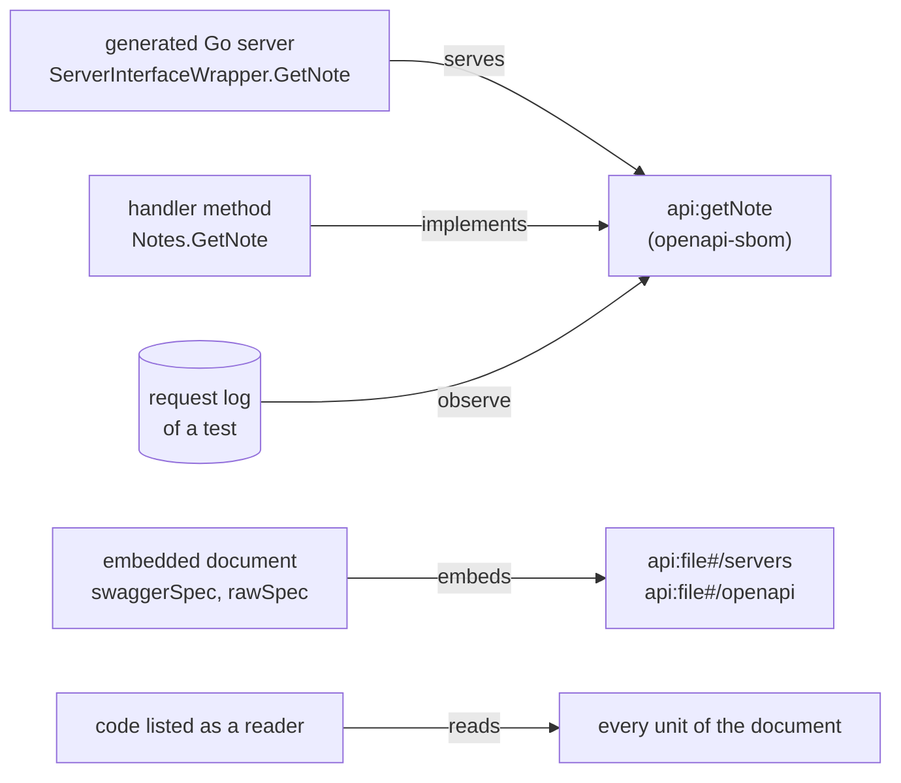

# oapi-codegen-correlator

oapi-codegen-correlator is a correlator plugin for
[pipelinegen](https://github.com/sideways-works/pipelinegen), which runs
only the test slices a change can break. In a Go server that
[oapi-codegen](https://github.com/oapi-codegen/oapi-codegen) generated, it
records which code serves each operation of an OpenAPI contract, and which
operations a test requested.

It owns no units. It links Go declarations
([go-sbom](../../sbom/go)'s units) to the
`api:` units [openapi-sbom](../../sbom/openapi)
lists, and it reads request logs. Both plugins read the documents with
openapi-sbom's `openapi` package, so they name every operation the same
way.



## An example

A contract `api/notes.yaml` has the operations `getNote` and
`createNote`, and oapi-codegen generated a server for it into
`server/gen/notesgen`. oapi-codegen-correlator links
`go:server/gen/notesgen#method:ServerInterfaceWrapper.GetNote` to
`api:getNote`. A browser slice whose requests reached only `getNote` binds
that wrapper through its coverage, and its request log names `api:getNote`.

A change to `createNote` in the contract changes `api:createNote` and the
generated code for it, so only the slices bound to `createNote` run.
Without this plugin, every test that starts the server would run: the
generated package keeps the whole document in a variable that every
request reads, and that variable changes with every edit, prose included.

## Setting it up

Name the plugin in `pipelinegen.yaml` next to openapi-sbom and the Go
plugins, pinned by a release and its checksum:

```yaml
plugins:
  - repository: https://github.com/sideways-works/pipelinegen-plugins
    with:
      - name: api-uses
        kind: correlator
        path: correlator/oapi-codegen
        release: {version: v0.4.0, sums: …}
```

`sums` is the checksum of the release's `SHA256SUMS`, so one pin serves
every platform and each binary is checked by its own line of that list.
To pin one binary alone, put `sha256:` with its line
(`oapi-codegen-correlator-linux-amd64`) in place of `sums`. A new pin
selects nothing by itself. List `pipelinegen.yaml` under
`everything_on`, so that a pin change, like any other change to the
config, runs every slice.

### The files it claims

`describe` names the candidates `**/*.go`, `**/go.mod`, `**/*.yaml`,
`**/*.yml` and `**/*.json`. `detect` claims these files, each from its own
content and the config:

| File | Role |
|---|---|
| a file whose header reads `Code generated by github.com/oapi-codegen/oapi-codegen/v2 version ... DO NOT EDIT.` (or names the older `github.com/deepmap/oapi-codegen`) | `generated`, with the generator, its version and the generated declarations it holds (a server wrapper, a strict handler, the embedded document) |
| a file with a `//go:generate` line that runs oapi-codegen (`go tool oapi-codegen`, `go run .../oapi-codegen@v2.8.0`, `oapi-codegen` on the path) | `directive`, naming the contract (the one argument that isn't a flag) and the `-config` file, both from the tree's root |
| a contract, as openapi-sbom detects one | `contract`, with the files its refs point into in `depends` |
| any other Go file in the `scan` and handler directories (the whole tree by default), test files included | `source`: the scans read it |
| a `go.mod` | `manifest`, with its `module`: the import path of the packages below it |

All Go files in those directories are claimed, because code can reach the
document through a wrapper declared in another file. Go files and
`go.mod` files under `vendor`, `node_modules`, `testdata` and directories
whose names start with a dot or an underscore are left out.

Contracts that no generated package serves are read too: their routes
count for every operation (see [Digests taken from the
contract](#digests-taken-from-the-contract)).

`links` pairs each generated package with the directive in its directory.
A method that implements an operation can sit anywhere in the handler
directories (the scanned ones by default), as long as it takes the request
type from that generated package.

### Config

`request_log` and `request_log_lines` describe the run, and `readers` and
`per_operation` record what only a person can say. The rest are
overrides.

```yaml
    config:
      scan: [server]
      request_log: var/requests.log
      request_log_lines: patterns
      documents:
        - path: api/notes.yaml
          base: /api
          go:
            readers: ["go:server/rules#func:Count"]
            per_operation: ["go:server/http#func:Middleware"]
```

| Key | Default | What it does |
|---|---|---|
| `request_log` | none | the file the test stack appends one line per request to, relative to the batch task's working directory |
| `request_log_lines` | `urls` | what a line of the log holds: `urls`, the request's method and URL or path (`GET /api/notes/n1`), or `patterns`, its method and the route pattern the server's router matched (`GET /api/notes/{id}`) |
| `other_routes` | none | with `patterns`, the routes the server logs that no contract has (`GET /healthz`); a line with one of them touches nothing |
| `scan` | the whole tree | the directories whose Go files are claimed and searched for code that reaches the embedded document, for handlers and for maps keyed by operation |
| `documents[].path` | the contracts detection finds | a contract; a document listed here overrides what detection found for it |
| `documents[].base` | the path of the first server's URL | the path prefix requests carry before the templates |
| `documents[].go.readers` | none | Go ids of code that reads the document beyond the operation being served; each is linked to every unit of the document |
| `documents[].go.per_operation` | none | Go ids of code that uses the document only for the operation a request was routed to (request validation, an access check) |
| `documents[].go.package`, `strict`, `no_wrapper`, `spec_vars` | found by detection | the generated package, whether the strict server was generated, whether no server was (models or a client only), and the variables that hold the document (`[]` for none) |
| `documents[].go.handlers` | the `scan` directories | the directories searched for methods that implement an operation |

Each key of a document's `go` block overrides detection only when the
config sets it, also to `false` or `[]`; a key it leaves out keeps what
detection found. A block that lists only `readers` and `per_operation`, as
above, keeps the detected package and server. Set `package`, `strict`,
`no_wrapper` and `spec_vars` only for code generated without a
`go:generate` line, or to correct what detection found.

### Toolchain and caches

oapi-codegen-correlator is a static Go program: `describe` declares no
`needs` and no `caches`. It reads the Go code without type-checking it.

## What it produces

### Links

| From | To | Kind |
|---|---|---|
| `go:<generated package>#method:ServerInterfaceWrapper.<GoName>` | `api:<operationId>` | `serves` |
| `go:<generated package>#method:strictHandler.<GoName>` (strict server) | `api:<operationId>` | `serves` |
| `go:<dir>#method:<Type>.<GoName>`, a handler method that takes `<GoName>RequestObject` | `api:<operationId>` | `implements` |
| `go:<generated package>#var:swaggerSpec` and `#var:rawSpec` | the document's top-level units, or every unit while `document-units` is off | `embeds` |
| each Go id listed under `readers` | every unit of the document | `reads` |
| a declaration holding a map literal keyed by the document's operations | every unit of the document | `reads` |

`GoName` is oapi-codegen's default name for an operation: the operationId
in camel case (`delete-note` is `DeleteNote`).

Each operation is bound through the code that runs only for it. With
oapi-codegen's server, the `ServerInterfaceWrapper` method of an operation
runs for every request routed to it, before any middleware, so a test
whose request is rejected with a 400 or a 403 still binds the operation
that decided the rejection. With the strict server, `strictHandler`'s
method runs too.

The handler links add little over Go's own closure, since a handler's
signature already names the generated types. They make a handler's tests
run when the operation changes in a way no generated type shows, such as
who may call it or a pattern a validator checks. That can select more
tests, never fewer.

### Code keyed by operation

Code that walks a map keyed by operations, such as access rules by
operationId or a test's table of every operation it expects, depends on
every operation of the document. The plugin looks for such maps in the
scanned directories, test files included, outside the generated packages.
A map counts when it has at least two keys and each key is a string
literal naming an operation of one document, by its operationId or by the
name oapi-codegen gives it. The declaration that holds the map
(`go:<dir>#var:Rules`, or `go:<dir>#func:TestRules@test` as go-sbom names
a declaration in a test file) reads every unit of that document. A map
with one key, or with a key that names no operation, is left alone. The
plugin doesn't see a map built at run time, keys spelled through named
constants, or a `switch` over operation ids; list such code under
`readers`.

### Digests taken from the contract

The declarations generated from the whole document take their digest from
what every operation shares, not from their own content. They are:

- the embedded document (`swaggerSpec`, `rawSpec`);
- the server interfaces (`ServerInterface`, `StrictServerInterface`, one
  method per operation) and the strict server's `strictHandler` type,
  whose digest holds every operation's method signature;
- the functions that register one route per operation (`Handler`,
  `HandlerWithOptions`, `RegisterHandlers`, `NewStrictHandler` and their
  variants).

The `links` answer's set relates them in its `digest_from`, under the
`generated-from-source` narrowing. pipelinegen reads a set's
`digest_from` from its v0.1.9 on. An older pipelinegen ignores it, and
the declarations keep their own digests, as with the narrowing off.

Each takes its digest from the document's top-level units
(`api:<file>#/servers`, `api:<file>#/openapi`, `api:<file>#/paths`), the
routing table of every other document (`api:<other>#/paths`), the
generator's module (`dep:go:github.com/oapi-codegen/oapi-codegen/v2`) and
the generator's config file. A change inside one operation then changes
none of them.

Adding, removing or moving a route, or changing its method, changes all
of them. A router picks the most specific pattern that matches, so a new
route can take requests from any operation. Several generated servers may
also register on one router, and the tree doesn't show which documents
share one, so routes count across every contract. Such a change runs
every test that starts the server and, through openapi-sbom's links from
each operation to every routing table, every test bound to an operation.

This is sound because a change to one operation changes its method in the
interfaces and its route in the registration, and also that operation's
wrapper and strict handler, which the tests of that operation are bound
to. A generator upgrade or a config change reaches every one of these
declarations through the module and the file. What is lost is a hand edit
to generated code, which the header forbids.

### The accessor scan

Some code reads more of the document than the operation being served: it
iterates every path, looks up a component by name, or serves the document
itself. Such code depends on all of the document. The plugin finds it by
scanning the Go code in the `scan` directories for declarations that use
the generated accessors (`GetSpec`, `GetSwagger`, `GetSpecJSON`,
`PathToRawSpec`). A variable that only hands an accessor on without
calling it, such as `var Spec = sync.OnceValues(notesgen.GetSpec)`, counts
as an accessor itself, and its users are found in turn.

Every declaration found must be listed under `readers` or
`per_operation`. One that nobody classified goes into the `links`
answer's `cannot_tell`, and pipelinegen binds it wide until the config
says which it is. `why` on an `embeds` link lists every declaration the
scan found and how each is classified.

Generated code without a `go:generate` line beside it (generated by a
Makefile or a build rule) has no contract the tree names. Its embedded
document goes into `cannot_tell` and is bound wide until the config names
the document for that package.

## Recording a run

`observe` turns the requests a slice made into the operations they
reached. It reads `requests.txt` (one request per line: the method and
the URL or path, or the route pattern) and HAR files (a browser's network
log) in the slice's directories, `coverage/<slice>/<plugin>`, where `<plugin>` is the plugin
entry's name (`api-uses` above).

### What the task must do

The test stack appends one line per request it serves to the configured
`request_log`: the method and the URL (`GET /api/notes/n1`), or, with
`request_log_lines: patterns`, the method and the route pattern its router
matched (`GET /api/notes/{id}`). In a Go server on `net/http`'s
`ServeMux`, a middleware finds that pattern in the request's `Pattern`
field once the mux has routed the request. pipelinegen's `slice start` and
`slice end` call `collect`, which cuts that log into each slice's
directory. At `setup-end` and `slice-end` it copies what the log holds to
`requests.txt` and empties the log, and at `slice-start` it empties it,
so requests between slices count for neither.

When the server can't log, a browser suite can write the same log from the
browser's side. With Playwright, a fixture appends every request of every
context to the configured `request_log`, and `collect` cuts it as above:

```ts
import { appendFileSync } from "node:fs";
import { test as base } from "@playwright/test";

export const test = base.extend({
  context: async ({ context }, use) => {
    context.on("request", (r) => appendFileSync(process.env.REQUEST_LOG!, `${r.method()} ${r.url()}\n`));
    await use(context);
  },
});
```

Here `REQUEST_LOG` holds the same path as `request_log`. Create the file
before the batch starts (`: > "$REQUEST_LOG"`), since `collect` fails
when the log is missing, and the browser writes it only at its first
request.

A browser log misses requests made outside a page. Playwright's `request`
fixture and `page.request` (an API login in a spec's setup, say) go
through no page, and neither do other services the server calls. The
server's own log sees them all, so prefer it where you can. HAR files (Playwright's `recordHar`) are
read too, but Playwright writes one per browser context, so a spec that
opens a context per test overwrites its HAR test by test unless each
context gets a path of its own. A HAR file goes into the slice's
directory, `coverage/<slice>/<plugin>`.

Each URL, from the log or a HAR file, is matched as a router would: the
document's base path, then the template that fits, a literal segment
before `{id}.txt` before `{id}`. A URL that matches no operation (a page,
a script, another service, a 404) touches nothing. A logged pattern counts
when it is an operation's method and route, the base and the template,
whatever its parameters are called; `HEAD` counts for the `GET` route, as
`ServeMux` serves it. HAR files always hold URLs. The matching uses
openapi-sbom's router, and observing requests doesn't depend on
oapi-codegen, so any repository with a contract can use it.

### When it can't tell

An empty `requests.txt` is positive evidence. The recording finished and
the slice made no request, so the answer is an empty list. `observe`
answers "can't tell" (exit 3) when one of the slice's own directories
doesn't exist, or holds neither a requests file nor a HAR file, which is
what a task that forgot to log leaves behind. pipelinegen then marks the
slice, and the slice runs on every change until a recording tells again.
The batch's setup directory needs no evidence: a suite without a request
log never fills it. When it holds a log, what the setup requested is added
to the answer. An unreadable log fails (exit 1), in the setup's directory
too.

A recording that can't be mapped back to the tree is "can't tell" as
well:

- the tree holds no contract at all (none claimed, none found, none in
  the config), which is what a contract renamed or moved without the
  config saying so can leave;
- with `request_log_lines: patterns`, a logged pattern is no operation's
  route and isn't listed under `other_routes`: the recording and the tree
  disagree. The message names the pattern and the log. When the line
  matches a route as a URL, the message says the log seems to hold URLs.

With URLs, a line that matches nothing is ordinary, so a contract that
lost an operation can't be told from a request to a page.

`collect` fails when the configured log is missing, so a stack that
stopped logging errors its slice instead of passing as one that made no
request. Without `request_log` in the config there is no stack to cut a
log of, and `collect` succeeds doing nothing.

## Narrowings

pipelinegen's level decides which narrowings are on: a narrowing is on at
every level below its "off from" level and off from that level up. Links
that belong to a narrowing come in both variants, tagged with `narrowing`
and `while` (`"on"` for the narrow link, `"off"` for the wide one), and
every `digest_from` relation names its narrowing, so one answer serves
every level.

| Narrowing | Off from level | Narrow rule | Wide rule | What it can miss |
|---|---|---|---|---|
| `generated-from-source` | 5 | the declarations generated from the whole contract take their digest from the contract's top-level units, every contract's routing table, the generator's module and its config | they keep their own digests, so any change to an operation selects every test that starts the server | a hand edit to generated code. That is safe only if the repository checks that generated code is current (regenerate it and fail on any difference, in a commit hook or a lint suite); without such a check, keep this narrowing off. Also a test that depends on the `strictHandler` type's method set as such (reflection over its methods, an interface assertion on the generated type): it runs from level 5 |
| `document-units` (openapi-sbom's) | 2 | the embedded document binds only the document's top-level parts, and each operation is bound through the code that serves it | the embedded document binds every unit of the contract, so any change that isn't prose selects every test that started the server | what the items under [What it can't see](#what-it-cant-see) describe |

Over 60 commits to three contracts of about 600 operations, 8 operations
were added, and each addition selects every test that starts the server,
since routes count for every operation. On a backend serving those
contracts, the links to generated code all resolved, the handler scan
found a method for every operation, and the scan found seven declarations
to classify: three that read the whole document and four that use it per
operation.

## What it can't see

Each item is a way a test could be missed. None of them hides a failure
from the nightly run, which runs everything.

- The scan follows direct uses and wrapping variables. It doesn't follow
  a function that returns the document to its callers, a document passed
  through an interface, or reflection. Code that reads the document that
  way and isn't listed as a reader is missed. A declaration listed under
  `per_operation` that in fact reads other operations is missed too: the
  classification is a person's judgement, so review it when that code
  changes.
- Middleware that builds a table of every operation at start-up (access
  rules, schemas) can fail to start because of one operation's change.
  Every test selected for that change then fails as well, so the change
  can't pass. Only an operation that no test reaches can break start-up
  unseen until the nightly run.
- A request that matched no route (a 404) touches no operation. The test
  that made it started the server, so it is bound to the route
  registration, whose digest takes every routing table, and a template
  that starts matching that URL selects it. With pipelinegen's setup split
  on, the registration runs in the batch's setup, so such a test runs only
  when the setup's sample picks it.
- `collect` copies the request log at a slice's end and empties it. A
  request written between the copy and the truncate is lost, which is why
  a batch runs no background work during its slices.
- Code generated by another generator, or with a custom name normaliser,
  has other names. The links then dangle: pipelinegen reports them and
  binds their sources wide, so the mistake shows and costs only time.
- Clients. A TypeScript client generator that writes types only needs no
  correlator: types are erased before anything runs, so browser tests
  reach an operation through the server code they started. A generator
  that writes a runtime function per operation would need a correlator of
  its own, named after it, linking those functions to the same `api:`
  units.

## The calls

The requests and answers follow pipelinegen's
[plugin protocol](https://github.com/sideways-works/pipelinegen/blob/main/docs/plugins.md).
What follows is particular to oapi-codegen-correlator. Its capabilities
are `detect`, `links`, `observe`, `collect` and `why`, and `inputs`
declares `detect` per file and `links` per set. It declares no
namespace.

### `detect`

```console
$ echo '{"protocol":1,"tree":".","paths":["server/gen/notesgen/notes.gen.go","server/gen/notesgen/generate.go","server/main.go"]}' | oapi-codegen-correlator detect
{"claims":[{"path":"server/gen/notesgen/notes.gen.go","role":"generated","generator":"github.com/oapi-codegen/oapi-codegen/v2",
           "version":"v2.8.0","declarations":["Handler","HandlerWithOptions","ServerInterface","ServerInterfaceWrapper", ...]},
          {"path":"server/gen/notesgen/generate.go","role":"directive","contract":"api/notes.yaml","config":"server/gen/notesgen/codegen.yaml"}]}
```

### `links`

`links` reads only the files pipelinegen passes in `claimed` and answers
them as one set whose `inputs` are those files, since a wrapper in one
file and its users in others make each file matter to the rest.

A contract may keep its paths in other files (`/notes: $ref:
notes/notes.yaml#/paths/~1notes`, one file per part of the API, bundled
into one file only for the generators). The operations are then read out
of those files, and every file the contract was read from is an input
too, so an edit to any of them asks about the set again.

With `paths`, it answers the set when one of them is an input or no
longer in the tree, and no set otherwise. When run by hand without
`claimed` or `paths`, it detects the files in the tree itself. The set
carries the digest relations in its `digest_from`, so they are cached
with the set's files, and the answer has no other key:

```console
$ echo '{"protocol":1,"tree":".","config":{...},"claimed":[{"path":"server/gen/notesgen/notes.gen.go","role":"generated"}, ...]}' | oapi-codegen-correlator links
{"sets":[{"group":"oapi-codegen","inputs":["api/notes.yaml","go.mod","server/gen/notesgen/generate.go", ...],
           "links":[{"from":"go:server/gen/notesgen#method:ServerInterfaceWrapper.GetNote","to":"api:getNote","kind":"serves"}, ...],
           "digest_from":[{"unit":"go:server/gen/notesgen#var:swaggerSpec","from":["api:api/notes.yaml#/servers","api:api/notes.yaml#/openapi",
                           "api:api/notes.yaml#/paths","dep:go:github.com/oapi-codegen/oapi-codegen/v2","file:server/gen/notesgen/codegen.yaml"],
                           "narrowing":"generated-from-source","reason":"..."}, ...],
           "cannot_tell":[{"unit":"go:server/http#func:Raw","reason":"reaches the document api/notes.yaml through notesgen.GetSpecJSON; list it under readers or per_operation"}]}]}
```

A document whose refs lead where the commit can't be read answers "can't
tell" (exit 3), with a message naming the ref and the file: a remote URL,
a file the tree doesn't hold, a cycle of path items. A broken document
fails (exit 1).

### `observe`

`observe` reads only the contracts: those in `claimed` when the request
carries it, else the contracts it finds among the tree's YAML and JSON
files. The config's `documents` are laid over them as in `links`, so a
contract the config doesn't name is still observed. A contract that keeps
its paths in other files is read with them, so a request maps to the
operation as the bundled document has it.

```console
$ echo '{"protocol":1,"tree":".","config":{...},"slice":"e2e/notes.spec.ts",
         "dirs":["coverage/_setup/api-uses","coverage/e2e/notes.spec.ts/api-uses"]}' | oapi-codegen-correlator observe
{"touched":["api:createNote","api:getNote","api:listNotes"]}
```

### `collect`

```console
$ echo '{"protocol":1,"config":{"request_log":"var/requests.log"},
         "action":"slice-end","slice":"e2e/notes.spec.ts","dir":"coverage/e2e/notes.spec.ts/api-uses"}' | oapi-codegen-correlator collect
{}
```

### `why`

`why` takes `from` and `to` and answers the link's reason as a path of
steps, each with a note.

## Developing

`bazel run //correlator/oapi-codegen:test` runs the tests and `bazel run
//correlator/oapi-codegen:lint` the lint, with the Go, golangci-lint and
Node the repository pins in `MODULE.bazel`
([CONTRIBUTING](../../CONTRIBUTING.md)). The fixture in
`correlate/testdata/repo` is a small Go module with a contract and the
code oapi-codegen v2.8.0 generated from it, so the tests check the
naming convention against real generator output. Its `go.mod` requires
the generator and the generated code's modules, as a repository using
oapi-codegen does, and `correlate/testdata/getnote-full` holds the same
contract and code with one operation changed, so a test can show which
digests a change to one operation moves. The tests read those modules
from the module cache, filled once with `go mod download` in
`correlate/testdata/repo`, and after that use no network.

pipelinegen's conformance kit calls the oapi-codegen-correlator you
built the way pipelinegen does, on that fixture with the recording its
`.pipelinegen-kit.json` names (requests of a setup and of one slice
under `coverage/`), and on `correlate/testdata/split`, a contract whose
root lists its paths as refs into one file per context, with a recording
against it. `--sbom` runs openapi-sbom
([sbom/openapi](../../sbom/openapi)) beside it, which lists the units
the links name and declares the narrowings they carry. The commands
below run it from this directory with the pipelinegen that
`tools/go.mod` pins:

```sh
go build -trimpath -o oapi-codegen-correlator ./cmd/oapi-codegen-correlator
go build -C ../../sbom/openapi -trimpath -o "$PWD/openapi-sbom" ./cmd/openapi-sbom
go -C ../../tools tool pipelinegen plugin test "$PWD/oapi-codegen-correlator" --tree "$PWD/correlate/testdata/repo" --sbom "$PWD/openapi-sbom"
go -C ../../tools tool pipelinegen plugin test "$PWD/oapi-codegen-correlator" --tree "$PWD/correlate/testdata/split" --sbom "$PWD/openapi-sbom"
```

`bazel run //correlator/oapi-codegen:release` releases it from a tag
`correlator/oapi-codegen/vX.Y.Z` on `main`, as
[CONTRIBUTING](../../CONTRIBUTING.md#releases) describes: static
`oapi-codegen-correlator-linux-amd64`, `-linux-arm64`, `-darwin-amd64`
and `-darwin-arm64`, `plugin.json` (its own `describe` answer),
`LICENSE`, `NOTICE` and `SHA256SUMS`. Its first release here is `v0.4.0`
([RELEASING](../../RELEASING.md)), and a published release never
changes.

A change to what oapi-codegen-correlator links or observes comes with
its docs, so this README describes it as it is on `main`.
