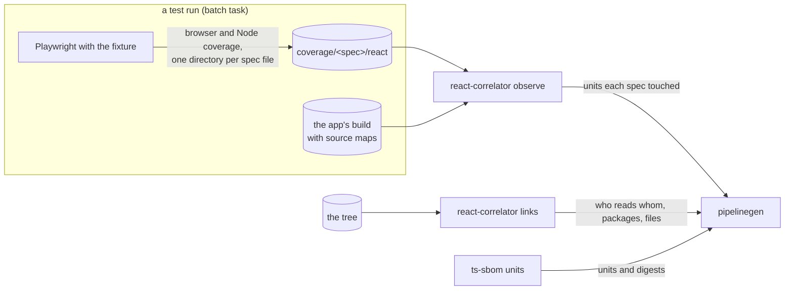

# react-correlator

react-correlator is a correlator plugin for
[pipelinegen](https://github.com/sideways-works/pipelinegen), which runs
only the test slices a change can break. In a TypeScript, JavaScript and
CSS frontend it records who uses and who runs what: which unit reads which,
which npm packages and files a unit loads, and which units each browser
test ran, in the browser and in the test's own Node process.

It owns no units. The units (functions, components, constants, types,
module init, stylesheets) are the ones
[ts-sbom](../../sbom/ts) lists, and both
plugins name them through ts-sbom's library: `ts:src/money.ts#fn:format`,
`css:src/app.css`. The npm packages are
[npm-sbom](../../sbom/npm)'s
`dep:npm:<name>` units. A repository configures react-correlator with
ts-sbom, and with npm-sbom for the packages.



## An example

A frontend has a file `src/money.ts` with two functions, `format` and
`parse`. In their last recorded run, the browser slice `e2e/editor.spec.ts`
ran `format`, and `e2e/search.spec.ts` ran `parse` but never `format`.

A change to the body of `format` changes its digest in ts-sbom's answer.
While the `ts-functions` narrowing is on (levels 1 to 3), only
`e2e/editor.spec.ts` runs. From level 4 a slice binds whole files, so both
specs run, since both ran code in `src/money.ts`. A comment-only or
formatting-only edit to the file changes no digest and runs neither.

## Setting it up

Name the plugin in `pipelinegen.yaml` next to ts-sbom, each pinned by a
release and its checksum:

```yaml
plugins:
  - repository: https://github.com/sideways-works/pipelinegen-plugins
    with:
      - name: ts
        kind: sbom
        path: sbom/ts
        release: {version: vX.Y.Z, sha256: ...}
      - name: react
        kind: correlator
        path: correlator/react
        release: {version: vX.Y.Z, sha256: ...}
```

The checksum is the `react-correlator.mjs` line of the release's
`SHA256SUMS`. A new pin selects nothing by itself. List `pipelinegen.yaml`
under `everything_on`, so that a pin change, like any other change to the
config, runs every slice.

Recording also needs the Playwright fixture in the test setup and two
things of the build, which are requirements, not tips:

- Every app a recording run serves is built with source maps (Vite:
  `build.sourcemap: true` or `--sourcemap`). A built script without its
  map makes `observe` answer "can't tell" for the slice.
- A workspace package whose built output (its `dist/`) the specs or the
  apps run carries maps to its committed sources. `observe` reads such
  code through the map, into the files the commit holds.

See [Recording a run](#recording-a-run). To check recordings made with
v0.1.3 or earlier for what that version dropped without saying so, run
`react-correlator check-recording --commit <rev> --coverage <dir> --build
<an app's dist> ...` in a clone of the recorded repository (or name it
with `--repo <dir>`): it lists each such script and exits 1 when a slice
should be recorded again.

### The files it claims

`links` and `observe` read exactly the files pipelinegen sends in the
request's `claimed`: the tracked files `detect` claimed, widened by the
plugin entry's `include` patterns and narrowed by its `exclude` patterns.
Imports resolve against those files alone, so `detect` claims every file
whose presence can change where an import leads. `describe` names the
script and stylesheet patterns, `**/tsconfig*.json`, `**/package.json` and
the asset extensions below as candidates, and `detect` claims:

| File | Role |
|---|---|
| a Vite config that imports `vite` | `directive` (tool `vite`) |
| a script or stylesheet, decided by ts-sbom's own detection | `source`, or `generated` (with the tool) when its header says a tool wrote it |
| every `tsconfig*.json`: one without `paths` still ends the search for the nearest one | `directive` (tool `typescript`), naming its `extends` chain in `depends` |
| every `package.json`: one without a name may gain one and become a package others import | `manifest` |
| a file an import can name: `svg`, `png`, `jpg`, `jpeg`, `gif`, `webp`, `avif`, `ico`, `bmp`, `json`, `json5`, `woff`, `woff2`, `ttf`, `otf`, `eot`, `mp3`, `mp4`, `webm`, `wav`, `ogg`, `wasm`, `txt`, `md`, `html` | `asset` |

A claim also says, with `"recorded": true`, that a recording made with this
plugin holds units of the file every time a test depends on it: a script
the browser or a test's Node process runs, and a file under a `public`
directory, which a request binds. A script of types alone carries
`"erased": true` instead: the build erases it, it runs in no test and no
recording holds it, so a change to it reaches only a type check. It is
judged by the statements that start a line, as a formatter writes them:
every one an `interface`, a `type` alias, a type-only `import` or
`export`, or `export {}`. Any `enum` (`const enum` and `declare enum`
included), a `namespace` or `module` block (`declare module` and
`declare global` augmentations included), any other import or export, and a
triple-slash directive make it code, so a misjudged file is only ever left
unmarked. A build step that reads types (generating code or a schema from
them) makes such a file its input: that step's target must name it. Stylesheets, configs (`*.config.ts`),
manifests, `tsconfig`s, HTML pages, assets a bundler copies under a new
name, and build tooling (a script that imports `vite`, `rollup`,
`rolldown`, `esbuild`, `webpack` or a plugin of theirs) are claimed without
it: no recording holds them, or not every time a test depends on them, so a
change to one must reach the tests some other way (a build input, a target).

Nothing under `node_modules` is claimed. An import of a file of any other
type names no claimed file and goes under `cannot_tell`. The plugin lists
no files itself and starts no process. Until pipelinegen sends `claimed` to
`observe`, `observe` finds the Vite configs in a request without claims by
reading the tree's directories, outside `node_modules` and hidden ones.

### Config

Every key is optional. `build_root` is the only run-time location; the
others override what the plugin would find. To read only part of the tree,
put `include` and `exclude` patterns on the plugin's entry; the `include`
and `exclude` keys that earlier versions read inside `config` are refused
with a message that points there.

| Key | Default | What it does |
|---|---|---|
| `aliases` | none | import prefixes a bundler maps and `tsconfig.json` doesn't (`{"@ui": "packages/ui/src"}`) |
| `bundles` | found from the Vite configs | where the builds are, when the bundler config can't say; a `base` may be a full URL, as Vite's may |
| `build_root` | the tree | where a run put its builds when it made them outside the tree: a directory laid out like the tree, relative to the task's working directory, under `source/` or `coverage/` (`describe` lists it in `observe_reads`, so pipelinegen refuses any other place) |

`observe` finds each build from the Vite config in the tree: its `root`,
`base`, `publicDir` and `build.outDir`, with Vite's defaults for what the
config leaves out, and the `index.html` in the root. A setting the config
computes at run time (`base: process.env.BASE`) can't be read from the
tree. The default stands in for it, and if a script on the app's origin is
then found in no build, `observe` answers "can't tell" and names the
setting. For such a build, give it in `bundles`:

```yaml
    config:
      bundles:
        - {dist: web/dist, base: /notes/, html: web/index.html, public: web/public}
```

A run that builds the apps in one step and runs the tests in another often
hands the build over in a directory of its own. Point `build_root` at it:
`observe` then reads the built scripts and maps there, and still resolves
the maps' sources against the tree. Mind where `observe` runs: see [Where
observe runs, and what it needs there](#where-observe-runs-and-what-it-needs-there).

### Toolchain and caches

`describe` declares `needs: ["node>=22.18"]`; pipelinegen fetches that
Node when a configured plugin needs it. The plugin declares no shared
cache. It keeps its index of each built script in the request's own cache
directory.

## What it produces

react-correlator answers links, from the user to the used:

| Kind | From | To |
|---|---|---|
| `reads` | a unit | the constants and other data it reads, in its own file or through imports, re-exports and namespace imports |
| `reads` | a unit | a plain file it imports, such as an image or a JSON file (`file:<path>`, pipelinegen's own units) |
| `uses` | a unit | the units it calls, and its module's `init` and back, which are the wide links of `ts-functions` |
| `reads` | a unit | the types it names, which is the wide link of `types-erased` |
| `uses` | a unit | the npm package it imports (`dep:npm:<name>`, the name as `package-lock.json` writes it) |
| `uses` | a module's `init` | every package it loads, since loading a package runs it, and the stylesheets it imports (`css:<file>`) |
| `uses` | a unit that starts a worker | every unit the worker's module and the modules it loads hold, with or without narrowings, because coverage never sees a worker's code |

A worker counts as started by `new Worker(new URL("./w.ts",
import.meta.url))` or by an import with `?worker`.

Import specifiers resolve as TypeScript and the bundler do: relative
paths; the config's `aliases`; `tsconfig.json` `paths` and `baseUrl` (with
`extends`); the workspace packages' `exports`, `module` and `main`; and only
then an npm package. The `tsconfig.json` that applies is the nearest one
above the importer. When that one is a solution (`references` and no
settings of its own, as Vite's templates write it), the referenced project
whose `include` covers the file and whose `exclude` doesn't applies, and
for a file none covers, the first referenced project with `paths`. None
of this needs `node_modules`. A specifier that names no claimed file, or a
name a module doesn't export, puts the unit under `cannot_tell` with the
reason, and pipelinegen binds it wide.

A bare specifier that no npm package can be named (`@/shared`, `~/lib`)
and that no `paths` or alias resolves is an alias only the bundler knows:
Vite's `resolve.alias`, esbuild's `--alias`. The plugin doesn't read
bundler configs for it, since they compute aliases at run time
(`path.resolve(__dirname, ...)`, plugins), so the unit goes under
`cannot_tell` with the reason "import '@/shared' matches no package name
and no tsconfig path: declare the alias under the plugin's config
`aliases`". Mirror the alias in `tsconfig.json` `paths`, which type-checking
wants anyway, or declare it in `aliases`.

Where an import leads also depends on files that aren't there: `./x` is
`x.tsx` only while no `x.ts` exists, an import of a directory finds its
`index.ts` once one is added, and a `tsconfig.json` added nearer to the
importer brings other `paths`. So each set also remembers the paths
its imports tried and found absent (the files with each extension a
bundler tries before the one it found, the index files, the `tsconfig.json`
of every directory between the importer and the one in effect). Those
paths are listed under the set's `absent`, apart from its `inputs`, which
are files of the tree; `links` also answers the set when asked about any
of them, so a file that appears at one asks about the set again. The inputs themselves are the files the imports resolved to (with
their extension, the index file, the workspace package's entry), the
importer, and every `package.json` and `tsconfig.json`, so a package that
gains a name asks again too. An import of an installed package is a
`dep:npm:` unit, never an input. On a frontend of about 900 files this adds
about 14 % to the inputs and nothing measurable to the time.

## Recording a run

`observe` turns what a spec file left behind into the units it ran. The
evidence comes from three places:

- In the browser, Chromium's precise coverage of every page of every
  context a spec opens, with block detail. The fixture flattens it into
  the parts of each script that ran. `observe` maps those through the
  build's source maps to the top-level units of the sources, and adds the
  init of every module in a script that ran at all.
- In Node, V8's precise coverage of the test worker, read and reset per
  spec file. The test runner's transform leaves inline source maps, so
  test files and the helpers they share bind per function, like the app.
- The static files a page requested from the app's `public` directory, as
  `file:` units, and the page's inline scripts as the app's `index.html`,
  on whatever route of the app the page was opened (`/account/settings` as
  well as `/`), where the route names no file of the build.

### Where observe runs, and what it needs there

`observe` doesn't run where the tests ran. pipelinegen calls it when a
slice ends, and a batch that runs without a token only journals then: the
batch's end step observes every slice of it afterwards. On Concourse that
step gets the repository's source, the batch's result and its coverage
output, and nothing else the batch task had.

The fixture therefore keeps every script the pages ran, and its source
map, with the recording: once per script, by the sha its records carry, in
`<out>/_setup/<name>/scripts/` (`<sha>.js`, `<sha>.map`, or `<sha>.nomap`
for a script that names no map). It fetches each map from the page, so a
test's own routing serves it too, and from the test process when the page
can't (a page that is closing), each attempt bounded at 60 seconds. An
answer counts as the map only when it is JSON with `mappings` and
`sources`, or an index map's `sections`, and its content type is no HTML
page's: a server's single-page fallback answers a map it lacks with its
page and status 200. A map neither attempt gets leaves `<sha>.mapfail`
with why (each attempt's HTTP status and content type and what came
instead, such as "it is an HTML document", or its error). A kept map that
is no source map (one a fixture before this check kept) is read the same
way, with that as the reason. `observe` then reads the build for that
script, and when
the build's copy differs it says so with both shas, both sizes, the first
differing byte and the reason. A script the recording kept nothing of is
said apart: the build is not the one the specs were served. `observe` reads those instead of a
build, so a recording is whole in the coverage output and needs no build
where it is observed. A script served alike by several apps (`/assets/...`
on each port) is placed in the build of the app its origin serves, learned
from the scripts only one build holds; else in the app whose build holds
it, else the one its map's sources resolve in. A kept script without a map
(a page's inline script, the bundler's runtime) goes to the app the
origin's other kept maps resolve in, so with no build where `observe`
runs it is still named in its own app and binds its own app's page. With several builds
configured, stderr names what each origin was found to serve
(`origins: http://127.0.0.1:7151 serves apps/web/dist`). A kept script
without a map is the bundler's own code only when its origin served
other scripts with maps; an app that sent none can't be told. The
files are written whole or not at all, so workers of one batch and batches
sharing an output can write the same script at once. They cost the size of
the scripts the specs loaded and their maps, once per batch's output: for
three apps of about 25 MB of minified scripts, roughly 100 MB if every
spec loaded everything.

A script binds as the app's code only when its origin serves the app's
build in that recording. The scripts tell which origins those are: one
that served a script a build holds at its path, or a kept script with its
map. So do the origin a full URL as `base` names (a CDN the build is
served from), this machine's and a private network's origins (each app of
a stack on its own port, a dev server), and every origin on the site of
one of them. A script of any other origin is foreign code, whatever its
path: a third party's script the app's page loads (a payment provider's
`/v1.0/connect.js`), its frames, or a page of the third party's that the
test opened. It binds nothing, is never taken for a script of the build
that lacks its map, and stderr counts and names its origins (`2 scripts of
other origins ran and bind nothing, as code no build of the tree holds:
https://js.vendor.example (2)`). Nothing needs configuring for this. Where
no script tells (no build where `observe` runs and no map kept), every
origin may be the app's, so a missing build or a build without maps is
said, never taken for foreign code.

`build_root` stays for recordings made before the fixture kept scripts,
and for a map it couldn't fetch: then the built files the specs were
served must be in the coverage output, laid out like the tree, and
`build_root` must name that directory from the step's working directory
(`coverage/_builds`, say). The tree's own pages and `public` files are read
from the source, as always.

A `build_root` that doesn't exist where `observe` runs is said once, with
what to do: "build_root prepared/tree does not exist here (<directory>):
the step that observes must be given the built files". When a script is
in no build, the message lists each build as found (`apps/web/dist`, or
`apps/web/dist in coverage/_builds`) or as "expected at apps/web/dist (not
found)".

### What the task must do

Build the apps with source maps (Vite: `build.sourcemap: true`; esbuild:
`sourcemap: true`). On a frontend of about 6,000 units this costs a few seconds of build time and some tens
of MB per app.

A map should hold its sources' text (`sourcesContent`), which Vite and
esbuild write by default. rules_esbuild leaves it out unless the rule sets
`sources_content = True`. A map without it still works: `observe` reads
each source from the tree at the path the map names and takes the map's
positions as positions in that text, which is right whenever the bundler
saw the files as committed. What it can't see then is a build plugin
that changed a source before bundling (a code transform that left no map
of its own): with the text in the map, `observe` notices the difference
and binds that file whole; without it, it binds by positions that may
belong to other functions of the file. If your build changes sources that
way, keep `sourcesContent`.

#### What attribution a build gives

Attribution is per function in any build with source maps, minified or
not, split into chunks or not. A source unit is touched when any generated
code mapped to it lies in a range that ran; a unit is left out only when
every range covering its generated code has a zero count. So a function
the minifier inlined into its caller, merged with another, hoisted into a
wrapper, or turned into a property assignment or a getter counts by its
own code's place in the generated script, not by a function of its own
(`test/shapes.test.ts` pins each shape), and a never-called function
counts as nothing, whatever the minifier did around it. Names in the map aren't needed. Code that runs
when a module loads (its init, a top-level value computed from a call)
counts for every spec that loads the module, because it ran. What
`observe` leaves out of that is what the bundler writes around a module
without running the module's code: a declaration hoisted without its value
(esbuild's `var COLORS;` for a module it initialises lazily), the names of
variables and properties, a component defined as an arrow function, and
the export glue mapped to the module's first position. A module's init
stands for the module being evaluated, whether or not its top level holds
a statement today, so a statement added there later selects every spec that
loaded it. It counts when the script ran, except where the evidence says
the module was never evaluated: a module a bundle initialises on first
import (esbuild's lazily initialised modules, a page behind `import()`
without code splitting) whose own top-level code is mapped and none of it
ran, or a module of declarations only whose functions all sit in a wrapper
that holds none of its code and never ran. A module behind `import()` in a
chunk of its own that never loaded has no init at all. Where nothing tells,
the init counts.

How much a spec's load-time code covers depends on how the app is split.
A single bundle loads every module on start, so each module's init and
top-level values count for every spec that opens the app. A change to a
function still selects only the specs that called it, but a change to a
page's top-level constant selects every spec. Routes split into chunks
loaded on demand (a dynamic `import()` per page with code splitting, Vite's
default) load only the pages a spec opens. `observe` says so on stderr
when one script loads 20 or more modules at once.

The fixture is one file, `dist/playwright.mjs`: a self-contained ES
module whose one export is `withCoverage`. It imports nothing but Node's
own modules (`node:crypto`, `node:fs`, `node:inspector/promises`,
`node:path`, `node:url`), so a consumer provides only Node 22 or later and
the `@playwright/test` whose `test` it wraps. The file is committed with
the sources and released byte for byte as committed;
`test/fixture-file.test.ts` fails when it differs from a fresh build or
imports anything else. Take it as the release asset `playwright.mjs`,
pinned like the plugin by its version and its line in the release's
`SHA256SUMS` (npm can't install a package from a directory of a git
repository, so a git dependency on this repository doesn't reach it).
Fetch it where the recording step can reach it, check it, and import it by
path:

```sh
gh release download correlator/react/vX.Y.Z -R sideways-works/pipelinegen-plugins -p playwright.mjs -p SHA256SUMS -D tools/react-correlator
(cd tools/react-correlator && sha256sum --ignore-missing -c SHA256SUMS)
```

```ts
import { withCoverage } from "../tools/react-correlator/playwright.mjs";
```

The file brings no type declarations; TypeScript reads it as untyped
JavaScript (`allowJs`, or a one-line `declare module`).

The file is an ES module. In a Playwright project, a test or
fixture file imports it with `import` whether the project is an ES module
or CommonJS: Playwright's loader takes it on every Node 22 release (tried
on 22.11.0, 22.12.0, 22.13.0 and 26.10.0). A plain `require()` from
CommonJS that Playwright doesn't load needs Node 22.12.0 or later; 22.12
prints an ExperimentalWarning, and from 22.13.0 it loads quietly.
`import()` works on every Node 22, but it returns a promise, so it doesn't
suit a fixture that a module defines when it loads.

Wrap the repository's Playwright `test` with it and run each batch with one
worker, so spec files run one after another:

```ts
import { execFileSync } from "node:child_process";
import { test as base } from "@playwright/test";
import { withCoverage } from "@sideways-works/react-correlator/playwright";

const pipelinegen = (...args: string[]) => execFileSync("tools/pipelinegen", args, { stdio: "inherit" });

export const test = withCoverage(base, {
  out: process.env.PIPELINEGEN_RECORD === "true" ? "coverage" : undefined,
  root: process.cwd(),
  node: true,
  onSliceStart: (slice) => pipelinegen("slice", "start", slice),
  onSliceEnd: (slice) => pipelinegen("slice", "end", slice),
});
```

The fixture is the collector. A page's coverage lives in that page's
debugging session and ends when the page closes, and the worker's Node
coverage can only be read from inside the worker, so no separate process
could collect either. The fixture writes `coverage/<spec file>/react/`
once the spec file's tests are done (when the next file's first hook or
test starts, or when the worker ends), then calls `onSliceEnd`. A spec file can
run more than once between a slice's start and end (once per Playwright
project, such as a phone and a desktop layout), so each run is a part of
its own: a numbered directory `1/`, `2/`, ... inside, with
`browser.json`, `node.json` and, written last, `done`. No part ever
overwrites another, and `observe` adds every part up. A part without its
`done` was cut off, and the slice can't tell. pipelinegen counts the
runs too, as the batch's hook calls `slice start` once per run, and keeps
part k ≥ 2 in `coverage/.pipelinegen/part-<k>/<spec file>/`: the end of
each later part's `collect` moves the numbered directories the fixture
wrote since the previous part into that part's `react/`, so every
directory pipelinegen hands `observe` holds its own run. What ran before the first
test goes into `coverage/_setup/react/` the same way, one part per
worker. Without `out` it records nothing. A page that stays open from one
test to the next, such as one a `beforeAll` hook opened, is read at each
test's end and covered on. The repository's own reporting still writes
each spec file's result before `slice end`.

In a recording run of a suite with a stack, the servers the tests talk to
keep running across the batch and pipelinegen collects their coverage at
each spec file's start and stop. The playwright driver runs such a bundle
with one worker and names the batch's marks directory in
`PIPELINEGEN_MARKS`, and the fixture marks the spec files itself: when
`PIPELINEGEN_MARKS` names a directory that exists and `out` is set, it
marks a spec file's start before the file's first `beforeAll` hook or
test, and its stop once the file's part is written and `onSliceEnd` has
returned. Each mark waits until pipelinegen has taken it, at most two
minutes, and one that is refused or not taken fails the test or hook it
came from, so no spec file runs unmarked. Without the directory nothing
is marked. pipelinegen makes the directory afresh for each bundle it
marks, but names it to every run of the suite's tests, so a spec file that
runs again on its own after such a bundle (one the bundle left without a
result) finds the directory with nobody taking marks there: its first hook or
test waits the two minutes and fails.

- A spec file that goes on in a new worker (after a failed test, for a
  retry, or once per project) is marked again there and writes another
  part; pipelinegen adds the parts up as it does the fixture's.
- A test or hook the run's stop cuts (Playwright's global timeout, an
  interrupt) leaves its spec file unfinished: at the worker's end its part gets no
  `done` and its stop is not marked, so pipelinegen can't take either
  record for the whole file.
- A spec file whose tests are all skipped runs no fixture, so it is not
  marked, and pipelinegen can't tell what it touched.
- A bundle with more than one worker (a `--workers` in the suite's
  `flags`) is refused: every test fails with the worker count, since the
  stack's coverage of two spec files at once can't be told apart.
- Hooks of the suite's own that mark through the playwright driver's
  `marks.mjs` (`onSliceStart: onSliceStart`) can stay: they share its
  state, so each boundary is still marked once.
- An auto fixture of the `test` you wrap is set up before the fixture's,
  so what it makes the servers run at a spec file's first test lands in
  the spec file before it. Set such fixtures up in an `extend` of the
  wrapped `test`.

The fixture's `name` option (default `react`) names the directory inside
each spec's. It has to match the plugin entry's `name` in
`pipelinegen.yaml`, since that is where `observe` looks.

### When it can't tell

Only finished recordings, parts with the fixture's `done` marker, can give
an empty answer: the spec ran and touched nothing seen here. The setup's
directory, always the first in `dirs`, may be missing or empty: a batch
whose setup recorded nothing. For the slice's own directories, `observe`
answers "can't tell" (exit 3) when:

- a directory is missing, or empty, which is what a run without the
  fixture leaves;
- a directory holds no part the fixture wrote;
- any part, the setup's included, lacks its `done` marker;
- a recorded script differs from the built file in the tree, or the
  browser reported it without its text, so the build's copy can't be
  checked against it;
- a script on the app's origin is in no build, and the recording holds
  no copy of it `observe` can read. The answer names the script and says
  why: the fixture kept it without the map it names (with the reason the
  map couldn't be fetched), the browser reported it without its text, or
  the recording holds no copy of it (with the sha and size it recorded);
- a built script on the app's origin has no source map and none of the
  app's built scripts there has one (the message names it: "the app's
  build has no source map for
  apps/web/dist/assets/index-3f2a.js: build with source maps for
  recording runs"). In a build with source maps, a script without one is
  told by evidence: the `public` directory's file of the same path binds
  as that file; a byte-for-byte copy of a file of the tree, or of an
  installed package's file (`<name>-<hash><ext>` is matched to `<name><ext>`,
  then compared), binds that file or that package; anything else is code
  the bundler wrote itself (its runtime, its preload helper), since a
  bundler writes a map for every chunk that holds a module of the app, and
  binds nothing. `observe` names those on stderr;
- the browser wasn't Chromium;
- a Node script ran transformed without a source map;
- a Node script the tree doesn't hold ran without a source map (a
  recording of another tree, or a file the commit doesn't hold).

A source a map names inside the tree that the commit doesn't hold (a
generated module, a bundler's virtual module) has no units, so what ran
there binds nothing. `observe` still answers, and says how many such
sources there were on stderr, naming the first. It also names, on
stderr, the units of installed packages (`dep:npm:...`) a slice touched:
only an sbom that reads the lockfile lists them, so a reader can tell
whether one is configured.

pipelinegen then marks the slice, and the slice runs on every change until
a recording tells again. A source map that can't be read makes the
answer "can't tell" too, naming its script. A recording that can't be read
fails (exit 1): a part's `browser.json` or `node.json` that isn't JSON or
lists no scripts names the file, its size and what is wrong with it.

For a suite that runs a stack (the suite's `stack: true`), `collect`
fails at `slice-end` when the slice's directory holds no part, or a part
without its `done`, and names it, so a setup that forgot the fixture shows
at once.

## Narrowings

pipelinegen's level decides which narrowings are on: a narrowing is on at
every level below its "off from" level and off from that level up. Each
narrowing's wide links carry its name and `"while": "off"`, so pipelinegen
drops them while it is on and can report what it dropped.

| Narrowing | Off from level | Narrow rule | Wide rule | What it can miss |
|---|---|---|---|---|
| `ts-functions` | 4 | a spec binds the functions it ran | a unit that ran binds every unit of its file, and a function binds the functions it calls | code that never ran before and now runs, in a function the spec didn't run. That code runs only if a function the spec did run now calls it, and that function changed too. Data can't be missed: reads of constants are links either way |
| `types-erased` | 5 | types bind no test | a unit binds the types it names | a build that emits metadata from types (decorator metadata). Interfaces, type aliases and annotations are erased before any code runs, and the type check runs as its own suite; per-file transforms such as esbuild, SWC and Oxc emit no such metadata |

Measured on a real frontend, a change to one function selected 28 % fewer
specs with `ts-functions` on than binding by file.

`setup_like` serves pipelinegen's `setup-split` (off from level 3). It is
the part of `touched` that ran only while modules loaded (module init,
data built at load, functions declared but never called) or only before
the batch's first test. Under the split pipelinegen binds those units
through the sample instead of to the spec. It also treats as setup every
unit that every spec of a suite touches, and works that set out again in
every full run, so a unit leaves the shared part as soon as one spec stops
touching it. On a real frontend, `setup_like` alone cut the units every
spec shares by about two thirds. What it can miss: a change to
module-level code that matters to one spec runs that spec only when the
sample picks it or at night. Data read by a function the spec ran stays
bound through its `reads` link. A click handler a module registers at its
top level belongs to its init, so when that handler runs, the init stays
the spec's own.

Comment-only and formatting-only edits select nothing without any
narrowing: ts-sbom's digest keeps every token that reaches the built code
and nothing else.

## What it can't see

- Functions that never ran are absent from V8's report. A function counts
  as run only when V8 reported it with a count above zero.
- About a third of the built functions on a real frontend map their start
  to the enclosing call (`useEffect(`) or to the name they are bound to
  (`x = `), not to the function itself. That still lands in the right
  top-level unit, which is why units stop at the top level and nested
  closures belong to the unit around them.
- Code a bundler inlines into its caller maps back to its own source, so
  it is found. Measured on a real frontend, mapping whole covered ranges
  found at most two units per spec beyond the function starts.
- Coverage needs Chromium. A spec run in another browser makes `observe`
  answer "can't tell".
- A popup's first scripts can run before its coverage starts, and a page
  the app closes by itself (`window.close()`) takes its coverage with it.
- Stylesheets bind per file, through the imports that load them. The
  browser doesn't report which rules matched.
- Page coverage doesn't reach Web Workers or service workers: their code
  runs outside the page, so no spec's recording holds it.
  - A Web Worker a module starts (`new Worker(new URL("./w.ts",
    import.meta.url))`, a `?worker` import) is bound through links: every
    spec that ran the starting code binds every unit of the worker's
    modules.
  - A worker script copied into the build without a map (a library's
    prebuilt worker, such as pdf.js's) binds the package it was copied
    from when a page loads it, matched by content against the installed
    package's files; one copied from the tree binds that file.
  - A service worker from the `public` directory binds as its file when a
    page requests it, matched by its path (a build that injects its
    precache list into it changes its content, not its path). What the
    service worker itself runs is never observed. Bind its file to the
    specs that depend on it with a sample rule in pipelinegen's config, or
    list it under `everything_on` if every spec depends on it.
- A dynamic `import()` with a computed specifier has no link, though the
  code it loads is observed when it runs.
- Playwright loads the next spec file while the current one ends, so that
  file's top level shows up in the current spec's Node record. It only adds
  a link: spec files are slices of their own.
- Comments a bundler reads, such as `/*#__PURE__*/`, are dropped from the
  digest like any other comment.

## The calls

The requests and answers follow pipelinegen's
[plugin protocol](https://github.com/sideways-works/pipelinegen/blob/main/docs/plugins.md).
This section adds what is particular to react-correlator. Its
capabilities are `detect`, `links`, `observe`, `collect` and `why`;
`inputs` declares `detect` per file and `links` per set. It declares no
namespace, and `collects` names only `slice-end`, so pipelinegen starts it
once per slice.

### `links`

`links` answers one set per script file: the links its units start, and
the files they were worked out from (the file, the modules its imports
resolve through, the tsconfigs and workspace manifests). A change to one
file then recomputes only the sets that read it. With `paths` in the
request it answers just those sets, and a script that is gone as an empty
set.

```sh
echo '{"protocol": 1, "tree": "."}' | react-correlator links
```

```json
{"sets": [
  {"group": "src/app.tsx", "whole": false,
   "inputs": ["package.json", "src/app.tsx", "src/money.ts", "tsconfig.json"],
   "links": [
     {"from": "ts:src/app.tsx#fn:App", "to": "ts:src/app.tsx#const:TITLE", "kind": "reads"},
     {"from": "ts:src/app.tsx#fn:App", "to": "file:src/logo.svg", "kind": "reads"},
     {"from": "ts:src/app.tsx#fn:App", "to": "ts:src/money.ts#fn:format", "kind": "uses", "narrowing": "ts-functions", "while": "off"},
     {"from": "ts:src/app.tsx#init", "to": "dep:npm:react", "kind": "uses"}
   ],
   "cannot_tell": []}
]}
```

An answer goes on stdout unless it is larger than 32 MB; then it goes into
`sets.jsonl` in the work directory, one set a line, and the answer names
the file in `files`.

### `observe`

`observe` runs in the batch task, while the build exists. It takes the
directories one spec file left, named from the task's working directory:
the setup's first, told by its place in `dirs` and never by its name, then
the slice's. It reads every part in each and adds them up:

```sh
echo '{"protocol": 1, "tree": ".", "slice": "e2e/editor.spec.ts", "dirs": ["coverage/_setup/react", "coverage/e2e/editor.spec.ts/react"]}' | react-correlator observe
```

```json
{"touched": ["ts:src/editor.ts#fn:addLine", "ts:src/editor.ts#const:LIMITS", "ts:src/main.ts#init", "dep:npm:react", "file:index.html"],
 "setup_like": ["ts:src/editor.ts#const:LIMITS"]}
```

The first `observe` that meets a built script indexes it (offsets to
units) in the cache directory, a few seconds for a large app. After that a
spec takes well under a second.

### `collect`

The fixture does the collecting. A `slice-end` for the first part notes,
in a `.taken` file, which numbered directories are that part's; one for a
later part (its `dir` under `.pipelinegen/part-<k>/`) moves the numbered
directories written since into `dir`. The batch closes each part before
the next one starts, so what is new at a part's end is that part's. Then
the stack check under [When it can't tell](#when-it-cant-tell) applies to
`dir`.

### `why`

`why` explains a link with every narrowing off:

```json
{"path": [
  {"unit": "ts:src/main.tsx#init", "note": "start"},
  {"unit": "ts:src/app.tsx#fn:App", "note": "uses (ts-functions off)"},
  {"unit": "ts:src/money.ts#fn:format", "note": "uses (ts-functions off)"},
  {"unit": "ts:src/money.ts#const:RATES", "note": "reads"}
]}
```

## Developing and releasing

```sh
npm install
npx playwright install chromium   # the browser test runs a real Chromium
npm test                          # node:test, with fixtures in testdata
npm run lint                      # Biome and tsc --noEmit
npm run build                     # dist/react-correlator.mjs, and the committed dist/playwright.mjs
```

The build runs on the Node version in `.node-version`; npm refuses another
one (`devEngines` in `package.json`), so a release builds the same bytes
on any machine. Running the built command needs Node 22.18 or later.

esbuild's install script stays off (`allowScripts` in `package.json`). The
build calls esbuild's JavaScript API, which finds its platform binary
without that script, and a release installs with every script off.

The browser tests run the fixture site built two ways: by esbuild
(`test/browser.test.ts`), and by Vite with rolldown at Vite's defaults plus
`--sourcemap` (`test/rolldown.test.ts`), once split by route and once as
one script, so rolldown's lazy wrappers, its CommonJS helpers and its
map-less runtime chunk (`rolldown-runtime-*.js`) are real output. Both
are pinned devDependencies; bump them to the versions the apps a recording
serves are built with.

`test/command.test.ts` fails when `describe`, `collect` or a `detect`
without a tsconfig loads TypeScript or the linker, and checks the built
file as pipelinegen runs it. The browser test builds a small site from
testdata with esbuild (minified, code-split, with source maps), serves it
through Playwright's routing with no server and no network, runs two spec
files with the fixture, and checks what `observe` says each one touched.

The conformance kit checks the plugin the way pipelinegen calls it, on the
fixture tree in `testdata/tree`:

```sh
pipelinegen plugin test dist/react-correlator.mjs --tree testdata/tree
```

Releases are built and published with `bazel run //correlator/react:release`, which
runs pipelinegen's release command as its [release guide](https://github.com/sideways-works/pipelinegen/blob/main/docs/releases.md)
describes: `react-correlator.mjs`, `plugin.json` (the plugin's own
`describe`), `playwright.mjs` (the fixture, named in `package.json` under
`pipelinegen.release`), `LICENSE`, `NOTICE` and `SHA256SUMS`, for a tag `correlator/react/vX.Y.Z` on `main`.
The release script fails unless the fixture it built is byte for byte the
committed file. A published release never changes; a wrong one gets a new
version.

### How the command file is built

A release is one file, `react-correlator.mjs`, and a repository pins it by
one checksum. Most of the code in that file is TypeScript and the linker,
which take Node about a quarter of a second to load. `describe`, `collect`
and most `detect` calls need none of it, and pipelinegen calls `collect`
at every switch between spec files, about 500 times in a large browser
batch.

So the file has two parts. The entry, built from `src/main.ts`, is a few
kilobytes of plain JavaScript that reads the call and answers `describe`,
`collect` and a `detect` without a tsconfig among its paths. Everything
else (`src/cli.ts` and what it imports, TypeScript included) is built as
one CommonJS bundle, compressed with brotli and kept in the entry as a
single base64 string starting with `embedded:brotli+base64:`. `links`,
`observe`, `why` and a `detect` with a tsconfig (only TypeScript's own
reader reads one as TypeScript does) unpack that embedded part and run it,
the way Node runs a CommonJS file. If unpacking or running it fails, the
call exits 1 and says why on stderr. TypeScript's license notice stays
readable at the end of the file.

On a loaded eight-core machine, `describe`, `collect` and a cheap `detect`
take 6 to 14 ms longer than `node -e 0`, against about 250 ms when the
whole file was loaded. About 2 ms of that is the entry; the rest is
reading the 1 MB string. The other calls spend about 15 ms more unpacking
and compiling the embedded part.

Every compression setting is fixed and the build writes no timestamps, so
two builds of one commit give the same bytes; pipelinegen's release script
builds twice and fails on any difference. The compressed bytes come from
Node's brotli encoder, so they follow the Node version in `.node-version`.
The unpacked bytes don't.

To check that a release holds the code of its tag, build the tag afresh
and compare: the check downloads the release and fails unless every file,
`react-correlator.mjs` included, is byte for byte the fresh build:

```sh
bazel run //correlator/react:release -- check vX.Y.Z
```

## Developing

The tests and the lint run with the Go, golangci-lint and Node that the
repository pins, as [CONTRIBUTING](../../CONTRIBUTING.md) describes; the
other commands run in this directory. ts-sbom, a dependency, is
[sbom/ts](../../sbom/ts) of the same commit, which the npm workspace at
the root links; the browser tests run a real Chromium (`npx playwright
install chromium`).

```sh
bazel run //correlator/react:test
bazel run //correlator/react:lint
npm ci
npm run build                     # dist/react-correlator.mjs and dist/playwright.mjs
npm run build
pipelinegen plugin test dist/react-correlator.mjs --tree testdata/tree --sbom <ts-sbom.mjs>
```

- The tests use no network: the browser tests serve the fixture sites in
  `testdata` through Playwright's routing, built by esbuild and by Vite
  with rolldown.
- `dist/playwright.mjs`, the fixture a repository's tests import, is
  committed: after a change to its sources, build it and commit it. A
  test fails when it differs from a fresh build, and so does the release.
- The last line is pipelinegen's conformance kit. It calls the built
  command the way pipelinegen does, on the fixture tree in
  `testdata/tree`, with ts-sbom's command beside it as `--sbom`, which says
  which claimed files hold units. Take `pipelinegen` from
  [its releases](https://github.com/sideways-works/pipelinegen/blob/main/docs/tutorial/install.md)
  and `ts-sbom.mjs` from a release of ts-sbom or its own build.
- `test/command.test.ts` fails when `describe`, `collect` or a `detect`
  without a tsconfig loads TypeScript: keep those calls in the small
  entry, `src/main.ts`.
- A change to what react-correlator records comes with its docs: the
  README describes react-correlator as it is on `main`.
