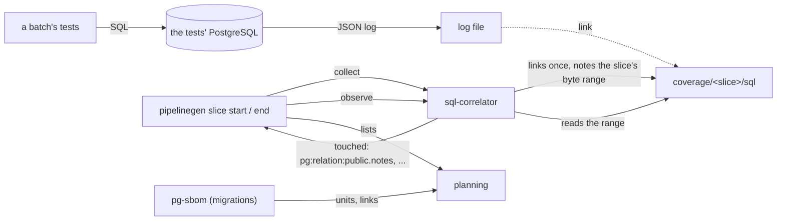

# sql-correlator

sql-correlator is a correlator plugin for
[pipelinegen](https://github.com/sideways-works/pipelinegen), which runs
only the test slices a change can break. It records which database objects
each test slice touched, from the statement log that the tests' own
PostgreSQL server writes. It never connects to a database, starts no
server and needs no container: files go in and JSON comes out.

It owns no units. The tables, views and functions it names are the units
[pg-sbom](https://github.com/sideways-works/pipelinegen-sbom-pg) reads from the
migration files, and both build ids with pg-sbom's `pgid` package, so they
name every object the same way.



## An example

A backend's test slice `api/notes_test.go` ran statements on the table
`notes`, and `api/tags_test.go` ran statements on `tags`. sql-correlator
recorded `pg:relation:public.notes` for the first and
`pg:relation:public.tags` for the second.

A new migration adds a column to `tags`. pg-sbom says the file changes
`pg:table:public.tags`. While pg-sbom's `migrations-by-table` narrowing is
on, pipelinegen replaces each slice's dependency on the migration files by
what the slice touched, so `api/tags_test.go` runs and
`api/notes_test.go` doesn't.

## Setting it up

Name the plugin in `pipelinegen.yaml` next to pg-sbom, pinned by a release
and its checksum, with the one run-time location it needs, the log:

```yaml
plugins:
  - name: sql
    kind: correlator
    repository: sideways-works/pipelinegen-correlator-sql
    release: {version: vX.Y.Z, sha256: ...}
    config:
      log: /var/log/postgresql-tests
```

The checksum is the `sql-correlator-linux-amd64` line of the release's
`SHA256SUMS`. Or pin the release by the checksum of its `SHA256SUMS`
itself, `sums: ...` in place of `sha256`: one pin then serves every
platform, a Mac's binary checked by its own line of the list.
A new pin selects nothing by itself. List `pipelinegen.yaml`
under `everything_on`, so that a pin change, like any other change to the
config, runs every slice.

sql-correlator reads no files of the tree, so it has no candidates and no
`detect`. The tests' server must be set up to log; see
[Recording a run](#recording-a-run).

### Config

`log` is the run-time location; the other keys are optional overrides.

```yaml
    config:
      log: /var/log/postgresql-tests
      setup_databases: ["*_template"]
      databases: ["notes_test_*"]
      search_path: [public]
      quiet: 150ms
```

| Key | Default | What it does |
|---|---|---|
| `log` | none | the log file, or the directory the server writes its `*.json` files into, relative to the batch task's working directory; best inside the coverage output (`coverage/pglog`), see [the tests' server](#the-tests-server) |
| `setup_databases` | none | databases whose statements belong to setup wherever they appear; tests that copy their databases from a template often migrate the template inside the first test |
| `databases` | every database | only these databases count; this is how the maintenance database, where tests create and drop theirs, is left out |
| `search_path` | `public` | the schemas an unqualified name is looked up in |
| `quiet` | `150ms` | how long the log must stop growing before a slice's part is noted |

Without `log`, `collect` succeeds with nothing to do and leaves a marker,
`unconfigured`, which `observe` reads as "can't tell". A forgotten setting
then marks the slices instead of binding them to nothing.

### Toolchain and caches

sql-correlator is a static Go program: `describe` declares no `needs` and
no shared caches. Statements are parsed with PostgreSQL's own parser,
libpg_query 17, compiled to WebAssembly
([go-pgquery](https://github.com/wasilibs/go-pgquery), MIT, on
libpg_query's BSD and PostgreSQL licences), so it needs no C toolchain.
go-pgquery's build tag `pgquery_cgo` links the C library instead, which
saves the WebAssembly start-up of one to four seconds the first time a
process parses. Parsed statements are kept in the request's cache
directory, so a slice whose statements were all seen before is observed in
a few milliseconds.

## What it produces

For every slice of a batch, the statements the slice ran, and from them:

- every relation a statement names, as `pg:relation:<schema>.<name>`
  (pg-sbom points that alias at the table or view of that name);
- the rows of every relation a statement reads, as
  `pg:data:<schema>.<name>`, so that rows a migration or a seed wrote reach
  the tests that read them;
- every function a statement calls, as `pg:routine:<schema>.<name>`, an
  alias for all its overloads, because a call doesn't show its argument
  types.

An unqualified name gives one candidate per schema on the configured
search path. A candidate that names nothing in the tree binds nothing.
PostgreSQL's own names are left out by pg-sbom's `sqlref`: an unqualified
call of a built-in function (`count`, `now`), an unqualified `pg_*`
relation, and anything in `pg_catalog` or `information_schema`.

sql-correlator answers only observations; it answers no `links` or `bind`.

## Recording a run

### The tests' server

The repository's test setup turns on logging in the PostgreSQL its tests
already use. These settings log every statement the server executes,
including those run inside triggers, functions and foreign key checks:

```
shared_preload_libraries = 'auto_explain'
logging_collector = on
log_destination = 'jsonlog'
log_timezone = 'UTC'
log_directory = '/var/log/postgresql-tests'
log_rotation_age = 0
log_rotation_size = 0
auto_explain.log_min_duration = 0
auto_explain.log_nested_statements = on
auto_explain.log_format = 'json'
auto_explain.log_parameter_max_length = 0
log_statement = 'mod'
```

`log_statement = 'mod'` adds what has no plan, such as `COPY` and
`TRUNCATE`. The log must be in UTC: a slice's part is chosen by time, and
`collect` refuses any other zone rather than misread it. Failed statements
reach the log as long as `log_min_error_statement` stays at its default,
`error`.

On a backend of a few hundred tables whose tests run whole flows through
it, these settings cost the server 16 % more CPU than no logging and wrote
2 to 27 MB of log per test file. The plain statement log
(`log_statement = 'all'` without auto_explain) costs 6 % and 2 to 8 MB, and
missed about a tenth of the objects each of those test files touched, all
of them reached through triggers and nested functions.

The log must be the batch's own: a fresh server per batch, or a log
directory nobody else writes into. For a server in a container, mount the
log directory where the batch task can read it. The server must run on the
same machine as the batch, or in a container on it, since the slice's part
of the log is chosen by time.

Put the log directory inside the batch's coverage output, such as
`coverage/pglog` under the batch task's working directory, with `log:
coverage/pglog`. The step that reads the recordings after the batch sees
only the tree and the coverage output, so the log's bytes have to be
there: `collect` links each file of the log into the coverage output once,
which costs nothing, and a link needs both on one filesystem. Where the log
is elsewhere and no link can be made (on CI systems that mount each output
apart, as Concourse does), `collect` copies each slice's range of the log
instead, which takes time in proportion to it, and says so in the batch's
log. The server may rotate its files during the batch, but must not empty
and write over one (`log_truncate_on_rotation = off`, the default) before
the batch has ended.

### What collect and observe do

`pipelinegen slice start` and `slice end` call `collect` around every
slice, and in a bundle whose driver marks its slices, at each mark. A
batch runs its slices one after another against its one server, so each
slice's statements lie between its start and its end.

`collect` reads no statement, so it takes the same short time whatever the
log's size, under the time pipelinegen gives a collect call.
`slice-start` writes `start.json` into the slice's directory: the time,
and the log's file with its size and a hash of its first bytes.
`slice-end` waits until the log stops growing and writes `window.json`:
the slice's start and end, this machine's time, and for each file of the
log that holds lines since the start, its byte range and a hash of the
range's first bytes. The files are linked into the setup's directory,
`coverage/_setup/<plugin>/log`, once per batch. `setup-end` does the same
for everything logged before the first slice. `collect` fails when the
log is missing, or when the log directory holds no `.json` file (the
server doesn't run with `log_destination=jsonlog` into it). That errors
the slice; otherwise the slice would be recorded as running no SQL.

`observe` reads each part's ranges a line at a time, in the memory of
the longest line and the part's distinct statements, and keeps the
statements logged in the part's window, once each with a count.

A slice's statements are chosen by the time each line carries, which the
server stamps when it writes the message, not by where the line lands in
the file: the server writes its log through a separate process, a few
milliseconds behind the statements, so a statement a slice ran but the
server wrote out after the slice ended still counts for that slice. The
log's times are in milliseconds:

- A slice's part runs from the millisecond of its start up to and
  including the millisecond of its end, and `slice-end` returns only once
  that millisecond is over, so two slices' parts never share one.
- A line logged at a statement's end with how long it ran (auto_explain's
  plan, a `duration:` line) shows when the statement began. One that began
  at least a millisecond before the slice's start was already running when
  the start was marked: it is not the slice's, and goes to no slice (see
  [what it can't see](#what-it-cant-see)).
- A log the server rotates during the batch (`log_rotation_size`, or a
  restart) is read whole: every file of the log directory written since the
  start, whatever its name, and the start's own file from where it stood,
  or from its beginning when it was emptied or replaced since.

A line in its part that isn't a jsonlog record (a log emptied while the
server wrote to it, a line cut short, another format) is never skipped,
since it could be a statement: `observe` answers "can't tell", with the
file, the line and why, which binds the slice wide.

What only the setup touched (the statements
logged before the first slice, and those of `setup_databases` during the
slice) is also answered in `setup_like`: with pipelinegen's setup split
on, it counts as setup, which a sample covers. The setup's directory is
the first of `dirs`, whatever it is called; a batch without one, or with
an empty one, is fine.

### When it can't tell

A window that holds no statement is positive evidence: `collect` noted
the slice's part of the log and the slice ran no SQL, so the answer is an
empty list. `observe` answers "can't tell" (exit 3), with the reason
below, when:

| Reason | What to do |
|---|---|
| the request names no part of the slice, only the setup's directory; or the slice's directory is missing, or holds no `window.json` | `collect` never ran for the slice: check that the suite names sql-correlator among its correlators |
| `collect had no log to read (config: log)`: the `unconfigured` marker | set `log` in the plugin's config |
| `the log looks cut ... or isn't jsonlog`, naming the file, the line and why | the log was emptied or cut while the server wrote it, or isn't jsonlog: give each batch its own log, written only by the server with `log_destination = 'jsonlog'` |
| `... no longer holds at byte N what collect noted there`, naming the server's file and where its bytes were kept | the file was emptied and written over between the slice's end and the step that reads the recordings: keep `log_truncate_on_rotation = off`, and don't empty the log before the batch has ended |
| `collect couldn't tell this part's statements from another slice's: slice-start came after the slice had already run`, naming the file already in the slice's directory and both times: the `unbounded` marker | the run step bundled its slices without marking them, so pipelinegen started and ended each slice only once its driver reported the end, while the driver already ran the next one. Set the run step's `batch: false` |
| `... holds a line stamped ..., later than this machine's clock`, naming the file, the line's timestamp and this machine's clock when `collect` noted the window | the server's clock runs ahead of the machine that runs the batch; run the server on that machine, or in a container on it |
| `N statements don't parse`, with the first one's place in the log (file, byte, line), its length and its SHA-256, never its text | a statement libpg_query can't parse: find it in the build's log by its place, and report it |

The `unbounded` marker is written when, at `slice-start`, the slice's
directory already holds a file at its top: only the slice's own run (its
task, or its driver's recording, such as go-driver's `tests.coverprofile`)
writes there, while every collector works in a directory of its own below
it, and a slice's later part gets a new directory. A run step whose driver
writes its recording only into directories below is not caught this way.

pipelinegen then marks the slice, and the slice runs on every change until
a recording tells again. A file that isn't valid JSON fails the call
(exit 1), and so does a log stamped in another zone than UTC.

## Narrowings

sql-correlator declares none. Its recordings serve pg-sbom's
`migrations-by-table` (off from level 5): a slice binds the objects its
statements touched, so a migration that changes table T runs the slices
that touched T, and the others don't. What that can miss:

- A statement on a code path the recorded run didn't take. Recording binds
  what ran, as coverage does for code; the nightly run of everything is
  the net.
- Triggers and cascades. With the settings above, the statements they run
  are logged and bound. With the plain statement log, a slice binds them
  only through pg-sbom's links from a table to its trigger functions, and a
  cascade into a child table only through the foreign key's definition,
  which pg-sbom keeps in both tables. That misses a change to a child table
  that only a cascade reaches.
- An unqualified name found only through a `search_path` a test sets at
  run time, or through a function's own `SET search_path`, binds nothing.
  That is unsound for a repository that relies on it; list every schema the
  tests use in `search_path`.
- An insert that only conflicts with a row someone else wrote. A slice that
  only inserts into T doesn't bind T's rows (pg-sbom's `rows-to-readers`,
  off from level 2), so a seed row that starts conflicting with what a test
  inserts is missed.

Views are bound by name, and pg-sbom links a view to the tables it reads,
so a change to those tables reaches the slice. Dynamic SQL is logged as it
ran, so the recording sees what `EXECUTE` built, even where pg-sbom can't
link the function to its tables.

In a backend whose tests run whole flows end to end, the flow tests shared
a core of about a third of its tables, because one flow really writes that
many. A migration on one of those still runs most flow tests. The gain is
on the rest: half of the tables were touched by none of the six test files
measured.

## What it can't see

- Work a server does on its own after its answer. A slice's statements
  are those logged while it runs: a queue job a test's request enqueued
  and a worker runs after the slice ended goes to whichever slice runs
  then, or to none. A statement already running at a slice's start, such
  as that job's long query, goes to no slice, since it isn't the new
  slice's and the one before it has ended; the slice that caused it misses
  its tables. A statement whose plan shows a duration counts only its
  running time, so one that waited between its steps (a cursor fetched
  across a mark) may still count for the later slice.
- Statements the server didn't log. With the plain statement log, that is
  everything the server runs on its own: trigger bodies, the statements of
  PL/pgSQL functions, foreign key checks and cascades.
- Which columns or rows a statement used. A slice binds whole tables.
- Text that libpg_query can't parse: the observation is "can't tell".
- A server whose clock runs behind the machine that runs the batch. One
  that runs ahead shows in the log and is "can't tell".
- Calls of an extension's functions by name: they bind nothing, since the
  functions are the extension's. pg-sbom links tables that use an
  extension's types or operator classes to the extension.
- Which seed code wrote which rows. `setup-end` records the seed's
  statements by table, and a test that reads table T binds
  `pg:data:<schema>.T`, but nothing links seed code to the rows it writes.
  A change to seed code reaches the tests through pipelinegen's rule for
  setup code.

## What leaves the build

The statement log holds the SQL the tests ran with the values they used.
Its bytes stay in the build, and only names of database objects and
places in the log leave it.

- What the tool keeps (a slice's list and its run's records, under
  `refs/pipelinegen/`) comes from `observe`'s answer: ids of the form
  `pg:relation:<schema>.<name>`, `pg:data:<schema>.<name>` and
  `pg:routine:<schema>.<name>`, in `touched` and `setup_like`. They are
  names a statement used, read from its parse tree, never a value.
- A "can't tell" reason, which the tool keeps with the slice, prints in the
  batch's log and in later plans, and shows in the run's report, says
  where and what kind, never what a line holds: a file, a line number and
  a byte offset, the kind of a JSON error and its byte within the line, a
  timestamp the plugin read as a time, the machine's time, the names of
  files in a slice's directory. A statement that doesn't parse is named by
  its place, its length and its SHA-256. A failure's message (exit 1) holds
  the same kinds of things: paths, offsets and kinds of error.
- `start.json` holds a time, the log file's path, its size and the
  SHA-256 of its first 4 KiB. `window.json` holds the part's start and
  end, the machine's time, and per file its path, a byte range and the
  SHA-256 of the range's first 4 KiB.
- The log itself is linked, or its range copied, into the batch's coverage
  output (`coverage/_setup/<plugin>/log`, or `coverage/<slice>/<plugin>/log`
  for a copy). The coverage output goes from the batch's task to the same
  build's `report batch-end` step and nowhere else: no cache, no store,
  no upload. It lives as long as the CI system keeps the build's volumes.
- `observe` keeps parsed statements in its cache directory by their
  SHA-256, each holding the names it found, not the text; in a batch that
  directory is temporary and goes with the step.
- On success, `observe` prints nothing and `collect` prints one line only
  when it copies instead of linking: the file's path and the size it
  copied.

## The calls

The requests and answers follow pipelinegen's
[plugin protocol](https://github.com/sideways-works/pipelinegen/blob/main/docs/plugins.md).
This section adds what is particular to sql-correlator. Its capabilities
are `observe` and `collect`; it declares no namespace, no candidates and
no `collects`, so pipelinegen calls it for all three actions.

### `collect`

```sh
echo '{"protocol":1,"work":"w","config":{"log":"/var/log/postgresql-tests"},
       "action":"slice-start","slice":"api/notes_test.go","dir":"coverage/api/notes_test.go/sql"}' \
  | sql-correlator collect
```

After `slice-end`, `window.json` holds the slice's window and where its
lines are:

```json
{"from":"2026-01-05T10:00:01Z","end":"2026-01-05T10:00:02.001Z","read_at":"2026-01-05T10:00:02.160Z",
 "spans":[{"file":"coverage/pglog/postgresql.json","path":"../../_setup/sql/log/4211-postgresql.json",
           "offset":120345,"size":88710,"at":120345,"head":"9f2c...","head_len":4096}]}
```

A recording may also list its statements itself, once each with a count,
in `statements.jsonl`; `observe` reads that where there is no window:

```json
{"text":"INSERT INTO notes (id, title) VALUES ($1, $2)","count":3}
{"text":"INSERT INTO tags (name) VALUES ($1)","count":1,"failed":true}
```

### `observe`

```sh
echo '{"protocol":1,"work":"w","cache":"c","slice":"api/notes_test.go",
       "dirs":["coverage/_setup/sql","coverage/api/notes_test.go/sql"]}' | sql-correlator observe
```

```json
{"touched":["pg:data:public.notes","pg:relation:public.notes","pg:relation:public.tags","pg:routine:public.note_score"],
 "setup_like":[]}
```

`dirs` holds the batch's setup directory first, then the slice's and any
further parts.

## Developing and releasing

The Go version and golangci-lint version are in `.tool-versions`. Before a
push, run `go test ./...` and `golangci-lint run`. Tests use small
logs in `testdata` and need no database.

The conformance kit checks the plugin the way pipelinegen calls it. The
plugin reads no files of the tree, but the kit needs one, and
`testdata/.pipelinegen-kit.json` names a recording in it (the statements
of a setup and of one slice under `testdata/coverage`), which the kit
observes:

```sh
go build -trimpath -o sql-correlator ./cmd/sql-correlator
pipelinegen plugin test ./sql-correlator --tree testdata
```

Releases are built and published with pipelinegen's `ci/release.sh`, as
its [release guide](https://github.com/sideways-works/pipelinegen/blob/main/docs/releases.md)
describes: static `sql-correlator-linux-amd64`, `-linux-arm64`, `-darwin-amd64` and
`-darwin-arm64`,
`plugin.json` (the plugin's own `describe`), `LICENSE`, `NOTICE` and `SHA256SUMS`, for a tag
`vX.Y.Z` on `main`. A published release never changes; a wrong one gets a
new version.
