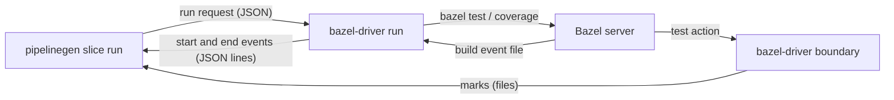

# bazel-driver

A pipelinegen driver for slices that are Bazel test targets. pipelinegen
chooses which slices a change runs; a driver says how they run. This one
runs them with `bazel test`, all of a batch's targets in one invocation when
the step's `batch` is on and one invocation per slice when it is off, both
against the same Bazel server and output root, and gives each slice its
result and, in a recording run, its coverage.



## Using it

```yaml
plugins:
  - {name: bazel, kind: driver, repository: sideways-works/pipelinegen-driver-bazel, release: {version: v0.1.0, sha256: ...}}
suites:
  unit:
    tag: unit-test
    steps:
      - run: bazel
        take: ["kind:go_test", "kind:sh_test"]
        batch: true
        with: {flags: ["--config=ci"], timeout: 600}
```

Its settings, under `with`:

| Setting | What it does |
|---|---|
| `startup` | Bazel startup options, after the driver's own. |
| `flags` | Options of `bazel test`, passed through. |
| `instrument` | The instrumentation filter of a recording run, `^//` (every package) by default. |
| `timeout` | Each test's limit in seconds (`--test_timeout`), Bazel's own by default. |

The driver reads its settings before it starts Bazel and refuses the run
when one is wrong, naming where: a key it doesn't take
(`timout: unknown key; the keys of bazel-driver's settings are startup,
flags, instrument, timeout`), a value of another type or with no value at
all, a `timeout` below 1, and an empty `instrument`. A setting the driver
ignored would leave the run without it, unseen. A step's `batch` sits
beside `with`, not in it; the Bazel to run is the tools' `bazelisk` or the
`bazel` on `PATH`; and the variables set-ups export reach the tests by
themselves, so `with` holds none of these.

`describe` says it takes any test rule, that a bundle keeps recordings
apart, and that its recordings are LCOV.

## What it runs

Every invocation gets `--keep_going` and its own build event file, and the
request's `cache` holds Bazel's output root and repository cache, so a
worker's server and outputs are reused from one batch to the next. A slice
that names some tests of its target gets `--test_filter` in the form its
rule reads: for `go_test` a pattern rules_go hands to `-test.run`. That
filter holds for a whole invocation, so slices of one target with different
tests take one invocation each. A rule whose filter the driver doesn't know
runs nothing and ends failed with the reason, rather than running all its
tests as if filtered. Values a set-up step exported are set in Bazel's
environment and passed to the tests with `--test_env`, since Bazel's tests
inherit nothing.

A recording run is `bazel coverage` with `--instrumentation_filter=^//` and
`--combined_report=none`: Bazel's default filter instruments only the tests'
own packages, and code a test runs elsewhere is what its recording is for.
Each target's `coverage.dat` becomes the slice's `coverage.lcov`, as Bazel
wrote it.

A deadline in the request interrupts the Bazel client two minutes before it.
Bazel then still closes its build event file, and the targets it had not run
come out without a result.

## Results

A slice's result comes from this invocation's build event file alone: the
target's test summary gives its status, and each shard's and run's last
attempt its files. Never from Bazel's exit code, and never from files found
in `bazel-testlogs`, which survive from earlier invocations. The driver
copies each part's `test.log` and `test.xml` into the slice's `extras`
directory as soon as the result is read, because a later invocation
replaces Bazel's copies. The test count and the failing tests come from
`test.xml`; where it holds no cases (rules_go writes none under coverage) a
failure carries the end of the failing part's log.

A target that did not build ends failed with Bazel's message and is not run
again. A target the invocation gave no result (the server died, the
invocation was interrupted, the target was skipped) gets no end event:
pipelinegen runs it again on its own. A result Bazel replays from its cache
is a result, marked replayed, with the stored files. A remote cache that
leaves outputs remote (`--remote_download_minimal`) keeps the result but
leaves no recording, which reads as unknown, never as nothing run.

## Stack suites

A suite whose tests run against servers a set-up step started is not
hermetic for Bazel: the servers' code is no input of a test's action, so a
replayed pass after a server changed would be a test missed. Every
invocation of such a suite gets `--nocache_test_results`; this is the one
place the driver forces tests to run. Bazel users would mark such tests
`tags = ["external"]`, which does the same for every run; the driver does not
need it.

In a recording run of a stack suite pipelinegen collects the servers'
coverage between slices, and Bazel can't be paused from outside, so each
test holds itself. The tests run one at a time (`--local_test_jobs=1`),
each wrapped by `bazel-driver boundary` as `--run_under`, the same absolute
path and arguments every time. The wrapper reads `TEST_TARGET`, asks
pipelinegen to mark the slice's start by a file in the marks directory
(writable in the sandbox through `--sandbox_writable_path`), waits for the
answer, runs the test and marks its stop. A shard, a run or a retried
attempt is marked as its own action, so each adds to the slice's recording.
When Bazel stops a test at its timeout the wrapper passes the signal on and
still marks the stop within ten seconds, so the next test's start is
answered. A mark not answered within five minutes, or answered failed, ends
the test failed: its recording would otherwise mix with another slice's.
Under remote execution nothing can be marked, and the driver fails a
recorded stack suite's slices with that reason.

## Checking it

`cmd/bazel-driver/testdata/workspace` is the driver's fixture for
pipelinegen's conformance kit: a Bazel workspace of three shell tests,
one of which fails on purpose, each writing an LCOV record of the library
it sources under `bazel coverage`. A real `bazel test` fetches the
platforms repository, and `bazel coverage` the coverage merger and a Java
runtime, before the first test runs, so the kit can't run on a real Bazel
offline. It drives `cmd/bazel-driver/testdata/fake-bazel/bazel` instead, a
stand-in that runs each target's script as Bazel runs a test (the same
environment, the `--run_under` prefix, a test.xml and coverage where Bazel
puts them) and writes the build events the driver reads:

```
$ go build -o /tmp/bazel-driver ./cmd/bazel-driver
$ PATH=$PWD/cmd/bazel-driver/testdata/fake-bazel:$PATH \
    go tool pipelinegen plugin test /tmp/bazel-driver --tree cmd/bazel-driver/testdata/workspace
ok    describe answers the protocol
ok    refuses no-such-call
ok    refuses units
ok    run answers every slice, one by one and bundled, not recording
ok    one by one and bundled give each slice the same result, not recording
ok    run answers every slice, one by one and bundled, recording
ok    one by one and bundled give each slice the same result, recording
ok    one by one and bundled leave each slice the same recording
ok    a recorded stack suite's bundle marks each slice's start and stop, one slice at a time
ok    a marked bundle gives each slice its result on its own
ok    no answer or message carries the token
```

`go test ./cmd/bazel-driver` runs the kit that way, and runs it again on
the same workspace with the Bazel on `PATH`, downloads included, unless
there is none or the tests run with `-short`.
