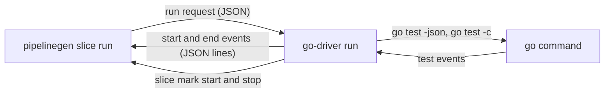

# go-driver

A pipelinegen driver for slices that are Go test files. pipelinegen
chooses which slices a change runs; a driver says how they run. This one
runs each slice, a `_test.go` file and the top-level tests it holds, with
`go test` in the module, and gives each slice its result and, in a
recording run, its coverage.



## Using it

```yaml
plugins:
  - {name: go, kind: driver, repository: sideways-works/pipelinegen-driver-go, release: {version: v0.1.0, sha256: ...}}
suites:
  go:
    tests: ["**/*_test.go"]
    steps:
      - run: go
        take: ["**/*_test.go"]
        batch: true
        with: {timeout: 10m, cover_tags: [pipelinegen_cover]}
```

Its settings, under `with`:

| Setting | What it does |
|---|---|
| `module` | The Go module's directory in the tree, its root by default. |
| `timeout` | Each `go test`'s `-timeout`, as a positive Go duration; `go test`'s own by default. Under a step's deadline the driver passes the time left instead when it is shorter, or when `timeout` is unset. `-timeout` is part of the key of `go test`'s result cache, so a fixed `timeout` lets a result be served from the cache in a later run, while without it the time left differs every run and nothing is served. |
| `tags` | Build tags of every `go test`. |
| `cover_tags` | Build tags a recording run adds to `tags`, which the repository's coverage build needs. None by default. |
| `coverpkg` | The packages a recording covers, as `-coverpkg` takes them; every package of the module (`./...`) by default. |
| `flags` | Options of `go test`, passed through. |
| `race` | Runs every test under the race detector. Off by default: a file that needs it says so with a line `//ci:race`. |
| `cache_mb` | A cap on Go's build cache, in megabytes. Before each run, a cache over it loses the entries unused for a day, then the least lately used, until it is within it. No cap by default. |
| `modcache_mb` | A cap on Go's module cache, in megabytes. Before each run, a cache over it is removed whole: a module cache partly removed is corrupt. `go` then fetches what the tests need again, so leave it unset where the batch can't fetch (`GOPROXY=off`). No cap by default. |
| `must_run` | Tests that must run, not skip: a map from a test file, as the slices name it, to a regular expression of the top-level tests it holds. None by default. |
| `uncached` | Test files, by pattern as the slices name them (`api/git_test.go`, `**/*_clock_test.go`), whose tests run every time: their `go test` never takes a result from Go's result cache, and runs on its own when the step bundles. None by default. |

The driver reads its settings before it runs anything and refuses the
step when one is wrong, naming where: a key it doesn't take
(`timout: unknown key; the keys of go-driver's settings are ...`), a value
of another type or with no value at all, a `timeout` of zero or less
(`go test` reads 0 as no limit), a cap below 0, a `module` outside the
tree, and a `must_run` key that is no test file of the tree as the slices
name it (`dir/name_test.go`) or whose pattern is empty, and an `uncached` pattern that can name no test file. A setting the
driver ignored would leave the step running without it, unseen.

`describe` says it takes the files `**/*_test.go`, that it needs `go`, that
a bundle keeps recordings apart, and that its recordings are Go
coverprofiles.

## Tests that must run

A skipped test passes its file, which is right for most tests and wrong
for a few: an access check that skips without its database proves
nothing. `must_run` names those tests and the file that holds them:

```yaml
with:
  must_run:
    api/access_matrix_test.go: ^TestAccessMatrix$
```

A pattern holds the tests of the file its key names, and of no other
file. A held test that skips fails its file, with a failure that names
the test, keeps its output (the skip's reason) and names its file and the
pattern that holds it. A pattern that every test of the file matches
(`.`) says that no test of that file may skip. A file that `must_run`
names fails when it holds no test its pattern matches, with a failure
named `(must_run)`: a test renamed, or moved to another file, can't fall
out of the setting unnoticed.

A file that `must_run` names and the tree doesn't hold fails nothing:
each run says so on its log, and its pattern holds no test until
`must_run` names the file's new place. In a proposed change's run the
setting comes from the trusted config while the tree is the change's, so
a change that moves the file could never pass if that failed.
`pipelinegen check` can't tell either, since the tree isn't what it
checks the setting against. For the same reason, move or rename a test
the setting holds in two changes: first widen `must_run` to both places
or names (`^(TestOld|TestNew)$`, or a second key for the new file), then
move or rename the test and narrow `must_run`.

## Tests that read what Go's cache can't see

Go's test cache serves a passed result again when the test binary, its
flags, the files the test opened inside the module and the environment
variables it read are unchanged. That is right for almost every test. A
test that reads anything else, such as git history, the network, a clock
or a service the test didn't start, can be served a pass that no longer
holds. Name its file in `uncached`, and only that file runs every time:

```yaml
with:
  uncached: [tools/release/history_test.go]
```

A test that depends on the commit under test can read `PIPELINEGEN_COMMIT`
instead, which pipelinegen hands every driver: Go keys a test that reads
it on its value, so it runs again for every commit with no setting.

## What it runs

A slice runs exactly its own tests, by name (`-run '^(TestA|TestB)$'`), in
the packages its files are in, with `-json` so each test's result is read
from go test's events. Not bundled (`batch: false`), each slice is one
`go test` of its package, as a task script would run it. Bundled, the
selected files of one package run in one `go test`: one test binary, one
`TestMain`, the way a developer's `go test ./pkg` runs them. Two packages
never share a process, and a slice whose files span packages runs each
package's part in turn and passes only if every part does. A file holding
a line `//ci:alone` always runs on its own, and one holding `//ci:race` on
its own under the race detector.

A recording run builds with coverage (`-cover -covermode=atomic` and the
`coverpkg` setting) and writes each slice's coverprofile into its
recording. Not bundled, that is the slice's own `go test`. Bundled, the
driver builds each package's test binary once with `go test -c` and runs
it once per file, as `go test` runs a binary, each with its own
coverprofile and coverage directory. So every file keeps its own
recording, a child process the test starts with a cut-down environment
included. In a recorded stack suite the files run one at a time, and the
driver marks each file's start and stop, so that the stack's coverage is
collected for each file on its own. A suite with a
stack always runs its tests (`-count=1`): the servers they talk to are no
input of go test's cache.

Each recorded coverprofile keeps its mode line, every block that ran, and
for a file none of whose blocks ran its first block, so it still names
every file the build covered. A full profile of a large module is
megabytes of zeros per test file; the cut keeps what go-correlator reads:
it binds a slice to the declarations around the blocks that ran, and reads
the zero blocks only to know which files the coverage holds. A profile
with a line the driver can't read stays whole.

The request's variables reach every `go test`, and Go's build and module
caches live in the request's cache directory unless the environment names
others. A deadline in the request ends the run a minute before it, so the
results are still reported.

The caps on Go's caches hold before the run's first `go test`, so a trim
never takes the minute kept for reporting. With less than two minutes of
the step's time left, the caches are not trimmed and the log says so. A
cache inside the tree or the prepared directory is never trimmed. The
cache directory is kept per task and per machine: on Concourse, a pull
request's suite job has its own, apart from the branch's, a build on
another worker starts with an empty one, and nothing but these caps trims
it.
