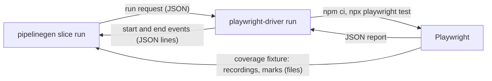

# playwright-driver

A pipelinegen driver for slices that are Playwright spec files. pipelinegen
chooses which slices a change runs; a driver says how they run. This one
runs a batch's spec files with `playwright test`, all in one run when the
step's `batch` is on and one run per spec file when it is off, reads each
file's result from Playwright's JSON report, and in a recording run checks
that each file left its recording.



## Using it

```yaml
plugins:
  - {name: playwright, kind: driver, repository: sideways-works/pipelinegen-driver-playwright, release: {version: v0.1.0, sha256: ...}}
suites:
  e2e:
    tests: ["e2e/**/*.spec.ts"]
    steps:
      - run: playwright
        take: ["e2e/**/*.spec.ts"]
        batch: true
        with: {dir: web, config: playwright.config.ts, workers: 4}
```

Its settings, under `with`:

| Setting | What it does |
|---|---|
| `dir` | The Playwright project's directory in the tree, where its config and `package.json` are; the tree's root by default. |
| `config` | The Playwright config, from `dir`; Playwright's own lookup by default. |
| `project` | Runs only this Playwright project. |
| `workers` | Playwright's workers, passed through; the config's by default. |
| `install` | Runs `npm ci` in `dir` when `node_modules` isn't what the lockfile says; on by default, `false` turns it off. |
| `flags` | Options of `playwright test`, passed through. |

The driver reads its settings before it runs anything and refuses the
step when one is wrong, naming where: a key it doesn't take
(`wokers: unknown key; the keys of playwright-driver's settings are ...`),
a value of another type or with no value at all, `workers` below 1, an
empty `project` (which would run every project) or `config`, and a `dir`
outside the tree. A setting the driver ignored would leave the step
running without it, unseen.

`describe` says it takes the files `**/*.ts`, `**/*.mts`, `**/*.js`,
`**/*.mjs`, `**/*.tsx` and `**/*.jsx` (a step's `take` narrows that to
the spec files), that it needs `node`, `npm` and `npx`, and that a bundle
keeps recordings apart.

## What it runs

Before the tests, the driver installs the project's packages with `npm
ci` when `node_modules` is older than `package-lock.json`, with npm's
cache in the request's cache directory. It then runs `npx playwright test
--reporter=json` in `dir` with the slices' spec files. Bundled, the spec
files go to one run, which Playwright spreads over its workers as it
always does; not bundled, each spec file is a run of its own. Each file's
result, its test count and its failing tests come from the JSON report. A
file whose worker died before its tests finished gets no result, and
pipelinegen runs it again on its own. So does a file with a skipped test in
a run Playwright stopped before its end (its global timeout, a failure
outside the tests): Playwright reports the tests such a run was running or
never reached as skipped, the same as a `test.skip`, so no file passes on a
skip there, and the log names what stopped the run. The request's variables reach the
tests, and a deadline in the request becomes Playwright's global timeout,
a minute before it, so the results are still reported.

A failing test's failure holds the last 15 lines of its error and, when
the test had a page, the page as it was at the failure: the accessibility
snapshot from the `error-context` attachment Playwright writes, its first
40 lines (at most 4 KB), with a line saying how many more there are and
in which file:

```
Error: expect(locator).toBeVisible() failed
...
the page at the failure:
- main:
  - heading "Notes" [level=1]
  - button "Add a note"
```

The driver records nothing itself. In a recording run it names, in
`PIPELINEGEN_COVERAGE` and `PIPELINEGEN_TREE`, where the suite's coverage
fixture writes each spec file's recording (a directory per file, named as
the slice is), and ends a file as recorded only when it left one.
react-correlator's Playwright fixture is such a fixture.

In a recorded stack suite the servers' coverage is collected between spec
files, so the bundle runs with one worker, one spec file at a time, and
the fixture marks each file's start and end through the directory
`PIPELINEGEN_MARKS` names. react-correlator's fixture marks by itself. A
fixture of the suite's own calls `markStart` and `markStop` from
`marks.mjs`, which writes each mark and waits until pipelinegen has
collected the stack's coverage for that file.

## Getting marks.mjs

The driver's binary carries `marks.mjs`, so a release is the binary and
nothing else. `playwright-driver marks <dir>` writes it into a directory,
creating the directory and replacing a `marks.mjs` already there, and
prints the file's path:

```
$ playwright-driver marks web/e2e/support
web/e2e/support/marks.mjs
```

A suite's own fixture imports it from there:

```js
import { markStart, markStop } from "./support/marks.mjs";
```

Commit the written file beside the fixture, and write it again when you
take a new release of the driver. It is byte for byte `marks.mjs` at the
root of this repository at the release's tag.
