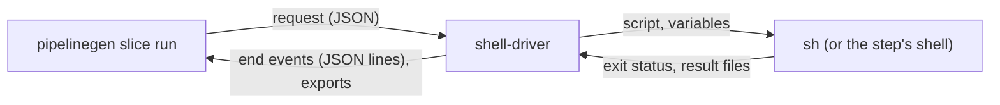

# shell-driver

A pipelinegen driver for steps written as shell. pipelinegen chooses which
slices a change runs; a driver says how they run. With this one a suite's
steps are short scripts in `pipelinegen.yaml` instead of task files and
shell scripts in the repository: a prepare step that builds something, a
set-up that gets a batch ready and cleans up after it, and run steps that
run a script per slice or per bundle, or run shell test files function by
function.



## Using it

```yaml
plugins:
  - repository: https://github.com/sideways-works/pipelinegen-plugins
    with:
      - name: shell
        kind: driver
        path: driver/shell
        release: {version: <tag>, sha256: <the release's checksum>}

suites:
  unit:
    tests: ["**/*_test.sh"]
    owner: "//{dir}:{stem}"
    bind: graph
    image: busybox
    steps:
      - run: shell
        with: {functions: test_}
  lint:
    tag: lint
    image: golang
    steps:
      - setup: shell
        with:
          script: |
            go install example.com/tools/linter@v1.2.3
            echo "LINTER=$(go env GOPATH)/bin/linter" >>"$PIPELINEGEN_EXPORT"
      - run: shell
        with:
          timeout: 20m
          script: |
            "$LINTER" ./...
```

A step gives one of three things to run:

- `script`, an inline script, run by the step's shell from a file of its
  own;
- `command`, a command and its arguments, run without a shell;
- on a run step, `functions`, which runs each slice as a shell test file;
- on a run step, `checks`, named scripts that each run as a test of the
  slice.

pipelinegen's own `command` driver also runs commands, and starts servers
and waits until they answer (`start` and `ready`). Use it for a server a
batch's tests talk to; this driver's set-up runs a script to its end.

## Settings

| Setting | Type | What it does |
|---|---|---|
| `script` | string | The script to run. |
| `command` | list | A command and its arguments, instead of a script. |
| `functions` | string | On a run step: every function of a slice's file whose name starts with this is a test (`test_`). |
| `shell` | list | The shell and its options. `sh -eu` for a script by default, so a failing line or an unset variable ends it; `sh` for test functions, which run as a plain `sh` runs them. |
| `dir` | string | The working directory, relative to the tree; its root by default. Test functions run in their file's own directory. |
| `env` | map | Variables set for the script, over its environment. |
| `timeout` | duration | Each slice's time limit; a bundle gets it once per slice it runs. On a prepare step or a set-up it bounds the script. |
| `stop` | string | On a set-up: a script run when the batch ends. |
| `caches` | list | Directories kept between builds, each `{dir, env, mb, age, unit}`, trimmed before the script runs (below). |
| `checks` | list | On a run step: named checks, each `{name, run, timeout, need}`, run as the slice's tests (below). |

Every verb reads its step's settings before it runs anything and refuses
the step when one is wrong, naming where: a key the driver doesn't take,
at the top or inside a check or a cache (`checks[2].timout: unknown key;
the keys of a check are name, run, timeout, need`), a value of another
type or with no value at all, a script or stop of nothing but blanks, a
variable name in `env` or a cache's `env` that is no variable's name or
is one the driver sets itself (below), and a variable that `env` and a
cache, or two caches, both set. A setting the driver ignored would leave
the step running without it, unseen.

## What a script gets

A script runs with the environment pipelinegen gives the driver: the
suite's `params`, the secrets the suite declares for the step's tasks,
what earlier set-ups exported, and the tools directory first on `PATH`.
pipelinegen keeps its tokens and its own variables out of that; the
driver drops any that reach it all the same, so a script sees a token only
when the suite declares it. Of pipelinegen's own it keeps what the batch
is (`PIPELINEGEN_RUN`, `PIPELINEGEN_SUITE`, `PIPELINEGEN_BATCH`,
`PIPELINEGEN_RECORD`, `PIPELINEGEN_RUN_FILE`) and `PIPELINEGEN_COMMIT`,
the commit the run runs. Over those it sets:

| Variable | What it holds |
|---|---|
| `PIPELINEGEN_TREE` | The tree under test. |
| `PIPELINEGEN_PREPARED` | The directory the prepare steps fill and later steps read. |
| `PIPELINEGEN_WORK` | The step's scratch directory for the batch. |
| `PIPELINEGEN_CACHE` | The step's directory kept between builds. |
| `PIPELINEGEN_EXPORT` | On a set-up: the export file. |
| `PIPELINEGEN_SLICES` | On a run step: the names of the slices this call runs, one per line. |
| `PIPELINEGEN_SLICES_FILE` | The same names in a file, one per line. |
| `PIPELINEGEN_RESULTS` | Where the script may leave a slice's result (below). |
| `PIPELINEGEN_SLICE` | When a call runs one slice: its name. |
| `PIPELINEGEN_SOURCE` | Its file, as an absolute path. |
| `PIPELINEGEN_TESTS` | Its tests, comma-separated, when the slice names some. |
| `PIPELINEGEN_LABEL`, `PIPELINEGEN_TARGET` | A target slice's label and target. |
| `PIPELINEGEN_EXTRAS` | The slice's directory for small extra files. |
| `PIPELINEGEN_RECORDING` | In a recording run: the directory its recording goes into. |

## Results

With `batch: false`, the default, pipelinegen calls the driver once per
slice and the script runs once for it. Its exit status is the slice's
result: 0 passed, anything else failed, with the last 15 lines of its
output. A slice past its `timeout` fails and says so.

With `batch: true` the script runs once for all the slices of the batch
routed to the step, named in `PIPELINEGEN_SLICES`. A script that exits 0
passes every slice it left no result for. A script that exits otherwise,
or runs out of time, leaves those slices without a result, and
pipelinegen runs each of them again on its own, so a slice's result is
always its own.

A script that knows more than its exit status says it per slice, in
`PIPELINEGEN_RESULTS`, as `<slice name>.json` in pipelinegen's result form,
or as `<slice name>.status` holding an exit status. The directories a
slice's name needs are there already:

```sh
for name in $PIPELINEGEN_SLICES; do
  if ./check "$name"; then echo 0; else echo 1; fi >"$PIPELINEGEN_RESULTS/$name.status"
done
```

```json
{"passed": false, "tests": 3, "failures": [{"test": "test_upper", "tail": "upper abc\n"}]}
```

A result file that isn't one fails its slice, saying why. The driver says
of itself that it judges by exit codes (`"results": "exit"`).

## Shell test files

With `functions: test_` a run step runs each slice's file as shell tests.
Every function whose definition starts a line with the prefix and `()` is
a test. Each runs in a shell of its own: the file is sourced in its
directory, then the function is called, with `fail` at hand to stop it
with a message:

```sh
. ./lib.sh

test_add() {
	[ "$(add 2 3)" = 5 ] || fail "add 2 3 = $(add 2 3), want 5"
}
```

The slice's result names each failing function with the end of its
output and counts its tests; a file that doesn't exist fails. The log
shows each test:

```
ok   calc/add_test.sh test_add
FAIL calc/neg_test.sh test_neg_twice
     neg(neg 4) = 4, want 5
```

## Caches

`PIPELINEGEN_CACHE` is a directory kept on the machine between builds. A
step names what it keeps there with `caches`, and the driver keeps each
within its caps:

```yaml
- prepare: shell
  with:
    caches:
      - {dir: gomod, env: GOMODCACHE, mb: 3072, age: 14d, unit: whole}
      - {dir: lint, mb: 8192, age: 30d, unit: entries}
    script: |
      go mod download
      key=$(sha256sum .custom-gcl.yml | cut -c1-16)
      bin=$PIPELINEGEN_CACHE/lint/$key
      if [ -x "$bin/golangci-lint-custom" ]; then
        touch "$bin"   # reused unchanged: counts as used
      else
        golangci-lint custom && mkdir -p "$bin" && cp var/bin/golangci-lint-custom "$bin/"
      fi
      cp "$bin/golangci-lint-custom" "$PIPELINEGEN_PREPARED/"
```

Each cache is `dir` inside `PIPELINEGEN_CACHE`, made if it is missing, and
`env` names a variable the step's scripts get its path in.
`PIPELINEGEN_CACHE` is not the directory `{cache}` names in a suite's
`params`: a param such as `BAZEL_ROOT: "{cache}/bazel"` points beside it,
where no cap of this driver reaches, so name such a directory with `env`
here instead. Before the step's script runs, the first time in a batch
(a run step called once per slice trims once, and a set-up's trim serves
the run steps after it), whatever is unused for longer than `age` goes, then
the least lately used until the cache holds at most `mb` megabytes; the
log gets one line per cache with its size and what went. `age` is a
duration, such as `6h` or `36h`, or a number of days, such as `14d`. What a trim
removes at once is its `unit`:

- `files`, the default: each file on its own, by its modification time,
  for a cache whose every file is an entry of its own, such as Go's build
  cache;
- `entries`: each top-level entry whole, by the newest time of anything
  in it, for keyed builds kept one directory each. A script that reuses
  an entry without changing it touches the entry's directory, as above,
  or the entry ages as if it were unused;
- `whole`: the whole cache, for one that a partial removal would corrupt,
  such as Go's module cache. The driver notes in it each time a step that
  declares it runs, so a cache read every day without anything new in it
  only goes past `mb`, never by `age`.

Directories are made writable before they are removed, since Go's module
cache is read-only. A file the trim can't remove is a line on the log,
never a failed step. A trim runs before the script, so it takes nothing
of a set-up's 10 seconds to stop. It never runs into the step's own time:
with less than two minutes of it left, the caches are not trimmed and the
log says so, and a trim that reaches that point stops.

What you need to know before choosing caps:

- The directory belongs to the task, not to the suite: a prepare's cache
  is not the batches' cache, so what a prepare keeps there reaches the
  batches only by copying it into `PIPELINEGEN_PREPARED`.
- It is kept per CI job and per machine: on Concourse, a pull request's
  suite job has a cache of its own, apart from the branch's, and a build
  on another worker starts with an empty one.
- All shell steps of one task share it, so two steps that name the same
  `dir` share that cache.
- Nothing but these caps trims it: pipelinegen's own `keep.cache` caps the
  planning step's cache, not a suite's tasks'.

## Named checks

A slice that is a list of checks (a lint, a build, a generated file that
must be current) gets one test per check with `checks`. Each has a
`name`, the script it runs (`run`, by the step's shell), its own time
limit (`timeout`, optional) and the earlier checks it needs (`need`,
optional):

```yaml
- run: shell
  take: ["//checks:go-lint"]
  with:
    shell: [bash, -euo, pipefail]
    timeout: 90m
    checks:
      - name: gofmt
        run: test -z "$(gofmt -l .)"
        timeout: 5m
      - name: the generated code is current
        run: go generate ./... && git diff --exit-code
        timeout: 10m
      - name: golangci-lint
        run: golangci-lint run ./...
        timeout: 45m
        need: [the generated code is current]
```

The checks run one after another, in the order written, for each slice
the step runs; a bundle runs its slices one at a time. Each check's output
goes to the log under a line `== <slice>: <check>`, and each ends with a
line `ok` or `FAIL`. The slice passes when every check passes, counts the
checks that ran as its tests, and has a failure for each check that
didn't pass, with the last 15 lines of that check's own output.

A failed check doesn't stop the ones after it. A check that names others
in `need` runs only if each of them passed; otherwise it doesn't run and
fails, its failure saying which need didn't pass, and the checks that need
it don't run either. `need` names only checks written before it, so the
order is the order of the list.

Three limits hold, and a check stops at the first one that runs out:

- its own `timeout`: the check fails, saying so, and the checks after it
  run;
- the step's `timeout`, which here is the slice's limit for all its
  checks together: the check it stops fails, and the checks after it fail
  as not run;
- the step's own time, the suite's `minutes`, less the minute the driver
  keeps to report. The check it stops has no result, and nor have the
  checks after it. If a check of the slice failed already, the slice ends
  failed, the stopped check and the rest named as not run; otherwise the
  slice ends without a result, the log's last lines name the check that
  was stopped and those that never ran, and pipelinegen reports the slice
  as errored. A check cut short or never run is never passed.

A stopped check gets TERM, and so does everything it started; what still
runs once the check's own process ended, or 10 seconds after the TERM,
gets KILL. A check runs in the driver's process
group, like every script (see [Time](#time)), so its processes are
stopped as a tree, not as a group of their own: a group of its own would
escape the tool's stop of the driver.

## Set-ups

A set-up's script runs to its end before any slice of the batch. Each
`NAME=value` line it writes to `PIPELINEGEN_EXPORT` reaches the later
steps and the tests they run as a variable. When the batch ends,
whatever happened, `stop` runs with those variables too. pipelinegen gives
a set-up 10 seconds to finish once the batch ends, so keep `stop` short.

What the script leaves running stays in the driver's process group and
is stopped with it. pipelinegen starts the driver in a process group of
its own. When the batch ends it closes the driver's stdin, and the driver
runs `stop`; a driver that hasn't exited 10 seconds later gets TERM, then
10 seconds after that KILL, each sent to the whole group. Once the driver
has exited, whatever is still in its group gets KILL. A server that may
simply be killed needs nothing more.

A daemon that has to stop by its own command, such as a database that
must flush or a Docker daemon with containers, is started with `setsid`
and stopped in `stop`. In a session and process group of its own, no
signal pipelinegen sends to the driver's group reaches it, so its own
stop command decides how it ends:

```yaml
- setup: shell
  with:
    script: |
      setsid pg_ctl -D "$PIPELINEGEN_WORK/pg" -l "$PIPELINEGEN_WORK/pg.log" -w start
    stop: pg_ctl -D "$PIPELINEGEN_WORK/pg" -m fast -w stop
```

On Linux the driver keeps the processes its scripts leave behind as its
own (it is their reaper, whatever session or group they moved to). Once
the set-up has ended, after its `stop` whether it passed or failed, or
after a script that failed, the driver kills whatever of it still runs,
`setsid` or not, and the log names each one. So `stop` decides how a
daemon ends, and nothing outlives the set-up when `stop` doesn't do its
job. A `stop` that failed still fails the set-up.

In a run or prepare step the driver kills what a script left behind as
soon as the script ends, so `setsid` keeps nothing alive past it: what a
slice's tests need running belongs in a set-up.

## Time

Besides `timeout`, every call holds the step's own limit, the suite's
`minutes`: a minute before it ends, the driver stops what it runs and
reports what finished. A script runs in the driver's own process group,
so whatever stops the driver stops the script and everything it started;
when a script's time runs out, it and what it started get TERM, then
KILL. What a run or prepare script leaves running in the background is
stopped when the script ends (on Linux, where the driver keeps its
scripts' orphans as its own).

A script, command, check or test function that writes nothing for a
minute gets a line on the log, and another for each further minute of
silence, so a long build shows that it is alive and a hung one shows
where it hangs:

```
shell-driver: check "golangci-lint" of //checks:go-lint still runs after 7m0s, silent for 3m0s
```

A set-up's script writes to the log directly, so its silence can't be
measured: it gets that line once a minute for as long as it runs. The
lines go to the log only, never into a failure's tail.

## Recording

In a recording run each slice's `PIPELINEGEN_RECORDING` is its recording
directory, made for it. pipelinegen calls the driver once per slice in a
recording run, so recordings never mix. In a recording run of a suite
with a stack, the driver runs a bundle's slices one at a time and marks
each slice's start and stop, as pipelinegen asks.

## Testing and releasing

`go test ./...` runs the driver's tests and pipelinegen's conformance kit
on `driver/testdata/sh`. A release is built and published like every
pipelinegen plugin: static binaries, the driver's `describe` answer as
`plugin.json`, and `SHA256SUMS`.

## Developing

The tests and the lint run with the Go, golangci-lint and Node that the
repository pins, as [CONTRIBUTING](../../CONTRIBUTING.md) describes; the
other commands run in this directory. The tests need `sh` and `bash` on
your `PATH`.

```sh
bazel run //driver/shell:test
bazel run //driver/shell:lint
```

The tests include pipelinegen's conformance kit (`go tool pipelinegen
plugin test`) on the fixture in `driver/testdata/sh`, which runs every
verb the driver declares. A change to what the driver does comes with its
test and its paragraph in the README.
