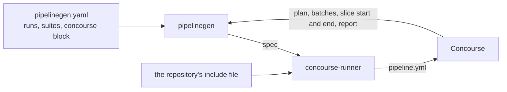

# concourse-runner

concourse-runner is the runner plugin for
[pipelinegen](https://github.com/sideways-works/pipelinegen), which runs
only the test slices a change can break. It turns the runs and suites of a
repository's `pipelinegen.yaml` into that repository's one Concourse
pipeline. `pipelinegen pipeline` calls it.

A runner records nothing about the code. The pipeline it writes calls
pipelinegen's own commands (`plan`, `unplanned`, `tree`, `batches`,
`slice start`, `slice end`, `report`), which know no CI system. The slices
a run selects never appear in the pipeline; a suite job learns them at
run time from the run's plan.



## An example

A repository declares two runs, `pr` and `nightly`, and two suites,
`backend` and `e2e`. concourse-runner writes these jobs:

- `pipeline`, which runs when the config or its include file changes;
- `plan-pr` and `plan-nightly`, which plan each change;
- `sweep-pr`, which plans the pull request heads `plan-pr` missed;
- `pr-backend`, `pr-e2e`, `nightly-backend` and `nightly-e2e`, one per run
  and suite.

A pull request that changes one Go function starts `plan-pr`. Say the plan
selects 7 slices of `e2e` and none of `backend`. `pr-e2e` deals the 7
slices into at most the suite's `parallel` batches and runs one batch task
per batch, all at once; `pr-backend` runs no batch. The pipeline's size
doesn't grow with the number of slices.

## Setting it up

Name the plugin in `pipelinegen.yaml`, pinned by a release and its
checksum:

```yaml
plugins:
  - repository: https://github.com/sideways-works/pipelinegen-plugins
    with:
      - name: concourse
        kind: runner
        path: runner/concourse
        release: {version: v0.4.0, sums: …}
```

`sums` is the checksum of the release's `SHA256SUMS`, so one pin serves
every platform and each binary is checked by its own line of that list.
To pin one binary alone, put `sha256:` with its line
(`concourse-runner-linux-amd64`) in place of `sums`. A runner claims no
files, so there is no `detect` and no `include` or `exclude`.

### Config

The runner reads the config's `concourse:` block, which pipelinegen passes
in the spec. pipelinegen's
[config reference](https://github.com/sideways-works/pipelinegen/blob/main/docs/reference/config.md)
lists every key; these are the ones the runner uses:

| Key | Default | What it does |
|---|---|---|
| `url`, `team` | team `main` | where the jobs' links in commit statuses point; without `url`, `PIPELINEGEN_CONCOURSE_URL` of whoever generates the pipeline gives it, and the pipeline hands it on to the `pipeline` job, the one place that writes the pipeline |
| `repository` | required | the `source` of the git resources; the runner sets `branch` per run |
| `planner.image`, `planner.digest` | required | the stock image pipelinegen's own steps run in, pinned by digest |
| `planner.prepare` | none | a command that fills the plugins' shared caches before planning |
| `planner.params`, `planner.secrets` | none | that command's environment, its alone |
| `planner.git_token` | none | the secret of `planner.secrets` that git authenticates with in that command |
| `planner.prepare_image` | none | a `registry-image` resource of the include file that the planning task runs in; see [Images](#images) |
| `include` | none | a pipeline file of the repository's own, merged in |
| `pull_requests` | `cfcommunity/github-pr-resource` 0.26.0 | the image of the pull request resource type |
| `self_set` | false | lets the `pipeline` job set the pipeline itself; see [Secrets](#secrets) |
| `serial_groups.<group>.per_run` | false | gives each run its own serial group `<group>-<run>` |

The include file may hold `resource_types`, `resources`, `groups` and
`jobs`, nothing else. A name that the generated pipeline already uses
fails the generation.

### Placement

Which workers each step runs on is set in the plugin's own config block,
the `config` of its entry in `plugins`, under `placement`:

```yaml
plugins:
  - repository: https://github.com/sideways-works/pipelinegen-plugins
    with:
      - name: concourse
        kind: runner
        path: runner/concourse
        release: {version: v0.4.0, sums: …}
        config:
          placement:
            default: [small]
            rules:
              - {for: suite, run: nightly, tags: [nightly]}
              - {for: suite, suite: e2e, tags: [browsers]}
```

Each rule is `for` one kind of step, may name a `suite` and a `run`, and
gives the step's `tags`. The rules are tried in order and the first that
matches a step places it. A step no rule matches takes `default`, and
without a default it has no tags. `tags: []` leaves a step to the workers
Concourse picks for an untagged step. When a placement has rules and no
default, the runner says of each suite job no rule places, as a notice
with the pipeline (`pipelinegen pipeline` prints it, `pipelinegen check`
reports it as a warning): `placement: <run>-<suite> is placed by no rule
and there is no default: its steps run on untagged workers`. A config
without a placement says nothing, since one pool of untagged workers is a
setup of its own, and neither does a suite a rule gives `tags: []`.

| `for` | Places | May name |
|---|---|---|
| `pipeline` | the `pipeline` job | nothing |
| `planning` | a run's planning job and a pull request run's sweep | a run |
| `checks` | the checks of the generated resources and resource types | nothing |
| `suite` | every step of a suite job but its bookkeeping: the gets, `start`, the prepare, the suite image, the batches, the whole-suite checks and their helpers, the `report-error` hooks; for a suite run by drivers (`steps`), its prepare task and the batch tasks that run its set-up and run steps too | a run, a suite |
| `bookkeeping` | each batch's `batch-end` and the suite job's `end`; see [Workers](#workers) | a run, a suite |

A suite's bookkeeping that no rule places runs with its suite. In the
example, the nightly's suites run on `nightly`, e2e on `browsers` in every
other run, and everything else on `small`.

The runner refuses, before it writes anything, a key it doesn't know, a
rule with an unknown `for`, without `tags` or with an empty tag, one that
names a run or a suite its `for` can't have or the spec lacks, and one that
places no step: an earlier rule covers all it would, or the pipeline has
no such step (a suite in no run). `pipelinegen check` asks the runner for
the pipeline when it is in `tools/plugins`, so these show before the
pipeline job runs.

The concourse section's `planner.tags`, `resource_tags` and `bookkeeping`
and each suite's `run_on.tags` placed steps before. pipelinegen refuses
them, each with the rule above that places the same steps, and the runner
refuses a spec that still carries them, which only a pipelinegen from
before the move sends. `run_on.serial_group`, `run_on.max_in_flight` and
`serial_groups` stay where they are.

A pull request can't move its own jobs. The pipeline is made from the
default branch's config. The plugin's block is one of pipelinegen's
trusted keys, so a change that edits it is planned with the default
branch's block, and its plan says the change takes effect once merged.

## What it produces

`pipeline` writes one file, `pipeline.yml`, the same bytes for the same
spec. For each run it has the resource that starts the run, a planning job
`plan-<run>` and a job per suite `<run>-<suite>`; a pull request run also
has a sweep job `sweep-<run>`. It also has a `pipeline` job and the
repository's own parts from its include file.

- A pull request run starts from a `github-pr` resource that takes every
  version, checked every minute; drafts are skipped when the run says so.
  A timer run starts from a `time` resource; any other run from the
  branch's git resource, named `branch-<branch>` with every byte Concourse
  doesn't take in a name (a `/`, a capital, `_`) written `_xx`, so
  `ci/x` is `branch-ci_2fx`. Only a branch some run starts from gets one.
- The planning job of a pull request run hands each head it planned to
  the suite jobs through a resource of its own, `planned-<run>`, and only
  when its write step opened the gate. See [Pull requests](#pull-requests).
- Each job holds as few tasks as the token allows, since each task waits
  for a worker on its own. A branch run's planning job is one task, and so
  is the `pipeline` job. A suite job with one batch is four: `start`, the batch,
  the batch's `batch-end`, and `end`, plus the suite's prepare and its
  whole-suite checks.
- Every task of pipelinegen's runs one short script, the bootstrap, and
  then a step of the runner's own program, `concourse-runner step <name>`,
  which does the task's work. The bootstrap fetches the runner the config's
  plugins pin into `tools/plugins`, checked by its sha256 like every pinned
  file, and runs the step; a task whose `tools` already hold the runner
  runs it from there. The step fetches pipelinegen, bazelisk and the
  configured plugins by checksum into `tools`, keeping them in the job's
  cache, and then calls pipelinegen as the task needs. Every run checks
  a cached file against its checksum again and fetches it anew when it
  doesn't match, so a wrong file under a right name never runs. The cache
  keeps only what the job's pins name: Concourse copies a task's whole
  cache each time the task ends, so a release, a commit's build or a
  bazelisk that no pin names any more is removed, and the task's log
  names it. A plugin pinned by a commit instead of a release is built from
  that commit, from `./cmd/<name>`. A release's file is
  `<name>-linux-amd64`, or, for a Node plugin, whose release has no such
  file, the script `<name>.mjs`, checked the same way and run by its own
  `node` shebang. `<name>` is the program the repository holds: a
  repository named `pipelinegen-KIND-NAME`, KIND a plugin kind, holds
  `NAME-KIND`, and any other
  repository the program of its own name. Both spellings of a renamed
  repository (`owner/NAME-KIND` and `owner/pipelinegen-KIND-NAME`) fetch
  the same file into the same cache entry, so switching a pin from one to
  the other fetches nothing again.
- Every task that runs pipelinegen, planning and bookkeeping tasks as
  much as a suite's, gets `PIPELINEGEN_PIPELINE_STEP=1`, which tells
  pipelinegen it runs as a pipeline's step: Bazel's output and bazelisk's
  downloads stay in the task's cache, so a plan starts Bazel warm. No task
  of the repository's gets it. `PIPELINEGEN_JOB_URL` is the job's link and
  goes to the suite jobs' tasks alone.
- A suite job's `start` task writes the tree under test and the gates,
  and when the plan selected anything of the suite it deals the selected
  slices into batches. The job runs one batch task per batch with
  `across` and `max_in_flight: all`, every batch at once (the suite's
  `parallel`, `batches` and `batch_minutes` say how many batches it
  deals). Each batch's `batch-end` runs in that batch's `ensure`, so every
  batch reports as it ends, whatever it did. Each whole-suite check runs only when the
  plan selected it. The `end` task runs in the job's `ensure`: it reports
  the suite.
- A suite's `run_on.serial_group` is one Concourse serial group for every
  run, unless `concourse.serial_groups.<group>.per_run` is true: then
  each run has its own, `<group>-<run>`, and a run's builds never queue
  behind another run's.
- No job is serialized unless the config asks for it (a suite's
  `run_on.serial_group` or `run_on.max_in_flight`). A branch run's suite
  jobs take every commit their planning job planned, and two commits'
  builds run side by side, each writing records of its own commit; the
  workers' own limits are the only bound. Two builds of one job each get
  a copy-on-write view of the job's task caches, and the last to finish
  keeps its own as the cache. That can cost a warm cache, never a wrong
  result.
  A planning job is never serial, a continuous run's included, below.
- A timer run's suite jobs take every commit its planning job passed, not
  the timer: a nightly that finds the branch where its last round left it
  plans nothing ("nothing changed since the nightly of ..."), passes no new
  commit, and starts no suite.
- A suite job that breaks before pipelinegen can report posts its status,
  and its run's, as errored from the runner's `report-error` step, which
  needs no pipelinegen; when the runner can't be fetched either, the
  bootstrap posts them with `curl`, so a status never stays pending.

By default the `pipeline` job only checks. It regenerates the pipeline and,
when it differs from the one set, fails with "the pipeline is stale: set
it" and the command to run. A person sets it with `fly set-pipeline`. When
the pinned pipelinegen can't read the tree's config at all (a config newer
than the tool), the pipeline is stale too, and one more line gives the
tool's reason.

### Pull requests

The pull request resource's check lists every open pull request's head,
oldest commit first, and whenever one of them is new Concourse moves all
of them, in that order, behind every version it had. So a job that takes
every version of it can find a new head placed behind one it already
took, and never take the new one. And a job that takes every version
passed through the planning job walks the planning builds in the order
they began: a plan that ends after a later one is never taken. Pull
requests pushed a few seconds apart hit both.

So the suite jobs of a pull request run don't take the trigger. The
planning job puts the head it planned to `planned-<run>`: a resource of
the same type that is never checked, with the head's version (its pull
request and commit) and, as its `committed`, the moment of the put with
a random fraction of a second, so each put is a version of its own,
numbered in the order the puts land. The suite jobs take every version
of it, without `passed`, and their get fetches exactly that head. A
suite job started by hand takes the newest hand-off, never an old pull
request.

The put sits in an `across` over `handoff/gate.json`, which the write
step's `pipelinegen plan --from plan --gate handoff` writes: open when
the step wrote the head's plan, or found the head planned with none of
its suites begun after `missed_after`, as the sweep would hand it on
again. A build of a head planned already, whose suites began or are on
their way, ends green and puts nothing, so planning a head again, by
hand or by the sweep and a push at once, never starts a second set of
suite builds beside the first. To run a head's suites again, rerun the
suite build, which runs the selected slices that have no pass for the
head, or push a commit.

The sweep job `sweep-<run>` closes what the trigger's reordering leaves
open. Every five minutes, and after every hand-off, it runs
`pipelinegen unplanned`, which lists the run's open heads that have no
plan, and the planned heads none of whose suites began, once each has
waited the run's `missed_after` (10 minutes by default) for its own
build. The sweep plans each head of the first kind in its own checkout,
after the planner's prepare command, and hands it off when its write
(`plan --from ... --gate`) opened the gate; it hands off each head of
the second kind again. Sweeps run side by side: pipelinegen writes its
mark on a head it takes up from the mark it read, so of two sweeps that
take one head up the first mark stands and the other hands nothing of it
on. A head that its own build planned meanwhile is planned once: the
later write finds the plan, shuts its gate and hands nothing on.

A suite job that is new takes the newest hand-off only, so heads planned
before it ever ran wait for the sweep.

### A connector's changes

A run whose changes come from a connector (`trigger: {changes: ...}` with,
say, the plain git connector's review branches) has no pull request
resource and no planning job. Only its sweep notices new changes: every
`sweep_every` (one minute by default), `pipelinegen unplanned` asks the
connector for the changes, plans each new head at once in its own
checkout, and hands each one on. A sweep costs one `ls-remote` of the
code's remote and one read of the store, so a minute is cheap. A
different period goes on the trigger:
`trigger: {changes: {base: main, sweep_every: 5m}}`.

The hand-off is `planned-<run>`, a resource of Concourse's bundled `mock`
type, never checked. Each put's version is the change's `run.json`,
which holds the sweep's time and a random part, so the same head handed
on again is a version of its own. mock's source takes no key it doesn't
know, so its `log` line names the pipeline and the run, which keeps two
runs' or two pipelines' hand-offs apart on a Concourse that shares
versions between equal sources. A suite job takes every version, and a
first task copies it into `trigger/run.json`. pipelinegen's steps check
the change out from there themselves, with the read token, and no git
resource fetches it. Such a run reports to no host, so its suite jobs post
no fallback status; `pipelinegen status` reads its state.

Over ssh (a remote like `ssh://git@git.example.test/team/r.git`), each
pipelinegen step gets the ssh key of each purpose it gets the token of, by
its var's name, in `PIPELINEGEN_SSH_KEY_READ` or `..._STORE`: the read key
alone where a change's code runs, none in the repository's own tasks.
pipelinegen writes a key to a private file only for the git command that
needs it and checks the server against `git.known_hosts` alone. Use a
read-only deploy key for `read` and another key for `store`.

This needs a Concourse with the bundled `mock` resource type. Stock
Concourse has it; to check yours, look for `mock` among each worker's
resource types:

```sh
fly -t <target> workers -d
```

A Concourse without it says so in the config, `concourse: {mock: missing}`,
and `pipelinegen pipeline` then refuses such a run before writing the
pipeline.

### Planning

The planning job's one task keeps `plan-cache` with the job: pipelinegen's
work tree and hashes, and the caches the plugins share at
`plan-cache/caches/<name>` (`gomodcache`, `gocache`, `npm`). When
`planner.prepare` is set, the task runs that command in the checkout
before planning, with `GOMODCACHE`, `GOCACHE` and `npm_config_cache`
pointing there (`go mod download`, say). That command may use the
network; the plugins never do. It gets `planner.params` and `planner.secrets`, which the plan
itself never sees, and the pipeline's token only when `planner.secrets`
declares it. With `planner.git_token`, git asks a credential helper that
reads that secret when it needs it (`pipelinegen git-auth`).

A pull request run's change comes from outside, and planning runs its
code: Bazel reads its build files. So its planning job has two tasks,
after a short third that comes first.

`begin` runs none of the change's code and holds the read and store
tokens alone. It runs `pipelinegen plan --begin`, recording that this
build plans the head. The run's sweep then leaves the head to the build
until `limits.plan` and ten minutes have passed, so a cold plan that
takes most of an hour isn't planned again beside itself. A store it
can't write only warns.

The first of the two, `plan`, holds only the credential that reads. It
runs the prepare command in a checkout of the base's tip, `base`, never
in the change's tree, then `pipelinegen plan --out plan`, which writes no
record and no status. The second, `write`, holds the credential that
writes and runs none of the change's code. Its
`pipelinegen plan --from plan` works out the commit under test and the
base again from the trigger, refuses a plan of anything else, writes the
plan and the statuses, and with `--gate handoff` says whether the job
hands the head on.

The sweep is split the same way. `planner.secrets` must therefore be
read-only credentials: the change's code never sees them, but it runs in
the task that had them.

### Images

A task file's `image_resource` can't pull a private image: Concourse fills
vars only in the pipeline file, and the registry's credentials live
there. So a suite may name, with `image`, a `registry-image` resource that
the include file declares with its credentials and its pinned version.
The suite's prepare task, every batch and every whole-suite check then run
in it (`image:` on the step); the task file's `image_resource` stays as
the fallback for running the task by hand. pipelinegen's own tasks of the
suite (`start`, `batch-end`, `end`) keep the planner's image.

The job fetches the image once, first in the work that runs only when the
plan selected the suite, on the suite's workers, without a trigger. A
build that runs nothing of the suite fetches nothing. A fetch is no task,
so it never waits for a worker slot; with the image already on the
worker, it reuses it in seconds. The resource's own `check_every` decides
how often Concourse looks for a new version.

When that resource is the planner's image (a `registry-image` of the same
repository, pinned to the planner's digest, or naming the planner's tag
and pinning no other version), the job fetches it once: its first fetch,
under the name `planner`, takes it from the suite's resource, and the
suite's tasks run in it with pipelinegen's own. A suite whose image
differs from the planner's in any of these is fetched apart, as above.

`planner.prepare_image` does the same for the planner's prepare command.
That command runs inside the planning job's one task, so with it the whole
task runs in the named image: the bootstrap, the prepare command and the
plan. This is the one place where an image of the repository's runs one
of pipelinegen's own tasks; a task of its own for the prepare command
couldn't share the plan's cache, and its module caches would be copied
between tasks on every build. The image must carry what the bootstrap
needs: `sh`, `git`, `curl`, `awk`, `sha256sum` and CA certificates. The
prepare command still never sees the pipeline's token unless
`planner.secrets` declares it.

### Packages and cached images

pipelinegen's spec may name packages: each suite's (`packages` and
`suites.<name>.packages` of the config), the planner's
(`concourse.planner.packages`), and a registry of cached images
(`images`). The runner reads them from the request, so it builds against
pipelinegen releases that predate them. A spec without them gives the
pipeline it always gave.

- Every task the runner writes that runs pipelinegen runs the spec's
  install script first, in the same shell: the suite's before
  `slice run` and `slice prepare`, the planner's before the rest (the
  bootstrap, planning, the reports). The script finds the image's
  package manager, installs only what is missing, and does nothing when
  the image has it all. Each such task keeps a `pkgcache` cache that the
  manager downloads into (`PIPELINEGEN_PACKAGE_CACHE`), so a worker
  downloads a package once. The `report-error` task goes on without the
  packages when they can't be installed, so a broken build is still
  reported. A task file is the repository's own script: nothing goes in
  front of it, and its suite gets its packages only from a cached image.
- For each cached image the spec names, a job `image-<key>` runs when
  the config changes. A `look` task in
  `concourse/registry-image-resource` asks the registry for
  `<registry>:<key>`. When it is missing, a `build` task in
  `concourse/oci-build-task` builds it on the base resource, fetched at
  its pinned digest as an OCI tarball, with the install script run as
  root, and a put pushes it. The build task is `privileged`, as
  `oci-build-task` requires, though it needs no Docker daemon. The
  registry-image resource can push but can't build, and no unprivileged
  builder keeps the base's config. The job takes nothing from the
  repository but the config's version: the recipe is the spec's, and the
  base the pinned resource. It holds no lock and is in no serial group.
  Two builds that race push the same packages on the same base. The
  resources it pushes through (`cached-<key>`) are never checked.
- A suite's job fetches its cached image in an
  `image-<key>` task at the start of its work, and its prepare, batch and
  whole-suite tasks run in that artifact. It is a task, not a `get`, since
  every `get` is an input of the job, and a build would wait for an image
  the registry hasn't got. When the registry hasn't got the image or can't
  be reached, the task fetches the base at its digest instead, says so,
  and the installs do the work.
- `images.credentials` (`((name.username))`,
  `((name.password))`) is in the image jobs and their resources, nowhere
  else: no suite job, planning job or pull request's job holds it.
  `images.pull_credentials`, when set, is in the fetch task, which runs no
  code of the repository's. Neither reaches a task that does.
- The planner is never swapped for a cached image: its steps hold the
  tokens that write.

### Workers

Each batch's `batch-end` and each suite job's `end` only report: they run
no test, no prepare and no Bazel. With a `bookkeeping` rule of the
[placement](#placement) they run on workers of their own instead of the
suite's, so on a busy test worker they never queue behind the tests.
`tags: []` puts them on untagged workers; without a rule they stay with
the suite.

Moving them adds streaming. They read what other tasks left on the test
workers, and Concourse streams it to the bookkeeping worker on every
build: the tools
(pipelinegen, bazelisk and the plugins), the trigger's checkout, the
`start` task's `source` (the whole tree under test, with its history)
and `batches`, each batch's `result` and, in a recording run, its
`coverage`, which can be large. In a recording run `batch-end` also runs
the correlators there, on that worker's CPU and memory. With a large tree,
the streaming can cost more than the queueing it saves: measure before
turning it on.

When the bookkeeping workers aren't the suite's, the job fetches the
trigger and the planner image a second time, on the bookkeeping workers,
so those two never cross between workers. The rest of what the
bookkeeping reads (the tools, `source`, the results) are tasks' outputs
and does cross.

Concourse streams a volume from one worker to another when a step reads
what another step made or fetched on another worker. Without
peer-to-peer streaming every such volume goes through the web node, which
for an image of a gigabyte can take the better part of an hour. Two
workers under one tag are a pool: a task and the fetch of its image are
placed apart within it, and the image then streams. So on a Concourse
without peer-to-peer streaming, give each suite a tag that only one
worker carries. Turning on `CONCOURSE_ENABLE_CACHE_STREAMED_VOLUMES` on
the web node keeps a streamed volume on the worker that received it, so
each version streams to a worker once; peer-to-peer streaming makes the
streams themselves fast. The runner can't see the workers' tags, so it
can't warn about a pool.

Only these two tasks move to the bookkeeping workers. Anything that runs
tests, a prepare or Bazel stays on the suite's tags, and so does the
`start` task: its `source`
output would otherwise stream from the bookkeeping worker to every batch
on the test workers. The `report-error` hooks of a build that broke stay
on the suite's tags too.

No step takes a lock: every batch of a build starts at once, and the
worker that takes it runs it. Admitting a batch only while its node has
free memory is coming next; until then nothing but the workers and their
tags keeps two repositories' pipelines from overfilling a shared
machine. A spec from an older pipelinegen may still hold a suite's
`lock`: the runner writes the same pipeline as without it and says so in
a notice.

### Continuous runs

A run whose trigger is `{branch: main, continuous: true}` takes every
commit of the branch: its planning job's get has `version: every`. The
job is not serial: its builds run side by side, and each plan step
records its round's start and planning in the run's records for the
others to read. The planning task first runs
`pipelinegen plan --decide --gate handoff`, before the repository's
prepare command: it ends a commit that is no longer the branch's tip at
once, waits while a round of the run is in progress (it reads the run's
records, and takes nothing), and lets the build go on when that round has
ended and its commit is still the newest. A build it ends has a closed
gate in `handoff/`, and the task stops there, green, without the prepare.

Only a build that goes on runs the prepare and then the plan step, which
decides once more and plans. So what the prepare leaves for the plan (a
credential cache that expires, say) need only last the plan's limit, not
the wait, and a superseded build never prepares. A planning build
whose step wrote a plan (`pipelinegen plan --gate handoff` opens its gate)
puts the run's `planned-<run>` hand-off; one that exited puts nothing.
The suite jobs trigger on those hand-offs (`version: every`, passed the
planning job) and take the branch's commit of the same planning build, so
a superseded or unchanged commit shows one green planning build and no
suite build.

The `pipeline` job runs its builds side by side too. pipelinegen gives a
build whose config the default branch no longer has a closed gate, so it
sets nothing (with `self_set`) or checks nothing: an older pipeline is
never set over a newer one.

### Time limits

Every step the runner writes has a `timeout`, so a step that hangs ends
and its job goes on to its `ensure`, which reports it, instead of holding
the run pending; in a continuous run the next round would wait behind it.
The minutes come from the spec:

- each of the suite's own tasks (the prepare, each batch, each
  whole-suite check) has the suite's `minutes` in the run, on its own, so
  one batch that hangs ends while the others go on;
- the planning job's and the sweep's tasks and puts have `limits.plan`,
  and a continuous run's plan task the run's `wait_minutes` on top, for
  the wait for the round in progress: its decision has the task's whole
  limit, and the prepare and the plan after it `limits.plan` from the
  decision's end (the task exports `PIPELINEGEN_DEADLINE` and
  `PIPELINEGEN_LIMIT` again there);
- pipelinegen's own steps have `limits.steps`: the start task, each
  batch's end, the checks' collect and report, the end task, the
  pipeline job.

A step in an `ensure` or another hook carries its own `timeout`: Concourse
runs a hook after a limit ended the step, outside that limit. A timeout
fails a step rather than erroring it, so the job's `on_error` hook doesn't
post for it; the end task, in the job's `ensure`, reports the suite.

The end task sits in no `try`, since its inputs are optional. Concourse runs the
job's `ensure` on an abort too, so the end task runs whatever happened to
the build. A build that broke or was aborted before its start task had the
tools, such as one still waiting for a worker for that task, has no
`tools`: the end task fetches them as the start task does (it holds the
same pins) and reports the suite, so a continuous run's next round need
not wait for it. A build that broke before its trigger was there has no
commit to end, and ends at once. Its step lets every failure of `report
suite` pass but exit 4, a suite's end that could not be recorded, which
fails the job.

The job's `on_error` and `on_abort` hooks (`report-error`) run before the
`ensure`. They run `report suite` themselves when the build had got as far
as its tools and its trigger; only without them do they post the suite's
status and the run's as errored, and the end task then ends the suite.
They hold the end task's tokens for that. A build aborted while it was
pending, before it started, and one that broke before it had its trigger
or the planner image the end task runs in, end no suite: theirs has no end
until `pipelinegen end` or the run's idle bound.

Each of pipelinegen's own steps gets `PIPELINEGEN_LIMIT` (the key and its
minutes), and a task that begins with a script exports
`PIPELINEGEN_DEADLINE` at its start: pipelinegen ends two minutes before
the limit and says which one it reached. The end task gets the start
task's `batches`, where pipelinegen stamped when the suite's work began,
so a slice a stopped task left open says whether a limit stopped it.

## A batch task's inputs

The suite's `run_slice` task file gets:

- `source`: the tree under test, a git work tree whose HEAD is the tested
  commit;
- `prepared`: the suite's `prepare` output, when it has one;
- `batches`: `batches/<n>/slices.json` and `batches/run.json`;
- `tools`: `tools/pipelinegen`, `tools/bazelisk` and the plugins in
  `tools/plugins/<name>`;

and the suite's params, then the suite's `secrets.batch`, then the
parameters `PIPELINEGEN_RUN`, `PIPELINEGEN_SUITE`, `PIPELINEGEN_BATCH`,
`PIPELINEGEN_RECORD`, `PIPELINEGEN_JOB_URL` and `PIPELINEGEN_RUN_FILE`
(`batches/run.json`, which names the change, its commit and the pull
request's number), so nothing overrides pipelinegen's own. It writes
`result`, and `coverage` when recording. What it does with them is
pipelinegen's batch contract. It needs no token: without one its slices
show when the batch ends, and declaring `GITHUB_TOKEN` in `secrets.batch`
shows them live, where the tests see it too. The suite's `prepare` task
gets the params, `secrets.prepare`, `PIPELINEGEN_RUN`, `PIPELINEGEN_SUITE`
and `PIPELINEGEN_RECORD`, the same as its batches'; a whole-suite check the
params, `secrets.whole`, those three and `PIPELINEGEN_JOB_URL`.

A suite run by drivers (`steps`) has no task file. Its batch task runs
`tools/pipelinegen slice run --root source --tools tools` in the suite's
image and its prepare task `slice prepare --root source --tools tools`;
both get `source` and `tools`, the batch `batches` and the prepare's
`prepared` too. `--tools tools` puts the tools directory, with pipelinegen
and bazelisk, first on the `PATH` of the drivers and of the tests they
start.

### Secrets

The pipeline needs one GitHub token, as a Concourse variable that the
config's `github.token` names. It uses the token to clone the repository
and fetch its commits; to read and write pipelinegen's hidden refs (plans,
run state, lists, the plugin cache); to post commit statuses and
the pull request comment; and to download pipelinegen's and the plugins'
releases. The least it needs is a fine-grained token for that one
repository with contents read and write (for the hidden refs), commit
statuses read and write, and pull requests read and write (for the
comment). The releases of private plugin repositories need contents read
on those repositories too.

The token may also be split by purpose (`github.tokens`: `read`,
`changes`, `report`, `store`). The spec then names each purpose's var, and
pipelinegen's steps read each from `PIPELINEGEN_<PURPOSE>_TOKEN`, never
from `GITHUB_TOKEN`. The runner hands each step only what it does:

- a task that runs a proposed change's code (the planning of a pull
  request run, in the planning job and in the sweep) gets `read` alone,
  and the planner's own secrets, which must be read-only credentials too;
- the steps that write (the plan's write step, the sweep's listing and
  writing, a suite's start, batch ends and end, a branch run's plan) get
  all four;
- the error hooks get `report`; every bootstrap reads releases with
  `read`; the pull request resources list and fetch with `changes`;
- a task of the repository's in a pull request run may declare the read
  token as a secret and no other purpose's: the runner refuses the
  pipeline otherwise.

The git resources take `concourse.repository` as the config gives it, so
its password names the read token's var. With one token nothing changes.

Only pipelinegen's own steps get the token. A task of the repository's
gets it, or any other secret, only where the suite's `secrets` declare it
for that kind of task; `params` hold no secrets, and the generation fails
on a param holding a `((var))`, a `PIPELINEGEN_` name, or a secret a param
also names. `pipelinegen pipeline --vars` lists the vars the pipeline
references: the token, the declared secrets, the repository's credentials
and the include file's.

The generated pipeline holds every secret only as a `((name))` reference.
How Concourse fills those references decides whether `self_set` is safe:

- Without a credential manager or `var_sources`, a pipeline set with
  `fly set-pipeline -v name=value` stores the value literally in the
  pipeline's config.
- A `set_pipeline` step prints the difference between the pipeline set and
  the new one in its build log, and on such a Concourse that difference
  shows the stored values.
- `self_set` is off unless the config turns it on. On, the `pipeline` job
  sets the pipeline with `set_pipeline: self` and never passes variables,
  so it works only where Concourse resolves the references itself. On a
  Concourse whose variables come from `fly set-pipeline -v`, leave it off.
- The stale check prints that the pipeline is stale and the command to
  set it, never the pipeline or a diff.

The token never goes into a URL, a command line, a variable of a script or
a log. git asks a credential helper that reads it from the environment
when it needs it. The runner's steps read it from the environment into a
request's `Authorization` header, which is dropped on a redirect to
another host; the bootstrap's curl reads that header from standard input,
written by `awk` from the environment. No script traces commands or prints
its environment. Tests check the generated pipeline and the bootstrap for
the patterns that would leak it and for any line where the shell expands
a secret, and run every step to check that no token reaches a command's
arguments or the log. Plugins never get it: pipelinegen runs them with a
fixed, minimal environment.

## What it can't see

- The bootstrap fetches the `linux-amd64` file of each release, so
  workers must be linux/amd64.
- A Node plugin runs with the `node` of the image its step runs in: the
  planner's image, or the suite's, must have Node when the config names
  one.
- `self_set` is safe only on a Concourse that resolves variables itself.
- Whoever sets the pipeline passes the vars `pipelinegen pipeline --vars`
  lists.
- A broken build that never fetched its trigger has no commit to post an
  error status to.
- A pull request run's sweep calls `pipelinegen unplanned`, so the pinned
  pipelinegen must have that command.

## The calls

The requests and answers follow pipelinegen's
[plugin protocol](https://github.com/sideways-works/pipelinegen/blob/main/docs/plugins.md).
`describe` declares the kind `runner` and the capabilities `pipeline`,
`repeat-at-run-time` (`across`), `job-caches`, `rerun`,
`connector_changes`, `ssh_keys`, `continuous`, `steps`,
`placement` (it reads the [placement](#placement) from its own config) and
`packages` (see [packages and cached images](#packages-and-cached-images)).
`pipeline` reads the spec and the repository's root (for the include
file) and answers `{"files": ["pipeline.yml"]}` in the work directory. A
call of another kind fails.

## Developing

`bazel run //runner/concourse:test` runs the tests and `bazel run
//runner/concourse:lint` the lint, with the Go, golangci-lint and Node
the repository pins in `MODULE.bazel`
([CONTRIBUTING](../../CONTRIBUTING.md)). The tests need a POSIX shell.
They run each step of `concourse-runner step` against a stand-in for
pipelinegen and the bootstrap with `sh` against a stand-in for the
runner, and compare whole pipelines with the files in
`internal/concourse/testdata`. With `fly` on your `PATH` they also check
every pipeline with `fly validate-pipeline --strict`; without it those
checks are skipped, so run them with `fly` before a pull request. No
step may print a secret: the tests check the pipeline and the bootstrap
for the patterns that would leak the token, and run every step to check
that none passes it on.

pipelinegen's conformance kit calls the runner the way pipelinegen does
and needs no fixture tree. It runs with the pipelinegen `go.mod`
requires as a tool, in this directory:

```sh
go build -trimpath -o concourse-runner ./cmd/concourse-runner
go tool pipelinegen plugin test ./concourse-runner
```

The pipeline's steps call pipelinegen's commands, so the runner and the
tool move together. A change that makes a step call something new comes
with the `go.mod` bump to the pipelinegen that has it, and the kit of an
older pipelinegen fails on it.

`bazel run //runner/concourse:release` releases it from a tag
`runner/concourse/vX.Y.Z` on `main`, as
[CONTRIBUTING](../../CONTRIBUTING.md#releases) describes: static
`concourse-runner-linux-amd64`, `-linux-arm64`, `-darwin-amd64` and
`-darwin-arm64`, `plugin.json` (its own `describe` answer), `LICENSE`,
`NOTICE` and `SHA256SUMS`. Its first release here is `v0.4.0`
([RELEASING](../../RELEASING.md)), and a published release never
changes.

A change to the pipeline comes with its docs, so this README describes
the pipeline as concourse-runner writes it on `main`.
