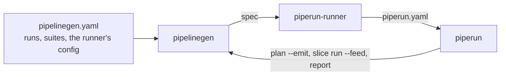

# piperun-runner

piperun-runner is the runner plugin for
[pipelinegen](https://github.com/sideways-works/pipelinegen), which runs
only the test slices a change can break. It turns the runs and suites of a
repository's `pipelinegen.yaml` into that repository's `piperun.yaml`, one
pipeline per run. `pipelinegen pipeline` calls it.

The file is static: the slices a run selects never appear in it. Each
run's planning job writes piperun's emission of its plan, and piperun
expands it into the suites' jobs from the templates the file declares.



## What it writes

For each run, a pipeline with two jobs that plan and, per suite of the
run, the templates piperun expands:

| Job or template | What it runs |
|---|---|
| `plan` | `pipelinegen plan --out`: the change's code (Bazel, the planner's prepare, the plugins) with the read token alone, writing nothing remote. Its plan goes on as an artifact. |
| `plan-write` | `pipelinegen plan --from --emit`: pinned, with the store and report tokens, running none of the change's code. It writes the plan's record and the statuses, and emits the templates below. |
| `<suite>-prepare` | `pipelinegen slice prepare`, when the suite has a prepare step. |
| `<suite>-slices` | The pool of the suite's selected slices, longest first. Each session runs `pipelinegen slice run --feed`, and its pinned `finally` step writes the confirmed slices' ends and closes what is left (`report batch-end`). The session runs the change's code and holds no writing token, so the slices show as each session ends, not one by one. |
| `<suite>-end` | `pipelinegen report suite`, once the pool and the prepare have ended, however they did. |

A step that runs the change's code (the first plan step, the prepare and
the sessions) holds at most the read token and the suite's own secrets;
the writing tokens go only to pipelinegen's own pinned steps. Every job
has a time limit: the plan's `limits.plan`, a suite's minutes, and
`limits.steps` for bookkeeping.

Triggers follow the run's: a branch watches the branch, a continuous run
adds `mode: continuous`, a timer is a `cron` trigger at its start with its
stop as the window (piperun builds a commit only once, so an unchanged
commit isn't run again), and a manual run is `manual`.

## The config

pipelinegen hands the runner its plugin entry's `config`; a config whose
runner is piperun-runner needs no `concourse` section (the runner reports
`own-settings`, from pipelinegen v0.9.1).

```yaml
plugins:
  - name: piperun
    kind: runner
    repository: sideways-works/pipelinegen-plugins
    path: runner/piperun
    release: {version: v0.1.0, sums: <sha256 of SHA256SUMS>}
    config:
      resource: {name: source, remote: https://github.com/example/shop.git, credential: github_read}
      images:
        golang: {ref: golang:1.27.4, digest: sha256:...}
      planner: {image: golang, needs: "w.labels.includes('trusted')"}
      needs: {default: "w.memory.total >= 8 * GiB", e2e: "w.memory.total >= 16 * GiB"}
      caches: {go: {gomod: /go/pkg/mod, gobuild: /root/.cache/go-build}}
      secrets: {from: sealed}
      pipelinegen: {version: v0.9.1, sums: <sha256 of SHA256SUMS>}
```

| Key | What it is |
|---|---|
| `resource` | The repository's `git` resource: its `name` (default `source`), `remote`, and the `credential` secret piperun clones with |
| `images` | The images steps run in, by the names the suites' `image` and the planner give, each with its `ref` and `digest` |
| `planner` | The planning and bookkeeping steps' `image` and `needs` rule |
| `needs` | piperun's `needs` rule per suite, `default` for the rest |
| `caches` | Per suite, the caches its steps mount: name to absolute path |
| `pipelinegen` | The pipelinegen release piperun mounts into pipelinegen's steps: `version` and one of `sha256` or `sums`, and `repository` (`sideways-works/pipelinegen` by default). A config with a `concourse` section may leave it to `concourse.planner.bootstrap` |
| `secrets.from` | Where piperun finds the tokens: `sealed` (the default), `env` or `file`; each token's key is its var's name in `pipelinegen.yaml` |

The runner reads the config strictly: a key it doesn't know is an error.

## What can't run on piperun yet

The runner refuses these by name rather than write a pipeline that would
not do what the config says:

- a suite of task files (`run_slice`): on piperun a suite runs by its
  drivers' `steps`;
- a suite with whole-suite checks, which are Concourse tasks;
- a pull request's or a forge's run: pipelinegen reads a change from
  Concourse's resource files so far;
- pipelinegen pinned by commit or zip: piperun mounts released tools only.
