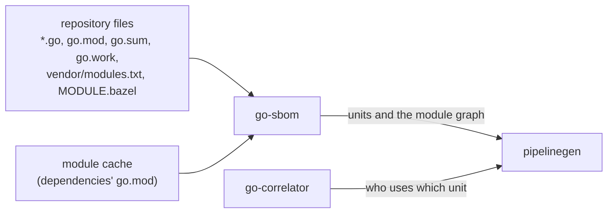

# go-sbom

go-sbom is an sbom plugin for
[pipelinegen](https://github.com/sideways-works/pipelinegen), which runs
only the test slices a change can break. It lists what exists in a Go
repository, each thing as a unit with an id and a digest:

- every top-level declaration of the repository's own Go code, test files
  included, as `go:<package directory>#<kind>:<name>`;
- every module the code depends on, as `dep:go:<module>`, with its version
  and checksum in the digest;
- the toolchain: the `go` and `toolchain` directives and the Go SDK that
  Bazel downloads.

It records what exists. Which code uses a declaration or a module, and
which declarations a test ran, is left to
[go-correlator](../../correlator/go), which names units through go-sbom's
`goid` package, so the two always agree. A repository configures the two
together.

go-sbom only reads files. It never runs the go command, never type-checks
and never touches the network. A backend of about 20,000 declarations
takes a few seconds.



## An example

A package `internal/notes` declares a type `Note` and a function `Create`.
A change that only rewords a comment in `notes.go` changes no digest, so
it selects no slice. A change to the body of `Create` changes the digest
of `go:internal/notes#func:Create` alone, and only the slices bound to
`Create` run.

Adding a method `MarshalJSON` to `Note` changes the digest of
`go:internal/notes#type:Note`, because a type's digest holds its method
set: code that hands a `Note` to `json.Marshal` may now behave
differently. A bump of `golang.org/x/text` in `go.mod` and `go.sum`
changes the digest of `dep:go:golang.org/x/text`, which reaches the slices
whose binaries link that module.

## Setting it up

Name the plugin in `pipelinegen.yaml` next to go-correlator, pinned by a
release and its checksum:

```yaml
plugins:
  - repository: https://github.com/sideways-works/pipelinegen-plugins
    with:
      - name: go
        kind: sbom
        path: sbom/go
        release: {version: v0.4.0, sums: …}
```

`sums` is the checksum of the release's `SHA256SUMS`, so one pin serves
every platform and each binary is checked by its own line of that list.
To pin one binary alone, put `sha256:` with its line
(`go-sbom-linux-amd64`) in place of `sums`.

A new pin selects nothing by itself. List `pipelinegen.yaml` under
`everything_on`, so that a pin change, like any other change to the
config, runs every slice. Usually nothing more is needed.

### The files it claims

`describe` names the candidates `**/*.go`, `**/go.mod`, `**/go.sum`,
`**/go.work`, `**/go.work.sum`, `**/vendor/modules.txt` and
`MODULE.bazel`. `detect` claims each from its path and content alone:

| File | Role |
|---|---|
| a `.go` file with a `package` clause | `source` |
| a `.go` file whose header says `// Code generated ... DO NOT EDIT.` before the clause | `generated` |
| `go.mod`, `go.work` | `manifest` |
| `go.sum`, `go.work.sum`, `vendor/modules.txt` | `lockfile` |
| `MODULE.bazel` that downloads a Go SDK (`go_sdk.download(`) | `directive` |

It never claims files under `testdata`, `vendor` (except
`vendor/modules.txt`) or `node_modules`, or under a directory whose name
starts with `.`, `_` or `bazel-`. The modules it lists are the ones that
hold a claimed file. The `include` and `exclude` patterns of the plugin's
entry widen or narrow that.

### Config

Every key is optional and overrides what the plugin would find or assume.

```yaml
    config:
      modules: [backend]
      build: {goos: linux, goarch: amd64, cgo: false, tags: [pipelinegen_cover, integration]}
      gomodcache: /cache/gomod
      digest_from: [...]
```

| Key | Default | What it does |
|---|---|---|
| `modules` | the modules that hold a claimed file, else every `go.mod` of the tree | lists only these module directories |
| `build` | linux, amd64, cgo off, the tag `pipelinegen_cover` | which files the build constraints keep; it must be the same as go-correlator's |
| `gomodcache` | `GOMODCACHE`, which pipelinegen points at the shared `gomodcache` cache; else `GOPATH/pkg/mod`, else `~/go/pkg/mod` | where the dependencies' `go.mod` files are read |
| `digest_from` | none | gives matching variables their digest from other units; see [Digests taken from other units](#digests-taken-from-other-units) |

go-sbom never reads the build context from the machine it runs on, so a
laptop and a CI worker give the same answer for the same files, and
pipelinegen can share answers between machines. The default tag
`pipelinegen_cover` is the one coverage builds set, so the file that links
go-correlator's `cover` package is read like any other.

### Toolchain and caches

go-sbom needs no toolchain: `describe` declares no `needs`. It declares
the cache `gomodcache`, which the runner keeps with the planning job, and
reads only the dependencies' `go.mod` files from it. It downloads nothing.
The planning job's prepare command fills the cache with `go mod download`
in each module. A build leaves the modules it compiles in the cache, but
the module graph also reads the `go.mod` of modules no package imports,
which only `go mod download` (or `go mod download -json all`) fetches.

## What it produces

go-sbom answers `units` in sets: one per package directory and one for the
dependencies. pipelinegen caches each set by the content of its inputs.

### Declaration ids

Plugins that name Go declarations import
`github.com/sideways-works/pipelinegen-plugins/sbom/go/goid`, so every
plugin names a declaration the same way. The format changes only with a new major
version of this module.

An id is `go:<package directory>#<kind>:<name>`. The package directory is
relative to the repository's root, with forward slashes, and `.` for the
root itself.

| Declaration | Id |
|---|---|
| function | `go:internal/notes#func:Create` |
| method | `go:internal/notes#method:Note.Title`, by its receiver's type name, never with `*` |
| method of a generic type | `go:internal/notes#method:List.Push` (the type parameters are dropped) |
| `init` | `go:internal/notes#init:notes.go:1`, by file and its order in the file |
| type | `go:internal/notes#type:Note` |
| constant or variable spec | `go:internal/notes#const:Max`, `go:internal/notes#var:a,b` (all of a spec's names, in order) |
| blank variable (`var _ = ...`) | `go:internal/notes#var:_:notes.go:2`, by file and order |
| in a `_test.go` file of the package | the name ends in `@test`: `go:internal/notes#func:newServer@test` |
| in an external test package (`package notes_test`) | the name ends in `@xtest` |
| a type with methods as declared, without its methods | `go:internal/notes#typedecl:Note`, next to `#type:Note`; in a test file `#typedecl:env@test` |
| one method's receiver, name and signature, without its body | `go:internal/notes#methodsig:Note.Title`, for every method of a type outside the test files (one declared in a test file ends in `@test`) |
| a file the build constraints leave out, or any Go file of a package where a file doesn't parse | `go:internal/notes#file:notes_windows.go` |
| what other packages can read of a package | `go:internal/notes#api:notes`, by the package's name |

Each unit also carries a `label`, its name as a developer would write it,
which `pipelinegen why` prints: `notes.Create`, `notes.Store.Get`,
`package notes init (notes.go:1)`, `notes.env (test)`, `the module
github.com/x/y@v1.2.0`. A label is at most 80 characters and the same on
every machine, and nothing hashes, caches or compares it.

An id names the file only where Go allows repeats (`init`, blank
variables), so moving any other declaration to another file of the same
package keeps its id. A generic declaration's instances share its id.
Closures, function literals and local declarations belong to the
declaration they sit in, and a struct field or an interface method
belongs to its type's declaration.

`goid.File` lists a parsed file's declarations with their ids.
`goid.Index` maps a position, or a `go/types` object, to the declaration
that holds it.

### What a declaration's digest covers

A digest changes when what the compiler reads of a declaration can
change, and stays the same when only comments, blank lines or line breaks
change. It hashes the declaration's syntax tree (node kinds, names,
literals and operators, never positions or comments) and also covers:

- the `//go:` directives above the declaration;
- for a type, the name, receiver and signature of each of its methods,
  whichever file of the package holds them. An added `MarshalJSON` changes
  the type's digest; a changed method body changes only that method's
  digest. While `unexported-methods` is on, an unexported method whose
  name no interface, field or other method of the package bears stays out
  of it (see Narrowings);
- for a constant in a group, the expression it repeats and its index when
  the group counts with `iota`. Inserting a constant changes the values of
  those after it, and their digests with them;
- for a variable with `//go:embed`, the content of the files it embeds;
- the import path behind each imported name the declaration uses. With an
  alias the path is known. Without one, go-sbom guesses the name from the
  path's last element (`math/rand` gives `rand`, `github.com/x/pgx/v5`
  gives `pgx`, `gopkg.in/yaml.v3` gives `yaml`). Where it can't guess
  (`github.com/x/weird-name.io`), every declaration with a selector that
  matches no import takes that path. A wrong guess, or a local variable
  that shares an import's name, only over-selects: the declaration's
  digest then changes with an import it doesn't use;
- a predeclared name (`len`, `error`, `max`) that the package declares
  itself. Every declaration that uses the name gets the shadowing in its
  digest, so adding `func len` to a package changes its callers' digests.
  A local variable of that name over-selects the same way.

Each package with Go files outside its tests also gets an `api` unit. Its
digest changes exactly when something changes that another package's
type check or links can depend on. It covers the package's name, every type
and constant in full, each function's and method's signature (type
parameters and constraints included) with whether its body is absent,
empty or has statements, and each variable's names and type, or the whole
spec when the initialiser decides the type. It leaves out function bodies
beyond that, test files, files the build leaves out, the content of
embedded files, inits and blank variables, and whether an initialiser
acts when the package starts, which only changes what the package itself
binds. So an edit inside a body that keeps it non-empty changes the
function's unit and not the package's `api`, and a correlator that keys
an importer's answer on the `api` units it reads is not asked again.

A package is the smallest set its answer depends on: a type's methods and
the package's top-level names come from all of its files, and embedded
files sit next to them. The set's inputs are the package directory's Go
files plus the files its embeds match. Reading a package needs no type
check.

A package whose declarations the analysis can't follow has its set marked
`"whole": true`. The reasons are cgo, `go:linkname`, a function without a
body, reflection by method or field name, assembly or other non-Go files,
and files the build constraints leave out. A file the constraints leave
out is one unit of its own, digested by its content: its declarations
aren't compiled in the build the tests run, but another build may compile
them.

A package where a file the build keeps doesn't parse is whole too, and
every Go file of it is one unit of that kind, since its declarations
can't be read. Its set marks each of those units under `cannot_tell`, with
the reason ("package internal/notes does not build with tags
[pipelinegen_cover]: notes.go:3:14: ...; tests that reach it run on every
change until it builds or is excluded"), so pipelinegen binds what reaches
them wide. The rest of the tree is answered as usual.

### A type's parts

A type with methods comes in three kinds of unit, so that a correlator can
bind each test to what it can observe of the type:

- `type:T` is the declaration with every method's receiver, name and
  signature: what code that hands a `T` to an interface or to reflection
  depends on;
- `typedecl:T` is the declaration alone: its fields, their tags, its
  embedded types, its type parameters. A new field changes it, a new
  method doesn't;
- `methodsig:T.M` is one method's receiver (value or pointer), name and
  signature, without the body: what an interface it satisfies, or a call
  that resolves to it, reads of it. A body edit changes `method:T.M` alone;
  a receiver turned into a pointer, or a parameter's type, changes both.

The ids key a method by its receiver as written, without `*` and type
parameters, so a method of an alias (`type Cash = Amount`) is
`methodsig:Cash.M`. An interface type has no methods of its own to list:
its methods are part of its declaration, and a new one changes `type:I`,
since it changes which types satisfy it. Methods a type gets by embedding
are not listed on it: they are the embedded type's, reached through the
embedding in `typedecl:T`. A test type gets `typedecl:T@test` and no
`methodsig` units: go-correlator binds a test type by the methods its
tests call.

### Digests taken from other units

A variable can hold something much larger than its declaration. Generated
API servers keep the whole contract in one variable (`swaggerSpec`, and
`rawSpec` built from it at start-up), so its digest changes with every
edit to the contract, and since start-up reads it, every slice depends on
it. Such a variable can take its digest from other units instead, so the
plugin that knows the contract decides what an edit reaches.

[oapi-codegen-correlator](../../correlator/oapi-codegen)
reports this relation for code that oapi-codegen generated. For other
cases, the config's `digest_from` says it by hand:

```yaml
config:
  digest_from:
    - units: ["go:*#var:swaggerSpec", "go:*#var:rawSpec"]
      from: ["api:api/notes.yaml#/servers", "api:api/notes.yaml#/openapi"]
```

`units` are declaration ids in which `*` stands for any run of characters.
A matching declaration carries `digest_from` with the listed ids and no
digest of its own, so it changes exactly when those units change.

### Dependencies

Each module the code depends on is a unit `dep:go:<module path>`, with the
path exactly as go.mod writes it, so `github.com/jackc/pgx/v5` is a module
of its own. The id never holds the version. The digest holds what is
built:

- the version go.mod requires. Since Go 1.17, go.mod lists every module
  that provides a package to the main module's packages and tests, so
  go-sbom knows the version without the module cache or a version
  selection;
- the h1 checksum of that version's zip, from go.sum. The `/go.mod` lines
  don't count, so a `go mod tidy` that only adds those changes no digest;
- for a module that a `replace` points elsewhere, the replacement's path,
  version and checksum. The id stays the original's.

The same facts are in each unit's `attributes`: `version`, `h1`,
`indirect` and `replaced_by`.

Some modules get no unit. A module replaced by a directory (`=> ../lib`),
a module that another go.mod of the tree declares, and every module a
`go.work` uses are first-party code, and their declarations are units of
their own.

A `go.work` builds one version of each module, the highest any of its
modules requires, and go-sbom digests that one. Main modules without a
workspace each build their own version, so the digest covers each main
module's choice. A bump in one of them then reaches the users of that
module in all of them, a small over-selection. When a module has
`vendor/modules.txt`, the modules it lists that go.mod doesn't are added
at their vendored version.

The toolchain has three units, of kind `toolchain`:

| Unit | From |
|---|---|
| `dep:go:go` | the `go` directive of each main module and go.work |
| `dep:go:toolchain` | their `toolchain` directive, when there is one |
| `dep:go:bazel_sdk` | `go_sdk.download(version = ...)` in MODULE.bazel |

pipelinegen treats a toolchain unit as reaching everything compiled with
it, and samples instead of running every test.

### The module graph

The dependency set's links are the module graph: `dep:go:A` requires
`dep:go:B` when A's own go.mod, read from the module cache, requires B.
go-sbom reads `$GOMODCACHE/cache/download/<module>/@v/<version>.mod`.
The links carry the narrowing `module-graph` with `"while": "off"`, so one
cached answer serves every level and pipelinegen drops them while the
narrowing is on.

### When it can't tell

When pipelinegen passes no claimed files and the walk finds no `go.mod`,
`units` and `document` answer "can't tell" (exit 3) and say so on stderr,
because an empty answer there would tell pipelinegen that every Go unit
of the tree is gone.

A module whose go.mod isn't in the module cache is listed under
`cannot_tell` with the reason, never as a module without requirements,
and the answer is marked `"cacheable": false`. Since the answer then
depends on the module cache as well as on the tree, the next plan asks
again; until then pipelinegen binds that module wide.

## Narrowings

pipelinegen's level decides which narrowings are on: a narrowing is on at
every level below its "off from" level and off from that level up, and
with it off the wide rule applies.

| Narrowing | Off from level | Narrow rule | Wide rule | What it can miss |
|---|---|---|---|---|
| `unexported-methods` | 5 | an unexported method whose name no interface, struct field or other method of the package bears stays out of its type's `type:T` digest: adding, removing or renaming such a helper changes the method and its signature unit, which bind the tests that call it, and not every test that uses the type | the type links to the signature of each such method, so a test bound to the type is bound to them all, as when they were in its digest | nothing. An unexported method is seen only by its own package: reflection and templates see exported methods alone, and an unexported name in another package is another name. In its package it can matter beyond a call that names it in two ways only: an interface declaring the name (a type may now satisfy it, also through an embedding, also an interface in a function body or a test file), and a selector through an embedding that now resolves to it (which needs another method or field of the same name somewhere in the package). Either keeps the method in the digest. A call naming the method is new or changed code itself, or it ran the old method, and is bound through that |
| `module-graph` | 5 | a slice binds only the modules its code links, through go-correlator | a slice bound to a module is also bound to every module that module's go.mod requires, transitively | nothing next to go-correlator, which links each package to the module of every package it imports, transitively, imports made by other modules' packages included. A module that another module's go.mod requires, but whose packages nothing imports, isn't compiled into any binary and can't change a result. Without go-correlator nothing links code to modules, so keep this narrowing off |

With go-correlator in place, the module graph only adds runs. A bump of a
text library would select everything that uses a database driver, even
where the driver never imports it. pipelinegen's ladder switches the
narrowing off at the same level as go-correlator's `module-bumps`.

## What it can't see

- Code generated at build time that isn't in the tree.
- Which code uses a module or a declaration: that is go-correlator's job.
- Modules that only another module's go.mod requires, when that go.mod
  isn't in the module cache (`cannot_tell`).
- Licences. The bill of materials holds versions, checksums and the graph
  only.

## The calls

The requests and answers follow pipelinegen's
[plugin protocol](https://github.com/sideways-works/pipelinegen/blob/main/docs/plugins.md).
What is particular to go-sbom: its capabilities are
`detect`, `units` and `document`; its namespaces are `go` and `dep:go`;
`inputs` declares `detect` per file and `units` and `document` per set.

### `detect`

```sh
echo '{"protocol": 1, "work": "w", "tree": ".", "paths": ["api/server.gen.go", "go.mod"]}' | go-sbom detect
```

```json
{"claims": [{"path": "api/server.gen.go", "role": "generated"},
            {"path": "go.mod", "role": "manifest"}]}
```

### `units`

```sh
echo '{"protocol": 1, "work": "w", "tree": ".", "paths": ["internal/notes/notes.go"]}' | go-sbom units
```

```json
{"sets": [
  {"group": "internal/notes",
   "inputs": ["internal/notes/notes.go", "internal/notes/notes_test.go"],
   "units": [{"id": "go:internal/notes#func:Create", "group": "internal/notes",
              "digest": "9f2c...", "file": "internal/notes/notes.go",
              "kind": "func", "executable": true}],
   "links": []}
]}
```

Without `paths` it answers the whole tree. With `paths` it answers only
what those files can change:

- a Go file: its package. A deleted package answers an empty set, so the
  cached one is dropped;
- any other file: each package above it in its module, since a package
  may embed it;
- `go.mod`, `go.sum`, `go.work`, `go.work.sum`, `vendor/modules.txt` or
  `MODULE.bazel`: the dependency set.

The tree may be a symlink: go-sbom reads the directory it points at.
Symlinks inside the tree are left alone, as the go command leaves them
alone for `./...`.

### `document`

The same request gives a CycloneDX 1.6 bill of materials. Each module
appears with its version, a `pkg:golang` purl and its go.sum checksum as
the property `go:h1`. The h1 checksum is a hash over the module's file
list, not over one file, so it isn't given as a CycloneDX hash. Each main
module lists what its go.mod requires, and each dependency lists the
modules its own go.mod requires. A module whose go.mod isn't in the
module cache gets no `dependencies` entry, which CycloneDX reads as
"unknown".

## Developing

`bazel run //sbom/go:test` runs the tests and `bazel run //sbom/go:lint`
the lint, with the Go, golangci-lint and Node the repository pins in
`MODULE.bazel` ([CONTRIBUTING](../../CONTRIBUTING.md)). The tests use no
network and no module cache of yours: their trees and caches are
fixtures in temporary directories.

pipelinegen's conformance kit calls the go-sbom you built the way
pipelinegen does, on the fixture tree in `testdata/kit`, and checks
every answer against the protocol. The commands below run it from this
directory with the pipelinegen that `tools/go.mod` pins. The go on your
`PATH` must be at least as new as `go.mod` asks.

```sh
go build -trimpath -o go-sbom ./cmd/go-sbom
go -C ../../tools tool pipelinegen plugin test "$PWD/go-sbom" --tree "$PWD/testdata/kit"
```

The ids in `goid` are what other plugins import to name a declaration,
so their format changes only with a new major version of this module.

`bazel run //sbom/go:release` releases it from a tag `sbom/go/vX.Y.Z` on
`main`, as [CONTRIBUTING](../../CONTRIBUTING.md#releases) describes:
static `go-sbom-linux-amd64`, `-linux-arm64`, `-darwin-amd64` and
`-darwin-arm64`, `plugin.json` (its own `describe` answer), `LICENSE`,
`NOTICE` and `SHA256SUMS`. Its first release here is `v0.4.0`
([RELEASING](../../RELEASING.md)), and a published release never
changes.

A change to what go-sbom answers comes with its docs, so this README
describes go-sbom as it is on `main`.
