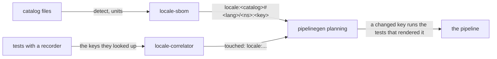

# locale-sbom

locale-sbom, from the repository
[pipelinegen-sbom-locale](https://github.com/sideways-works/pipelinegen-sbom-locale),
tells [pipelinegen](https://github.com/sideways-works/pipelinegen)
what the message catalogs of a repository hold: the JSON files an i18next
app or a Go lookup takes its texts from. It lists each key of each
namespace in each language as a unit whose digest is the key's meaning.
With [locale-correlator](https://github.com/sideways-works/pipelinegen-correlator-locale),
which records the keys each test looked up, a change to one key runs the
tests that rendered that key. Without them, every test whose Bazel target
names a catalog runs.

It reads files and answers JSON. It starts nothing and connects to nothing.



## What a catalog is

A directory with one file per language (`<catalog>/<lang>.json`) or one
directory per language with one file per namespace
(`<catalog>/<lang>/<ns>.json`). `<lang>` is a language tag whose language
is a two-letter ISO 639-1 code (`de`, `pt-BR`, `zh_Hant`, `es-419`) or one
of a short list of three-letter ones (`fil`, `yue`, ...). The catalog, or a
directory above it, is named `locales`, `locale`, `i18n`, `lang`, `langs`
or `translations`. Those names are the candidates; a plugin entry's
`include` adds others, and `exclude` takes some out.

A candidate is claimed when its content is a JSON object whose values are
strings, objects and arrays of them. JSON of another shape (a number, a
boolean, `null`, a list at the top) is no catalog and stays unclaimed. A
file laid out as a catalog that is no JSON at all is claimed, and its
units can't tell (below).

Never claimed: a path outside the tree, under `.git`, `node_modules`,
`dist` or `bazel-*`; anything that looks like a secret (`.env*`, keys and
certificates, names holding "secret", "token" or "password", anything in a
directory named `secret`, `secrets`, `credentials`, `.ssh`, `.aws` and
their kin); a symlink. Each claim has the role `catalog`,
`by_units: locale-keys` and the anchor `locale:<catalog>`, the catalog's
own unit.

The anchor is what lets pipelinegen narrow a catalog that a test reaches
inside a filegroup or another rule (an app's files, its shell), not only
through a label naming the file. locale-correlator puts the catalog's
unit in a slice's list whenever its recorder ran for that catalog. For a
slice whose list holds it, the core replaces every path to a changed file
of the catalog by the keys the slice looked up there; a slice without it
keeps every path, since nothing recorded what it read.

## The ids

| Id | What it is | Its digest changes |
|---|---|---|
| `locale:<catalog>` | the catalog itself; a recording that holds it says a recorder ran for this catalog | never (it goes when the catalog does) |
| `locale:<catalog>#<lang>` | the language being there | never (it comes and goes with the language) |
| `locale:<catalog>#<lang>/<ns>` | the namespace file being there | never (it comes and goes with the file) |
| `locale:<catalog>#<lang>/<ns>:<key>` | one key's meaning | when the decoded value changes |

`<ns>` is `-` for the one-file-per-language layout. `<key>` is the key's
path joined by dots, as i18next spells a key (`cart.items_one`,
`booking.lines.0`). A key that holds an object or an array is a unit too,
its digest that of everything below it: a lookup with `returnObjects`, or a
Go lookup that takes a whole template, binds it. The empty key
(`...#de/home:`) is the whole namespace. A flat key `"a.b"` and a nested
`a.b` are one unit, since i18next finds either for `a.b`.

A digest is the key's meaning: the decoded value, written one way. Key
order, indentation, a trailing newline, an escape against the literal
character it stands for (`é` and `é`) and moving a key within the file
change no digest. Any change to a value does, a space included, since a
test may compare it.

## What each change does

| Change | Units | Which tests can observe it (with locale-correlator) |
|---|---|---|
| layout, key order, escapes | none | none |
| a value changed | that key, its parents, the whole namespace | the tests that rendered the key in that language, a fallback included |
| a key added that nothing looks up | the new key, its parents | none; and every test whose recorded probe missed that key in that language, since a miss that now hits changes what it renders |
| a key removed | the key goes | the tests that looked it up |
| a plural or context variant added or removed (`_one`, `_male`) | the variant comes or goes | the tests whose probe missed or hit that variant |
| a whole language added or removed | the language, its namespaces and keys | the tests that ran in it or fell back through it |

Each row has a test: `TestWhatEachChangeDoesToTheUnits` here for the
units, `TestWhichTestsSeeAChange` in locale-correlator for the tests.

## What it can't tell

A claimed file that is no JSON: `units` exits 3 for the call and says which
file on stderr, and every file asked about binds as a whole to the slices
that could reach it.

What the units can't carry, because nothing records it:

- text a test reads from a catalog other than through a recorded lookup:
  a test that parses the file (`os.ReadFile`, `readFileSync`) or ranges over
  the map the catalog was loaded into. Such a reader needs a declaration
  that keeps its path to the file (see the correlator's README);
- a catalog loaded by a process without a recorder: it holds no catalog
  unit, so its paths to the file stay as they are, which is wide and safe.

## Scale

Measured on a repository with three catalogs (12 languages of 4 web
namespaces, 2 console languages, 12 mail languages), 52 files, 6.8 MB:
130,682 units (111,288 keys, 18,313 objects, 52 namespaces, 26 languages,
3 catalogs) in 4,893 groups, a 30.7 MB answer (3.5 MB gzipped) in 0.8 s. A
digest is 128 bits and key units carry no label, which keeps the answer to
about 235 bytes a unit. The core's cache keys each file's set by its blob,
so a plan asks again only about the files that changed.

That is about six times the 20,000 units the core assumes. In
pipelinegen's planner on that tree, beside go-sbom and go-correlator for
one Go package, a warm plan took 26.6 to 35 s against 19.6 to 21 s
without this pair, and the planner's peak memory rose from 31 to 125 MB to
486 to 701 MB (a loaded machine; see locale-correlator's README). The
answers are 39 MB uncompressed in the core's answer cache, and a commit
that changes a catalog file adds that file's answer anew, about 2 MB for a
web namespace of one language: the weekly cache ref grows by that much per
changed file until the core compresses its entries.

## Setting it up

```yaml
plugins:
  - name: locale
    kind: sbom
    repository: sideways-works/pipelinegen-sbom-locale
    release: {version: <tag>, sha256: ...}
  - name: locale-uses
    kind: correlator
    repository: sideways-works/pipelinegen-correlator-locale
    release: {version: <tag>, sha256: ...}
```

## Narrowing

`locale-keys`, off from level 3: a slice that depends on a catalog file
depends on the keys it was seen to look up, in each language, misses
included. It misses text a test takes from the file other than through a
recorded lookup.

## Calls

`detect` claims as above, per file. `units` answers per set: one set per
catalog file (the namespace being there and every key), and one per catalog
whose inputs are all its files (the catalog and its languages), so a file
added or removed asks again about the catalog's set. An answer of more than
2,000 units goes into `sets.jsonl` in the work directory.

## Development

```sh
go build -trimpath -o locale-sbom ./cmd/locale-sbom
go test ./...
PIPELINEGEN=/path/to/pipelinegen go test ./cmd/locale-sbom -run TestKit
pipelinegen plugin test ./locale-sbom --tree testdata/kit
golangci-lint run ./...
```

How it was tested:

- unit tests for every rule above: layouts and language tags, ids and
  groups, digests by meaning (layout, order, escapes), a changed value
  changing only its key and its parents, flat and nested keys, the shapes
  that are no catalog, paths outside the tree, secrets, symlinks;
- a golden test of the `units` answer and a determinism test;
- a test per kind of change (`TestWhatEachChangeDoesToTheUnits`), an
  answer about one path agreeing with the whole tree's, a deleted file
  answering an empty set, an unreadable catalog exiting 3, a large answer
  going into a file;
- the conformance kit on `testdata/kit` with pipelinegen built from main,
  every check passing, its cache checks included;
- on a copy of an adopter's tree, as measured under Scale.
