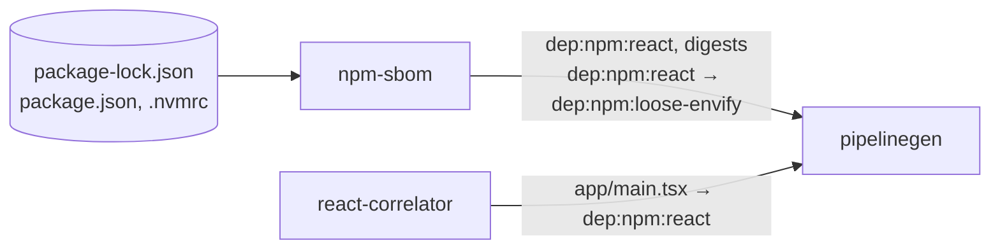

# npm-sbom

npm-sbom is an sbom plugin for
[pipelinegen](https://github.com/sideways-works/pipelinegen), which runs
only the test slices a change can break. It lists what an npm workspace
installs: every package with its resolved version and checksum, the
dependencies between packages, and the Node and npm versions the workspace
declares.

It records what exists. Which source file loads which package is for
[react-correlator](../../correlator/react) to know: it links files to the
`dep:npm:` units listed here.



## An example

A workspace's `package-lock.json` installs `react` and `loose-envify`,
which `react` depends on. A source file `app/main.tsx` imports `react`,
and react-correlator links it to `dep:npm:react`.

A lockfile change that bumps only `loose-envify` changes the digest of
`dep:npm:loose-envify`. npm-sbom's link from `dep:npm:react` to
`dep:npm:loose-envify` carries the change to everything that loads
`react`, so the tests bound to `app/main.tsx` run, and tests whose code
loads neither package don't. A bump of `vite` is a toolchain bump instead,
and pipelinegen samples every suite that builds with it.

On a real repository of about 900 source files, most of about a hundred
lockfile changes bumped one package. Bumps of a UI library that most of
the code imports each reached about a quarter of the source files, and
every test bound to those files ran. Outside those bumps, the median
change reached 2 source files. Changes to development tooling (a Markdown
linter) reached none, and two changes that included toolchain packages
were sampled.

## Setting it up

Name the plugin in `pipelinegen.yaml`, pinned by a release and its
checksum:

```yaml
plugins:
  - repository: https://github.com/sideways-works/pipelinegen-plugins
    with:
      - name: npm
        kind: sbom
        path: sbom/npm
        release: {version: vX.Y.Z, sha256: ...}
```

The checksum is the `npm-sbom-linux-amd64` line of the release's
`SHA256SUMS`. Or pin the release by the checksum of its `SHA256SUMS`
itself, `sums: ...` in place of `sha256`: one pin then serves every
platform, a Mac's binary checked by its own line of the list.
A new pin selects nothing by itself. List `pipelinegen.yaml`
under `everything_on`, so that a pin change, like any other change to the
config, runs every slice.

A lockfile is bound one way only: through this plugin's units, never also
through `everything_on` or `sample_on`. pipelinegen's check refuses a
lockfile in both.

### The files it claims

`describe` names the candidates `**/package.json`,
`**/package-lock.json`, `**/npm-shrinkwrap.json`, `**/pnpm-lock.yaml`,
`**/.nvmrc` and `**/.node-version`. `detect` claims each by its content:

| File | Role |
|---|---|
| `package-lock.json` or `npm-shrinkwrap.json` that holds `lockfileVersion` | `lockfile` |
| `pnpm-lock.yaml` that starts with `lockfileVersion:` | `lockfile` |
| `package.json` that is a JSON object | `manifest` |
| `.nvmrc`, `.node-version` | `node-version`, by its name |

Files inside `node_modules` belong to installed packages and are left
alone. Every lockfile found is read, one per directory: in a directory
with several, `npm-shrinkwrap.json` wins over `package-lock.json`, as it
does for npm, and either wins over `pnpm-lock.yaml`.

### pnpm

A `pnpm-lock.yaml` of version 6.0 (pnpm 8) or 9.0 (pnpm 9 and 10) is read
as pnpm installs it. Each importer's direct dependencies are copies at
`<importer>/node_modules/<name>`, under the name the code imports (an
alias such as `my-react: npm:react@17` is `dep:npm:my-react`). Every
package of the store is a copy at `node_modules/.pnpm/<key>/node_modules/<name>`.
Where each copy loads its dependencies from is read from the lockfile's
snapshots. A package that is imported directly and also sits in the store
has both copies in its digest. So does the real package behind an alias:
a bump of `react@17` behind `my-react` changes `dep:npm:react` too, which
can only select more. A peer dependency links to the version the
snapshot resolved it to.

### Config

Every key is optional and overrides what the plugin would find or assume.

```yaml
    config:
      lockfiles: [package-lock.json]
      toolchains: [typescript, vite, "@vitejs/*", vitest, "@playwright/test"]
      documents: [vendor/bom.json]
```

| Key | Default | What it does |
|---|---|---|
| `lockfiles` | every lockfile claimed | reads only these lockfiles |
| `toolchains` | `typescript`, `esbuild`, `vite`, `rolldown`, `rollup`, `webpack`, `@vitejs/*`, `@swc/*`, `@biomejs/biome`, `eslint`, `prettier`, `@playwright/test`, `playwright`, `playwright-core`, `vitest`, `jest` | the packages that build, check or run code; a list replaces the default, and a pattern ending in `/*` takes a whole scope |
| `documents` | none | CycloneDX or SPDX JSON documents whose npm packages (by their `pkg:npm/` package URL) count too, such as a vendored bundle; a lockfile always wins for a package it lists |

### Toolchain and caches

npm-sbom is a static Go program: `describe` declares no `needs` and no
`caches`. It reads only the tree.

## What it produces

### Units

- `dep:npm:<name>` for every installed package, the name as the
  lockfile's install path writes it (`dep:npm:@scope/pkg`). That is the
  name code imports it by, so an alias (`"my-react": "npm:react@17"`) is
  `dep:npm:my-react`. The digest covers every installed copy: its install
  path, its own name, its version and its integrity. When a package has no
  integrity (a git or file dependency), the digest covers where it was
  resolved from, which holds the commit.
- Two versions of one package in one lockfile are still one unit, whose
  digest covers both copies. A bump of either copy reaches every file that
  imports the name, even one that loads the other copy. That is a small
  over-selection and never a miss. Telling copies apart would need the
  correlator to resolve each import through the `node_modules` tree.
- `dep:npm:toolchain:node` and `dep:npm:toolchain:npm` (or yarn, pnpm),
  from `.nvmrc`, `.node-version`, the manifest's `engines` and its
  `packageManager`. A colon never appears in a package name, so these ids
  can't collide with a package. A version nobody declares gets no unit,
  because no file in the tree says what it is.
- Each unit carries a `label`, which `pipelinegen why` prints: `the
  package react@18.3.1` (every installed version, `js-tokens@2.0.0,
  4.0.0`), `the toolchain node 22.11.0`. A label is at most 80 characters
  and the same on every machine, and nothing hashes, caches or compares it.

Workspace packages (the lockfile's `link` entries and the workspace
directories) get no unit. They are files in the tree, and a change to
them is a change to those files.

Each unit's `attributes` say whether it is `direct` (a workspace's
manifest names it) or only needed by other packages, whether it is
installed for development only (`dev`), and which `versions` are
installed. pipelinegen keeps them for documents and reports; selection
doesn't use them.

A correlator maps an import specifier to its unit by the package name:
`@scope/pkg/sub/path` is `dep:npm:@scope/pkg`, `pkg/sub` is
`dep:npm:pkg`. Node's built-ins (`fs`, `node:fs`) have no unit, and
relative imports and workspace packages are files.

### Toolchains

A bundler, a compiler, a linter or a test runner is a package that builds
or runs code, and the code doesn't load it. A bump of one reaches
every test of everything it builds, which makes it one of the few cases
where running everything is honest. These units have the kind
`toolchain`. pipelinegen samples every suite that uses them instead of
following links, and the nightly run covers the rest.

A package that only a toolchain needs, such as a CSS minifier inside a
bundler, is a toolchain too. Otherwise a bump of the minifier would reach
every test of every app the bundler builds. A package that application
code also loads stays a package.

### Links

Links of kind `uses` go from a package to each package it depends on
(`dependencies`, `optionalDependencies`, `peerDependencies`), resolved the
way Node resolves them: the package's own `node_modules` first, then each
parent's up to the root. An optional dependency the lockfile didn't
install (a binary for another platform) gets no link. A bump of a package
that only another package requires reaches the code that loads that other
package.

These links carry no narrowing. react-correlator links first-party files
to the packages they import and doesn't read into `node_modules`, so
these links are the only way a change deep in the tree reaches the code
that loads it.

### When it can't tell

A version 1 lockfile (npm 6) lists a nested tree instead of install
paths, and a pnpm lockfile before version 6.0 keys its packages another
way, so npm-sbom answers "can't tell" (exit 3) for either and pipelinegen
falls back to the build graph. A tree with no lockfile gets the same answer:
the packages an install puts there are decided when it runs, and no file
shows them. A lockfile that can't be read fails (exit 1).

## Narrowings

npm-sbom declares none. Binding follows what is installed and imported,
and nothing narrower would be sound.

## What it can't see

- What ran. Code in a package runs through callbacks and its own
  start-up, which coverage of first-party code doesn't show, so binding
  goes by what is installed and imported.
- `yarn.lock` and `bun.lock`. A yarn v1 `yarn.lock` is its own text
  format, keyed by every specifier that resolves to an entry, with
  dependencies by range and no install paths. Reading it would mean
  resolving each range against the entries, as yarn does, and laying the
  packages out as hoisting would. A Yarn Berry `yarn.lock` is YAML with
  resolutions and checksums per entry, close to pnpm's. `bun.lock` is
  JSONC with a `packages` map keyed by install path, close to npm's, and
  the older binary `bun.lockb` can't be read at all.
- What an install script downloads (a browser, a native binary). It isn't
  in the lockfile, and it changes only when the package's version does,
  which the digest covers.
- A peer dependency that nothing installed: it gets no link. A peer that
  is installed resolves to what the workspace installed, as npm does.
- An import the code never declared. The toolchain closure goes by
  declared dependencies, so a package installed only because a toolchain
  needs it, but imported by code, looks like toolchain-only. A bump of it
  is then sampled instead of reaching that code's tests. Declaring every
  import (which a linter can enforce) closes this.

## The calls

The requests and answers follow pipelinegen's
[plugin protocol](https://github.com/sideways-works/pipelinegen/blob/main/docs/plugins.md).
What follows is particular to npm-sbom. Its capabilities are `detect`,
`units` and `document`, and its namespace is `dep:npm`. `inputs` declares
`detect` per file, and `units` and `document` per set.

### `detect`

```console
$ echo '{"protocol":1,"tree":".","paths":["package.json","package-lock.json","docs/notes.md"]}' | npm-sbom detect
{"claims":[{"path":"package.json","role":"manifest"},{"path":"package-lock.json","role":"lockfile"}]}
```

### `units`

The units come in one set, because a package that several lockfiles
install is one unit whose digest covers every copy. The set's `inputs`
are the lockfiles, the `package.json` and Node version files beside them,
and the configured `documents`. `units` reads only the lockfiles in
`claimed`, or those the `lockfiles` key names. With `paths` and no
`claimed` it detects them among the paths, and when run by hand with
neither it walks the tree. With `paths`, it answers the set when one of them is
an input or no longer in the tree, and no set otherwise:

```console
$ echo '{"protocol":1,"tree":".","config":{}}' | npm-sbom units
{"sets":[{"group":"npm","inputs":[".nvmrc","package-lock.json","package.json"],
           "units":[{"id":"dep:npm:react","group":"package-lock.json","digest":"9f2c...","file":"package-lock.json",
                     "kind":"package","executable":false,
                     "attributes":{"direct":true,"dev":false,"versions":["18.3.1"]}}, ...],
           "links":[{"from":"dep:npm:react","to":"dep:npm:loose-envify","kind":"uses"}, ...]}]}
```

On a workspace of about 400 installed packages, building the units and
links takes under 10 ms.

### `document`

`document` writes a CycloneDX 1.6 bill of materials: one component per
installed copy with its package URL and its integrity as a hex hash, and
the dependency graph.

## Developing and releasing

The Go version and golangci-lint version are in `.tool-versions`. Before a
push, run `go test ./...` and `golangci-lint run`. The tests run
against a small fixture workspace in `npm/testdata` and need no network.

The conformance kit checks the plugin the way pipelinegen calls it, on
that fixture:

```sh
go build -trimpath -o npm-sbom ./cmd/npm-sbom
pipelinegen plugin test ./npm-sbom --tree npm/testdata/workspace
pipelinegen plugin test ./npm-sbom --tree npm/testdata/pnpm
```

Releases are built and published with `bazel run //sbom/npm:release`,
which runs pipelinegen's release command as its [release
guide](https://github.com/sideways-works/pipelinegen/blob/main/docs/releases.md)
describes. For a tag `sbom/npm/vX.Y.Z` on `main` it publishes static
`npm-sbom-linux-amd64`, `-linux-arm64`, `-darwin-amd64` and
`-darwin-arm64`, `plugin.json` (the plugin's own `describe`), `LICENSE`,
`NOTICE` and `SHA256SUMS`. A published release never changes; a wrong one
gets a new version.

## Developing

The tests and the lint run with the Go, golangci-lint and Node that the
repository pins, as [CONTRIBUTING](../../CONTRIBUTING.md) describes; the
other commands run in this directory.

```sh
bazel run //sbom/npm:test
bazel run //sbom/npm:lint
go build -trimpath -o npm-sbom ./cmd/npm-sbom
pipelinegen plugin test ./npm-sbom --tree npm/testdata/workspace
pipelinegen plugin test ./npm-sbom --tree npm/testdata/pnpm
```

- Tests read the fixture workspaces in `npm/testdata` and use no
  network.
- The last two lines run pipelinegen's conformance kit, which calls the
  npm-sbom you built the way pipelinegen does, on an npm workspace and on
  a pnpm one. Take `pipelinegen` from [its
  releases](https://github.com/sideways-works/pipelinegen/blob/main/docs/tutorial/install.md).
- A change to what npm-sbom lists comes with its docs: the README
  describes npm-sbom as it is on `main`.
