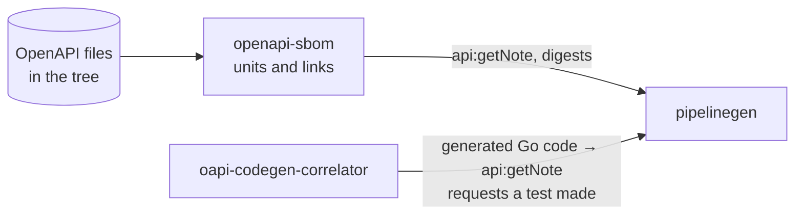

# openapi-sbom

openapi-sbom is an sbom plugin for
[pipelinegen](https://github.com/sideways-works/pipelinegen), which runs
only the test slices a change can break. It lists what an OpenAPI contract
holds: each operation, each shared component and the parts of the
document every operation depends on, each with a stable id and a digest.
The digest changes when what a server or a generated client does can
change. An edit to a description, a summary, a title or an example changes
no digest.

It records what exists. Correlators link these units to the code that
serves or calls each operation:
[oapi-codegen-correlator](https://github.com/sideways-works/pipelinegen-correlator-oapi-codegen)
does it for Go servers that oapi-codegen generated, and also reads which
operations a test requested. Correlators use this repository's `openapi`
package (units, operation names, and the router that maps a request to its
operation), so they name operations the same way this plugin does.



## An example

A contract `api/notes.yaml` has the operations `getNote` and `listTags`,
and a schema `Note` that only `getNote` returns. Adding a property to
`Note` changes the digests of `api:api/notes.yaml#/components/schemas/Note`
and `api:getNote`, and not of `api:listTags`. With a correlator linking
code and tests to operations, only what uses `getNote` runs.

Rewording the description of `getNote` changes no operation's digest, so
it runs nothing while the `doc-text` narrowing is on. Every backend test
that reads the contract file depends on the whole file through the build
graph; while `document-units` is on, pipelinegen replaces that dependency
by the operations each test was seen to touch.

## Setting it up

Name the plugin in `pipelinegen.yaml`, pinned by a release and its
checksum:

```yaml
plugins:
  - name: api
    kind: sbom
    repository: sideways-works/pipelinegen-sbom-openapi
    release: {version: vX.Y.Z, sha256: ...}
```

The checksum is the `openapi-sbom-linux-amd64` line of the release's
`SHA256SUMS`. Or pin the release by the checksum of its `SHA256SUMS`
itself, `sums: ...` in place of `sha256`: one pin then serves every
platform, a Mac's binary checked by its own line of the list.
A new pin selects nothing by itself. List `pipelinegen.yaml`
under `everything_on`, so that a pin change, like any other change to the
config, runs every slice.

### The files it claims

`describe` names the candidates `**/*.yaml`, `**/*.yml` and `**/*.json`.
`detect` reads each one and claims it only when its top level says it is
a contract:

| File | Role |
|---|---|
| YAML or JSON whose top level has `openapi` (or `swagger`) and `paths` (or `webhooks`) | `contract`, with `by_units: document-units` and the files its refs point into in `depends` |
| a file a contract's refs point into | `fragment`, through the contract's `depends` |

Any other YAML or JSON file is left alone. `by_units` lets pipelinegen
bind a test that depends on the contract file itself (as Bazel data, say)
to the units of it the test touched, while `document-units` is on. A
fragment that only another fragment refers to isn't claimed this way, but
`units` reads it as parts all the same when a document reaches it.

### Config

Every key is optional and overrides what the plugin would find or assume.

```yaml
    config:
      documents:
        - path: api/public.yaml
        - path: api/admin.yaml
          prefix: "admin."
        - path: api/common.yaml
      keep_docs: false
```

| Key | Default | What it does |
|---|---|---|
| `documents` | the claimed contracts | files to read whether detection claims them or not, each with an optional `prefix` for its operation ids, needed only when operationIds repeat across documents; a file of shared schemas may be listed too |
| `keep_docs` | false | keeps documentation in every digest at every level, with no documentation units; for a repository whose tests assert on documentation |

### Toolchain and caches

openapi-sbom is a static Go program: `describe` declares no `needs` and no
`caches`. It reads only the tree.

## What it produces

### Units

| Id | What |
|---|---|
| `api:<operationId>` | an operation |
| `api:<file>#/components/<section>/<name>` | a component, in every section of components, used or not |
| `api:<file>#/servers` | the document's servers |
| `api:<file>#/openapi` | the OpenAPI version, the JSON Schema dialect and the top-level extensions |
| `api:<file>#/paths` | the document's routing table: every method and path template its paths serve |
| `api:<file>` | the whole file |
| `api:<file>#/<name>` | a top-level entry of a file that is not a document itself (no `openapi` key) and only holds parts for documents to refer to |
| `api:docs:<id>` | a unit's documentation, of kind `docs` |

Operations are `executable`, since a request log can show one was reached.
Components and top-level parts aren't.

Each unit carries a `label`, its name as people say it, which `pipelinegen
why` prints: `GET /notes/{id} (getNote)` for an operation, `schema Note in
api.yaml`, `request body NewNote in shared/common.yaml`, `the routes of
api.yaml`, `the text of GET /notes/{id} (getNote)` for documentation. A
label is at most 80 characters and the same on every machine, and nothing
hashes, caches or compares it.

### Digests

An operation's digest covers the method and the path template, the path
item's parameters merged under the operation's own, the request body, the
responses and callbacks, the security that applies (the operation's own,
or the document's when it has none), the security schemes that security
names, and every `x-` extension. It also covers the components the
operation refers to, followed through their own refs within the same file.
A change to a shared schema therefore changes exactly the operations that
use it.

An operation's digest also lists the other templates of the document that
can match the same URLs (same number of segments, each segment equal or a
parameter on one side). Adding `/notes/drafts` changes `GET /notes/{id}`,
because a router may now send some of its URLs elsewhere.

### Routes

Every route counts for every operation. A router picks the most specific
pattern that matches, so a route added, removed, moved or given another
method can take requests from an operation whose template looks nothing
like it: Go's `ServeMux` serves `HEAD` with the `GET` pattern unless a
`HEAD` pattern exists, and a pattern ending in a slash serves every path
below it. A real conflict makes the server panic at start-up; shadowing
doesn't. So each document has a routing-table unit, `api:<file>#/paths`,
whose digest is its list of methods and templates, and every operation
uses the routing table of every document in the tree. Several generated
servers may register on one router, and which documents share one can't
be read from the documents, so route changes count across all of them. A
way to declare separate servers can come when someone needs it.

The cost: a commit that adds or moves a route runs every test bound to
any operation. With `document-units` off nothing changes, since every
reader of the document runs anyway.

The whole-file unit's digest covers every unit in the file, so a test that
reads the file as data can depend on it, and a prose edit doesn't run that
test.

Documentation (descriptions, summaries, titles and examples, as written)
is left out of every digest and kept in the `api:docs:` units instead.
What counts as documentation depends on where a key sits. `description` is
dropped from a schema, but a property named `description` inside
`properties` stays. Values under `enum`, `const` and `default` are always
kept as written. Every `x-` key is kept, since extensions often decide
behaviour.

### Links

| Kind | From | To |
|---|---|---|
| `uses` | an operation or a component | every unit it refers to |
| `uses` | an operation | its document's `#/servers` and `#/openapi` units, and the `#/paths` unit of every document |
| `uses` | a whole-file unit | what it refers to in other files |
| `uses` | a unit | its documentation unit, only while `doc-text` is off |
| `changes` | `file:<path>` | every unit of that file: what the file defines |

A file of parts is read on its own. A ref into another file becomes a
link to that file's unit, named by convention (`common.yaml#/Tag` links
to `api:common.yaml#/Tag`). The digest doesn't include the other file; a
change there changes the other file's units, and the link carries it to
the operations that use them.

A contract may list its paths as refs into other files, one file per part
of the API (`/notes: $ref: notes/notes.yaml#/paths/~1notes`), and bundle
them into one file only for its code generators. The plugin reads such a
path item where it is written, through any chain of refs, and makes its
operations the root document's units: the root is what serves them. The
item's own refs are read against its file, so `#/components/schemas/Note`
in `notes/notes.yaml` links to `api:notes/notes.yaml#/components/schemas/Note`.

Only the links to the routing tables depend on which documents exist, so
the documents are answered as one set, and each file of parts as a set of
its own. pipelinegen caches each set by the content of its `inputs`. The
documents' set lists every file the plugin read for it: the documents,
the files their path items live in, and the files their refs point into
(the plugin checks that each target is there). An edit to any of those
files asks about the documents' set again, as well as about the file's
own set.

### When it can't tell

openapi-sbom answers "can't tell" (exit 3) when a ref leads where the
commit can't be read: a remote URL, a file the tree doesn't hold or a path
out of it, or path item refs that form a cycle. The message names the ref
and the file, or the whole cycle. It also can't tell when a root reads a
path item out of another document that is answered too, so both list the
same operation; the message names the operation id and both documents,
and a `prefix` on one of them settles it. pipelinegen then falls back to
the build graph for those files. A ref to a node that isn't there, a file
that isn't YAML, or two unrelated documents sharing an operationId fails
(exit 1).

## Narrowings

pipelinegen's level decides which narrowings are on: a narrowing is on at
every level below its "off from" level and off from that level up, and
with it off the wide rule applies.

| Narrowing | Off from level | Narrow rule | Wide rule | What it can miss |
|---|---|---|---|---|
| `document-units` | 2 | a test that depends on a contract file as a whole (it reads the file from disk, or has a build edge to it) is bound to the operations of it the test was seen to touch | the dependency is the whole file | a test that reads the file whole, unless a correlator says so; then it stays bound to `api:<file>` (oapi-codegen-correlator says so for the code that embeds the document) |
| `doc-text` | 5 | digests leave documentation out | every unit links to its documentation unit | a test that depends on the text: a test of a served document, or an error message built from a description. The nightly run catches it |

oapi-codegen-correlator's links carry the same name, `document-units`,
for the embedded document. A repository whose tests assert on
documentation sets `keep_docs: true` instead of relying on the level.

Measured on a contract of about 600 operations, over its last 60 commits:
an edit changed 3 operations at the median and 100 at most (a pattern
added to a widely shared string schema). 8 of the 60 commits changed only
prose and select nothing. With documentation kept, the same commits
changed about twice as many operations.

## What it can't see

- Other files, in a file's own digest. A change there reaches the
  operations through the links instead.
- Parts of a schema: a ref to one property of a schema binds the whole
  schema. That can only select more.
- Remote refs, missing files and cycles of path items: "can't tell".
  Since every contract is in one set, the whole tree's contracts then have
  no units, and tests that depend on a contract bind the file whole.
- Code that reads documentation at run time. A server that serves its own
  document, or an error message built from a description, depends on text
  this plugin leaves out; see `doc-text`.
- Operation ids across documents. Two documents with the same operationId
  fail the call, since every document is in it; give one of them a
  `prefix`.

## The calls

The requests and answers follow pipelinegen's
[plugin protocol](https://github.com/sideways-works/pipelinegen/blob/main/docs/plugins.md).
This section adds what is particular to openapi-sbom. Its capabilities
are `detect`, `units` and `document`; its namespace is `api`; `inputs`
declares `units` and `document` per set and `detect` per file: a
document's operations may be read out of the files its paths refer to.

### `detect`

```console
$ echo '{"protocol":1,"tree":".","paths":["api/notes.yaml","api/common.yaml","deploy/app.yaml"]}' | openapi-sbom detect
{"claims":[{"path":"api/notes.yaml","role":"contract","depends":["api/common.yaml"],"by_units":"document-units"}]}
```

### `units`

`units` answers the sets that hold the files named in `paths`, which
pipelinegen fills with the claimed files it has no answer for; `claimed`
names every contract, which the contracts' set needs. Run by hand without
`paths` or `claimed`, the plugin detects the contracts in the tree
itself:

```console
$ echo '{"protocol":1,"tree":".","config":{"documents":[{"path":"api.yaml"}]},
         "paths":["api.yaml"]}' | openapi-sbom units
{"sets":[{"group":"contracts","inputs":["api.yaml"],
           "units":[{"id":"api:getNote","group":"api.yaml","digest":"5c1e...","file":"api.yaml",
                     "kind":"operation","executable":true}, ...],
           "links":[{"from":"api:getNote","to":"api:api.yaml#/components/schemas/Note","kind":"uses"}, ...]}]}
```

### `document`

`document` writes a CycloneDX 1.6 bill of materials. Each document is a
service with its servers as endpoints, and each operation is a nested
service with its full URL, its route (`GET /notes/{id}`) and its digest as
properties.

## Developing and releasing

The Go version and golangci-lint version are in `.tool-versions`. Before a
push, run `go test ./...` and `golangci-lint run`. The tests run
against small fixture documents in `openapi/testdata` and need no network.

The conformance kit checks the plugin the way pipelinegen calls it, on
the fixture contract:

```sh
go build -trimpath -o openapi-sbom ./cmd/openapi-sbom
pipelinegen plugin test ./openapi-sbom --tree openapi/testdata/notes
```

Releases are built and published with pipelinegen's `ci/release.sh`, as
its [release guide](https://github.com/sideways-works/pipelinegen/blob/main/docs/releases.md)
describes: static `openapi-sbom-linux-amd64`, `-linux-arm64`, `-darwin-amd64` and
`-darwin-arm64`,
`plugin.json` (the plugin's own `describe`), `LICENSE`, `NOTICE` and `SHA256SUMS`, for a tag
`vX.Y.Z` on `main`. A published release never changes; a wrong one gets a
new version.
