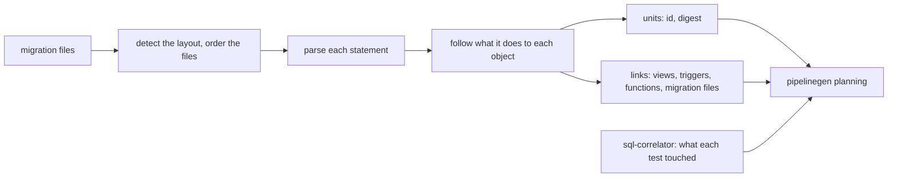

# pg-sbom

pg-sbom is an sbom plugin for
[pipelinegen](https://github.com/sideways-works/pipelinegen), which runs
only the test slices a change can break. It reads a repository's
PostgreSQL migration files and lists the database they build: every table,
view, function, type, sequence and extension, each with a stable id and a
digest, and the links between them.

It parses the files with PostgreSQL's own parser (libpg_query 17, compiled
to WebAssembly by [go-pgquery](https://github.com/wasilibs/go-pgquery), so
no C toolchain is needed). It starts no database, connects to nothing and
needs no container.

It records what exists. Which tests touched which objects is a
correlator's knowledge:
[sql-correlator](https://github.com/sideways-works/pipelinegen-correlator-sql) reads
it from the tests' statement log, and
[gorm-correlator](https://github.com/sideways-works/pipelinegen-correlator-gorm) links
Go code to the tables it reaches through GORM. All of them build ids with
pg-sbom's `pgid` package and read SQL with its `sqlref` package, so they
name things the same way.



## An example

A repository's migrations create the tables `notes` and `tags`. A new
migration adds a column to `notes`. pg-sbom gives the new file a
`changes` link to `pg:table:public.notes` only, and changes that unit's
digest.

Every backend test embeds the migrations, so through the build graph alone
every test would run. While the `migrations-by-table` narrowing is on,
pipelinegen replaces a recorded slice's dependency on a migration file by
the units of that file the slice was seen to touch. The tests that touched
`notes` run; the tests that touched only `tags` don't.

## Setting it up

Name the plugin in `pipelinegen.yaml`, pinned by a release and its
checksum:

```yaml
plugins:
  - name: pg
    kind: sbom
    repository: sideways-works/pipelinegen-sbom-pg
    release: {version: vX.Y.Z, sha256: ...}
```

The checksum is the `pg-sbom-linux-amd64` line of the release's
`SHA256SUMS`. Or pin the release by the checksum of its `SHA256SUMS`
itself, `sums: ...` in place of `sha256`: one pin then serves every
platform, a Mac's binary checked by its own line of the list.
A new pin selects nothing by itself. List `pipelinegen.yaml`
under `everything_on`, so that a pin change, like any other change to the
config, runs every slice.

### The files it claims

`describe` names the candidate `**/*.sql`. `detect` claims migrations, one
file at a time, by their names, in any directory whose `.sql` files hold
schema statements and follow one of these layouts:

| Layout | Files | Written by |
|---|---|---|
| `pairs` | `<version>_<name>.up.sql` and `<version>_<name>.down.sql` | golang-migrate, sqlx |
| `sections` | `<version>_<name>.sql` with marked sections (`-- +goose Up`, `-- migrate:up`), of which only the up section runs | goose, dbmate |
| `flyway` | `V<version>__<name>.sql`, then the repeatable `R__<name>.sql` in name order | Flyway |
| `dirs` | one directory per version holding `migration.sql` | Prisma |
| `numbered` | `<version>_<name>.sql` whose whole text is the change | Drizzle, Atlas |

A file of a pairs, Flyway or Prisma layout is claimed by its name; a plain
numbered file only when it holds a section marker or a schema statement.
Versions are ordered as numbers where they are numbers, so `2` runs before
`10` and `1.9` before `1.10`.

Up files are claimed in the role `migration` with `by_units` set to
`migrations-by-table`, which lets pipelinegen replace a dependency on the
file by the units it defines. Down files, and the parts below a down
marker, never run in a test's database setup, so they make no units:
`detect` claims them as migrations without `by_units`, and a test that
depends on one through the build graph keeps depending on the whole file.

Anything else (a Sqitch plan, files ordered by a list in code, a directory
mixing layouts) isn't read: the directory is reported on stderr and makes
no units, so a test that depends on its files keeps depending on each file
whole.

### Config

Every key is optional and overrides what the plugin would find or assume.

```yaml
    config:
      migrations:
        - {dir: db/migrations, layout: pairs}
      search_path: [app, public]
```

| Key | Default | What it does |
|---|---|---|
| `migrations` | every detected directory | reads only these directories; the call fails when one isn't a directory detection found in a known layout, or when its `layout` (`pairs`, `sections`, `flyway`, `dirs`, `numbered`) differs from the one detection found |
| `search_path` | `public` | the search_path the migrations start with; `SET search_path` inside them is followed (`SET LOCAL` until the file's end) |

### Toolchain and caches

pg-sbom is a static Go program with the parser compiled in: `describe`
declares no `needs` and no `caches`. It reads only the tree.

## What it produces

### Units

Every id is `pg:<kind>:<schema>.<name>`:

| Id | What |
|---|---|
| `pg:table:public.notes` | a table, partitioned or not |
| `pg:view:public.published_notes` | a view or materialized view |
| `pg:function:public.tag_count(bigint)` | one function or procedure, by its argument types |
| `pg:type:public.note_state` | an enum, domain, range or composite type |
| `pg:sequence:public.notes_id_seq` | a sequence, its own or a serial column's |
| `pg:extension:citext` | an extension (no schema) |
| `pg:data:public.notes` | the rows the migrations wrote into a table |
| `pg:relation:public.notes` | an alias for the table or view of that name |
| `pg:routine:public.tag_count` | an alias for every overload of a function name |

Names are written as PostgreSQL stores them: an unquoted identifier folded
to lower case, a quoted one exactly as quoted (`pg:table:public.Notes` for
`"Notes"`). Argument types are printed as PostgreSQL prints a function's
identity with an empty search_path: its own types by their SQL names
(`integer`, `timestamp with time zone`, `text[]`), every other type with
its schema (`public.note_state`). A unit's `file` is the migration that
created it.

Each unit also carries a `label`, its name as people say it, which
`pipelinegen why` prints: `the table notes`, `the view app.active_notes`,
`the function tag_count(bigint)`, `the rows of table notes`, `every
overload of tag_count`. The `public` schema is left out. A label is at most
80 characters and the same on every machine, and nothing hashes, caches or
compares it.

The two aliases are for code that can't know more. A query names a
relation without saying whether it is a table or a view, and a call names
a function without its argument types. An alias has no digest of its own:
it answers `digest_from` with the units it stands for, and links to them.
A correlator that reads ORM code links to these aliases, built with
`pgid`; gorm-correlator links to `pg:relation:` and `pg:routine:` ids.

PostgreSQL's own names are never units. An unqualified call of a built-in
function (`count`, `now`, `lower`) reaches `pg_catalog` first, and so does
an unqualified `pg_*` relation; anything in `pg_catalog` or
`information_schema` is the server's. `sqlref` leaves them out, using the
names of PostgreSQL 17's built-in functions in `sqlref/builtins.txt`.

The functions of an installed extension get `pg:routine:` aliases in the
extension's schema, pointing at the extension, so that a call of `st_x()`
binds PostGIS. A name that two installed extensions provide points at
both. `model/extensions.txt` lists what common extensions provide
(PostGIS, pgcrypto, pg_trgm, uuid-ossp, citext, btree_gist, hstore, ltree,
fuzzystrmatch, unaccent). An extension it doesn't list still has its unit.

A name no unit has is unknown, and what that does depends on who names
it. In an observation (a test called `st_x()` and no installed extension
provides it) it binds nothing, and pipelinegen's check counts it. In a
link from a correlator (code that calls it) it dangles, and pipelinegen
binds that code wide.

### Digests

A unit's digest is taken over the statements that shaped it, in the order
they ran, each as its parse tree without positions or comments. A new
migration changes exactly the units its statements name; an edited one
changes the units its old or new statements name. Reformatting, comments
and the case of keywords change nothing.

Some statements reach further than the object they name:

- A foreign key is in the history of both its table and the table it
  points at: adding `ON DELETE CASCADE` to a child changes what a delete
  on the parent does.
- Dropping an object changes everything that used it: the tables with keys
  to it, the views reading it, the tables whose columns had its type.
- A rename keeps the object's history and gives it its new id.
- `INSERT`, `UPDATE`, `DELETE`, `COPY` and `TRUNCATE` go into the table's
  data unit, not its definition. A statement that copies rows from another
  table links the two data units. A call of the repository's own function
  writes whatever that function writes.

A data unit's digest is taken over the statements, not the rows: rows hold
the time of the run and random ids, which would change on every build.

### Links

| From | To | Kind |
|---|---|---|
| a table | its trigger functions, its column types and sequences, what its defaults and checks call, the extensions its types and operator classes come from | `uses` |
| a view | the tables, views and functions its query reads, and the rows the migrations left in those tables | `reads` |
| a function | the tables its body reads (and their rows), the tables it writes, the functions it calls | `reads`, `writes`, `uses` |
| a partitioned table | its partitions, and back | `uses` |
| a data unit | the data units its rows were copied from, of the tables a migration wrote rows into | `reads` |
| an alias | the units it stands for | `uses` |
| `file:<migration>` | the units its statements changed | `changes` |
| `pg:relation:<table>` | `pg:data:<table>`, only while `rows-to-readers` is off | `uses` |

A foreign key is no link. Following keys would bind a table to every
ancestor and, in a schema of a few hundred tables, nearly everything to
everything. What a key does at run time (the check on the parent, a
cascade into the child) is recorded by the correlator as the statements
the server runs for it, and the key's definition is in both tables'
digests.

Function bodies are read with the PL/pgSQL parser: every statement and
expression in them. A body that builds SQL at run time (`EXECUTE`) can't
be followed; the report lists those functions.

### When it can't tell

A tree without migrations answers "can't tell" (exit 3). Within a tree it
can read, parts it can't follow stay in the answer as follows:

- A statement kind the model doesn't know, or a DO block that builds SQL
  at run time, is attributed to the objects it names. When it names none,
  it goes into every unit's digest: a change to it changes everything,
  since nobody can tell what it reaches.
- A file the parser refuses is opaque in the same way, and is listed in
  `cannot_tell` as `file:<path>`, so whatever depends on it binds wide.
- A statement naming an object by a name the model can't find (an index
  or constraint whose generated name it didn't foresee) is folded into the
  objects around it and listed in the report as unresolved.
- A function in C or another language that isn't SQL or PL/pgSQL has no
  links, and is listed as dynamic.

How much of the migrations the model understood goes to stderr, a line
per directory: files, statements, and the statements it couldn't
attribute, the names it couldn't resolve, the functions that build SQL at
run time and the files that don't parse.

## Narrowings

pipelinegen's level decides which narrowings are on: a narrowing is on at
every level below its "off from" level and off from that level up, and
with it off the wide rule applies.

| Narrowing | Off from level | Narrow rule | Wide rule | What it can miss |
|---|---|---|---|---|
| `migrations-by-table` | 5 | a recorded slice that depends on a migration file depends on the tables, views and functions of that file it was seen to touch | it depends on the whole file | what the recording didn't see |
| `rows-to-readers` | 2 | a slice that only wrote a table binds the table's definition alone | every user of a table binds the rows the migrations left in it | an insert that starts conflicting with a row a new migration adds |

The wide link of `rows-to-readers` is always in the answer, tagged with
the narrowing and `"while": "off"`, and pipelinegen keeps it at the
levels where the narrowing is off. A slice without a list keeps the whole
migration file under either level.

## What it can't see

- Rows that tests write themselves; those are the correlator's to record.
- SQL that a function builds at run time (`EXECUTE`), beyond listing the
  function.
- Functions in C or other languages, beyond their own unit.
- What runs on the server for a foreign key; the correlator records those
  statements.

### How close the model comes

On two real backends the model was compared with replaying the same
migrations into PostgreSQL and diffing the catalog after every file. The
comparison is by which units each file changed, not by digest:

| | about 400 migrations, a few hundred tables | about 170 migrations using an extension, nearly 200 tables |
|---|---|---|
| statements the model couldn't attribute | 0 | 0 |
| unresolved names | 0 | 0 |
| units of the replay the model lacks | none | none but 3 objects the extension owns |
| files changing exactly the same units | 81 % | 82 % |
| files where the model changes more | 19 % | 18 % |
| files where the model changes less | 1 | 1 |

Where the model changes more, it is nearly always data: an `UPDATE` the
model counts that matched no rows in the empty database. The rest is a
trigger disabled and enabled again in one file, and a function replaced by
the same body. The model changes less in two files, and neither is a miss:

- A file renames a table that has a foreign key to another. The catalog
  prints the child's name in the key's definition, so the replay saw the
  parent change, but nothing about the parent's behaviour did.
- The file that creates an extension: the replay counted three of the
  extension's own objects (two types and a table's rows) as the
  repository's, where the model keeps them in the extension's unit.

Parsing about 400 files takes about two seconds.

## The calls

The requests and answers follow pipelinegen's
[plugin protocol](https://github.com/sideways-works/pipelinegen/blob/main/docs/plugins.md).
This section adds what is particular to pg-sbom. Its capabilities are
`detect` and `units`; its namespace is `pg`; `inputs` declares `detect`
per file and `units` per set.

### `detect`

```sh
echo '{"protocol":1,"tree":"'$PWD'","paths":["db/migrations/000001_init.up.sql","db/migrations/000001_init.down.sql"]}' | pg-sbom detect
```

```json
{"claims":[{"path":"db/migrations/000001_init.up.sql","role":"migration","by_units":"migrations-by-table"},
          {"path":"db/migrations/000001_init.down.sql","role":"migration"}]}
```

### `units`

`units` answers one set holding every migration directory, since a schema
depends on all of them in order. A tree with two directories (two
databases) gets one set whose group names both; a table both make is one
unit whose digest comes from both, since a unit id belongs to one set.
With `paths` in the request, it answers the set only when it holds one of
them. The answer carries the links too (`with_links`). Called without
`claimed` files, `units` finds the migrations itself, which is how this
example runs:

```sh
echo '{"protocol":1,"tree":"'$PWD'"}' | pg-sbom units
```

```json
{"with_links":true,
 "sets":[{"group":"db/migrations",
  "inputs":["db/migrations/000001_init.down.sql","db/migrations/000001_init.up.sql"],
  "units":[{"id":"pg:table:public.notes","group":"db/migrations","kind":"table","digest":"6cc9...","file":"db/migrations/000001_init.up.sql"},
           {"id":"pg:relation:public.notes","group":"db/migrations","kind":"relation","digest_from":["pg:table:public.notes"],"file":"db/migrations/000001_init.up.sql"}],
  "links":[{"from":"pg:table:public.notes","to":"pg:function:public.note_written()","kind":"uses"},
           {"from":"pg:relation:public.users","to":"pg:data:public.users","kind":"uses","narrowing":"rows-to-readers","while":"off"}]
  }]}
```

## Developing and releasing

The Go version and golangci-lint version are in `.tool-versions`. Before a
push, run `go test ./...` and `golangci-lint run`. Tests use the
small migration trees in `testdata` and need no database.

The conformance kit checks the plugin the way pipelinegen calls it, on a
fixture tree:

```sh
go build -trimpath -o pg-sbom ./cmd/pg-sbom
pipelinegen plugin test ./pg-sbom --tree testdata/notes
```

`sqlref/builtins.txt` holds PostgreSQL 17's built-in function names. For
another major version:

```sh
curl -sfL https://raw.githubusercontent.com/postgres/postgres/REL_18_STABLE/src/include/catalog/pg_proc.dat |
  go run ./sqlref/genbuiltins -version 18 > sqlref/builtins.txt
```

`model/extensions.txt` lists what each extension provides. To refresh it,
install the extensions into an empty database of the versions to describe
and run `model/extensions.sql` there; the file says how.

Releases are built and published with pipelinegen's `ci/release.sh`, as
its [release guide](https://github.com/sideways-works/pipelinegen/blob/main/docs/releases.md)
describes: static `pg-sbom-linux-amd64`, `-linux-arm64`, `-darwin-amd64` and
`-darwin-arm64`, `plugin.json`
(the plugin's own `describe`), `LICENSE`, `NOTICE` and `SHA256SUMS`, for a tag `vX.Y.Z` on
`main`. A published release never changes; a wrong one gets a new
version.
