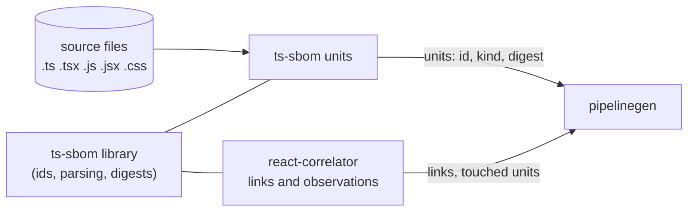

# ts-sbom

ts-sbom is an sbom plugin for
[pipelinegen](https://github.com/sideways-works/pipelinegen), which runs
only the test slices a change can break. It lists what exists in the
TypeScript, JavaScript and CSS of a repository: every top-level function,
component, class method, constant and type, the top-level code of each
module, and each stylesheet. Each unit has a stable id and a digest that
changes when what the code does can change, and stays the same when only
comments or formatting do.

It records what exists. Which units a test ran and which units use which
is [react-correlator](../../correlator/react)'s
job, and npm packages are
[npm-sbom](../npm)'s. Both ts-sbom and
react-correlator name units through this package's library, so they can't
disagree about an id.



## An example

A file `src/money.ts` exports a function `format` and a constant `RATES`.
ts-sbom lists them as `ts:src/money.ts#fn:format` and
`ts:src/money.ts#const:RATES`, plus `ts:src/money.ts#init` for the
module's own top-level code.

Reformatting the file, rewording a comment or switching its quotes
from single to double changes no digest, so no slice runs. Adding a type
annotation to `format` changes no runtime digest either, since the build
erases types before any test runs them. A change to the body of `format`
changes that one digest, and only the slices bound to `format` run.

## Setting it up

Name the plugin in `pipelinegen.yaml`, pinned by a release and its
checksum:

```yaml
plugins:
  - repository: https://github.com/sideways-works/pipelinegen-plugins
    with:
      - name: ts
        kind: sbom
        path: sbom/ts
        release: {version: vX.Y.Z, sha256: ...}
```

The checksum is the `ts-sbom.mjs` line of the release's `SHA256SUMS`. A
new pin selects nothing by itself. List `pipelinegen.yaml` under
`everything_on`, so that a pin change, like any other change to the
config, runs every slice.

### The files it claims

`describe` names the candidates `**/*.{ts,tsx,mts,cts,js,jsx,mjs,cjs}` and
`**/*.css`. `detect` claims a file only when its name and text say so:

| File | Role |
|---|---|
| a script or stylesheet | `source` |
| one whose header says a tool wrote it (`// Code generated by openapi-gen. DO NOT EDIT.`, `@generated`, `This file was generated`) | `generated`, with the tool when the header names one |

It leaves alone declaration files (`.d.ts`), anything under
`node_modules`, and minified bundles checked into the tree, which get no
units either. A generated file still gets units: its code runs like any
other.

`units` reads exactly the files pipelinegen sends in the request's
`claimed`: the tracked files `detect` claimed, widened by the plugin
entry's `include` patterns and narrowed by its `exclude` patterns. Of
those it reads the scripts and stylesheets; a file an `include` pattern
added with any other extension gets no units. It lists no files itself and
starts no process.

To read less or more of the tree, put patterns on the plugin's entry:

```yaml
  - repository: https://github.com/sideways-works/pipelinegen-plugins
    with:
      - name: ts
        kind: sbom
        path: sbom/ts
        release: {version: vX.Y.Z, sha256: ...}
        exclude: ["apps/legacy/**"]
```

### Config

The plugin has no config keys. The `include` and `exclude` keys that
earlier versions read inside `config` are refused with a message that
points to the entry's patterns.

### Toolchain and caches

`describe` declares `needs: ["node>=22.18"]`; pipelinegen fetches that
Node when a configured plugin needs it. The command bundles its own
TypeScript (6.0.3), so a repository's own TypeScript version never changes
a digest. The plugin declares no shared cache.

## What it produces

### Units

A unit's id is `ts:<file>#<key>` for scripts and `css:<file>` for
stylesheets, with the file's path from the tree's root. Ids hold names,
never positions, so moving code inside a file keeps them. A unit's group
is its file.

| Key | What it is | Executable |
|---|---|---|
| `fn:Name` | a top-level function or component, or a constant holding one (`const Card = memo(() => ...)`, `const add = (a, b) => a + b`) | yes |
| `method:Class.name` | a class method, accessor (`get size`), constructor, or a field holding a function; static members are named `static name` | yes |
| `class:Name` | the rest of a class: field initialisers, `extends`, decorators | yes |
| `const:name` | another top-level constant, `let`, `var` or enum; a destructuring is named by its names (`const:a,b`) | only when its value holds a function |
| `type:Name` | an interface, type alias or `declare` statement | no |
| `init` | the module's own top-level code: statements outside every other unit, and the modules it loads | yes, on import |

A few rules decide the edge cases:

- Nested functions and closures belong to the top-level unit around them.
  A click handler registered by a top-level statement belongs to `init`.
- Overload signatures merge into the function they describe.
- `export default function () {}` is `fn:default`; a default export of
  another value is `const:default`.
- Two top-level declarations with the same key, such as a `var` declared
  twice, are one unit.

### Digests

A digest is a hash of the unit's syntax tree, walked in a fixed form. It
keeps every token that reaches the built JavaScript and drops the rest:

- comments and whitespace, including the whitespace between JSX tags that
  React drops (a line break and indentation; a space inside a line stays).
  Comments a bundler reads stay, in the unit that holds them: `#__PURE__`
  and `@__NO_SIDE_EFFECTS__` (`#` and `@` alike), which let a minifier drop
  a call; `@vite-ignore` on a dynamic import; webpack's magic comments with
  their values (`webpackChunkName: "page"`). A file's JSX pragmas
  (`@jsx`, `@jsxFrag`, `@jsxImportSource`, `@jsxRuntime`), read from the
  comments before its first token, build every element in it, so they
  stay in the file's `init`. Comments no build reads (`@ts-nocheck`,
  `@ts-expect-error`, a licence) stay out;
- the quote style of strings, semicolons, trailing commas, and parentheses
  the tree's shape already implies (`(a?.b).c` and `a?.b.c` stay apart,
  and so do an array hole and a trailing comma);
- in every unit but a type, types: annotations, `as` and `satisfies`, `!`,
  type parameters, `implements`, overload signatures, and modifiers only
  the type checker reads. A constructor's `private x` stays, because it
  declares a field.

A unit's digest also holds what each import binding it reads names (`a`
from `./one` is not `a` from `./two`), so changing an import changes the
units that use it. `init` holds the list of modules the file loads.

A stylesheet's digest is its text without comments and with the
whitespace around braces, semicolons, commas, colons and `>` collapsed.

### Files covered whole

The answer's `complete` names the scripts whose units hold everything a
test can observe of them when they run as code: every statement is in a
unit whose digest covers it, and the text the digests leave out is
comments no tool reads and layout. pipelinegen takes a change to such a
file that keeps every digest (another layout, a JSDoc description, a
comment) for no change to the tests bound by recording; the checks that
read the text still run. A file of types and their docs, such as a client
generated from an API contract, is covered whole, and so is ordinary code.

A script is left out when one of these holds:

- the parser met a syntax error, or the file starts with a byte order
  mark or a shebang line;
- a comment is one a tool reads and no digest holds it: an `@` tag that
  isn't a JSDoc or TSDoc tag (`@vitest-environment`, `@flow`, `@refresh`),
  a legal comment, which the bundle keeps (`/*! ... */`, `@license`,
  `@preserve`), a triple-slash directive, a source map reference, a
  coverage directive (`c8 ignore`, `v8 ignore`, `istanbul ignore`), a JSX
  pragma after the first token, or a bundler's annotation where no unit's
  digest holds it (ending the line before, in an empty JSX expression,
  another bundler's `#__NAME__`). The annotations listed under Digests,
  where a unit's digest holds them, and the JSX pragmas before the first
  token, which `init` holds, leave the file whole;
- a statement declares several variables (`export const a = 1, b = 2`):
  each declaration is a unit, and the keyword and `export` are in none;
- a declaration binds no name (`const {} = setUp()`), which no unit holds;
- a decorator: a build that emits decorator metadata turns the decorated
  member's types into code;
- an import binding no unit reads, or one read only in types but imported
  without `type`, whose imported name is in no digest (renaming it may
  break the module's linking, and a build that keeps imports as written
  keeps it), or an import with attributes or a phase
  (`with { type: "json" }`, `import defer`);
- an abstract property, which the build drops while it emits a plain one
  as a field: the digests leave both modifiers out.

Stylesheets are never named: nothing here says what else a test sees of
one.

### Links

None. A unit's file is its group, so the answer holds no links among the
units; who uses whom is react-correlator's.

## Narrowings

ts-sbom declares none. Binding a test to functions rather than files is
react-correlator's `ts-functions` narrowing.

## What it can't see

- Comments a bundler reads beyond those listed under Digests (another
  bundler's annotations) are dropped like any comment: a change to one
  alone keeps the digest, so a file holding one is never in `complete`.
- A type-only edit keeps every runtime digest. The build erases types
  before any test runs them, and the type check runs on its own. A build
  that emits decorator metadata from types would break that; per-file
  transforms such as esbuild, SWC and Oxc don't, and a file with a
  decorator is never in `complete`.
- What a script's text says beyond its code: `Function.prototype.toString`
  returns a function's source with its comments and layout, and a stack
  trace names lines and columns, which another layout moves. A test that
  compares either sees a change no digest holds. So does an import of a
  script as text (Vite's `?raw`), from the importing side.
- A test that reads a script as text (a golden test over sources, a check
  that follows references in comments) sees what no digest holds. The
  repository declares it with the suite's `text_inputs` in pipelinegen,
  which keeps its edge to the file whatever `complete` says.
- Stylesheets are one unit per file. Finer units would be rules keyed by
  their selector and at-rule chain, bound through Chromium's CSS rule
  usage tracking (`CSS.startRuleUsageTracking`) and mapped back through CSS
  source maps, which builds rarely emit today.
- A file that fails to parse still gets its units from what the parser
  recovered, and the summary counts its syntax errors. It is never in
  `complete`.

## The calls

The requests and answers follow pipelinegen's
[plugin protocol](https://github.com/sideways-works/pipelinegen/blob/main/docs/plugins.md).
This section adds what is particular to ts-sbom. Its capabilities are
`detect` and `units`; its namespaces are `ts` and `css`; `inputs` declares
both calls per file, since a file's units depend on that file alone.

### `detect`

```sh
echo '{"protocol": 1, "tree": ".", "paths": ["src/api.ts", "src/editor.tsx", "notes.md"]}' | ts-sbom detect
```

```json
{"claims": [
  {"path": "src/api.ts", "role": "generated", "tool": "openapi-gen"},
  {"path": "src/editor.tsx", "role": "source"}
]}
```

### `units`

`units` lists every unit of the claimed files, or of those named in
`paths` when the caller has the rest already:

```sh
echo '{"protocol": 1, "tree": ".", "claimed": [{"path": "src/editor.tsx", "role": "source"}, {"path": "src/editor.css", "role": "source"}]}' | ts-sbom units
```

```json
{"units": [
  {"id": "ts:src/editor.tsx#fn:Editor", "group": "src/editor.tsx", "digest": "1c0e...", "file": "src/editor.tsx", "kind": "fn", "executable": true, "label": "Editor in editor.tsx"},
  {"id": "ts:src/editor.tsx#type:Line", "group": "src/editor.tsx", "digest": "77a2...", "file": "src/editor.tsx", "kind": "type", "executable": false, "label": "type Line in editor.tsx"},
  {"id": "css:src/editor.css", "group": "src/editor.css", "digest": "9b41...", "file": "src/editor.css", "kind": "css", "executable": false, "label": "the stylesheet editor.css"}
], "links": [], "complete": ["src/editor.tsx"]}
```

Each `label` is the unit as a developer names it, for `pipelinegen why`:
the declaration's name and its file from the source root on
(`getCaseFile in entities/casefile/api.ts`), `the module <path>` for a
module's init, `the stylesheet <path>` for a stylesheet. It is at most 80
characters and the same on every machine, and nothing hashes, caches or
compares it.

`complete` is left out when no script is covered whole. An answer larger
than 32 MB goes into `units.jsonl` in the work
directory, one unit a line, and the answer names the file in `files`. On a
frontend of about 6,000 units a full call takes a few seconds.

### The library

The package also exports what both plugins share: `summarize` (a file's
units, imports, exports and what each unit reads), `scriptId` and
`styleId`, detection, and `readTree` for the summaries of given files.
`@sideways-works/ts-sbom/detect` exports detection alone, which loads no
parser. react-correlator installs the package from git, pinned in its
`package.json` to the full commit of a ts-sbom release tag, and bundles
the library's sources into its own command.

The library's built files, `dist/lib.mjs` and `dist/detect.mjs`, are
committed, so installing the package runs no script, with or without
`--ignore-scripts`. `test/library.test.ts` fails when they differ from a
fresh build of the sources.

## Developing and releasing

```sh
npm install
npm test          # node:test, against the fixtures in testdata
npm run lint      # Biome and tsc --noEmit
npm run build     # dist/ts-sbom.mjs, and the committed library files
```

The build runs on the Node version in `.node-version`; npm refuses another
one (`devEngines` in `package.json`), so a release builds the same bytes
on any machine. Running the built command needs Node 22.18 or later.

esbuild's install script stays off (`allowScripts` in `package.json`). The
build calls esbuild's JavaScript API, which finds its platform binary
without that script, and a release installs with every script off.

`test/command.test.ts` fails when `describe` or `detect` loads the parser,
and checks the built file as pipelinegen runs it.

The conformance kit checks the plugin the way pipelinegen calls it, on the
fixture tree in `testdata/app`:

```sh
pipelinegen plugin test dist/ts-sbom.mjs --tree testdata/app
```

Releases are built and published with `bazel run //sbom/ts:release`, which
runs pipelinegen's release command as its [release guide](https://github.com/sideways-works/pipelinegen/blob/main/docs/releases.md)
describes: `ts-sbom.mjs`, `plugin.json` (the plugin's own `describe`),
`LICENSE`, `NOTICE` and `SHA256SUMS`, for a tag `sbom/ts/vX.Y.Z` on `main`.
Of the code, the release holds only the bundled command; packages that
use the library install it from git. A published release never changes; a
wrong one gets a new version.

### How the command file is built

A release is one file, `ts-sbom.mjs`, and a repository pins it by one
checksum. Most of the code in that file is the TypeScript parser, which
takes Node about a quarter of a second to load. `describe` and `detect`
need none of it, and pipelinegen calls them far more often than `units`.

So the file has two parts. The entry, built from `src/main.ts`, is a few
kilobytes of plain JavaScript that reads the call and answers `describe`
and `detect` itself. Everything else (`src/cli.ts` and what it imports,
TypeScript included) is built as one CommonJS bundle, compressed with
brotli and kept in the entry as a single base64 string starting with
`embedded:brotli+base64:`. Only `units` unpacks that embedded part and
runs it, the way Node runs a CommonJS file. If unpacking or running it
fails, the call exits 1 and says why on stderr. TypeScript's license
notice stays readable at the end of the file.

On a loaded eight-core machine, `describe` and `detect` take 8 to 13 ms
longer than `node -e 0`, against about 230 ms when the whole file was
loaded. About 2 ms of that is the entry; the rest is reading the 1 MB
string. `units` spends about 25 ms more CPU time unpacking and compiling
the embedded part. On a frontend of about 6,000 units the call takes about
3 s either way.

Every compression setting is fixed and the build writes no timestamps, so
two builds of one commit give the same bytes; pipelinegen's release script
builds twice and fails on any difference. The compressed bytes come from
Node's brotli encoder, so they follow the Node version in `.node-version`.
The unpacked bytes don't.

To check that a released file holds the code of its tag, check out the
tag, install, and run the checker on the downloaded file. It unpacks the
embedded part and compares it byte for byte with a fresh build of the
sources:

```sh
git checkout vX.Y.Z && npm ci
node scripts/check-release.ts path/to/ts-sbom.mjs
```

The tests run the checker on a fresh build, and on a build whose embedded
part was swapped for other code, which it must refuse.

## Developing

The tests and the lint run with the Go, golangci-lint and Node that the
repository pins, as [CONTRIBUTING](../../CONTRIBUTING.md) describes; the
other commands run in this directory.

```sh
bazel run //sbom/ts:test
bazel run //sbom/ts:lint
npm ci
npm run build                     # dist/ts-sbom.mjs, and the committed library files
npm run build
pipelinegen plugin test dist/ts-sbom.mjs --tree testdata/app
```

- The tests use no network; their trees are the fixtures in `testdata`.
- The library's built files, `dist/lib.mjs` and `dist/detect.mjs`, are
  committed, so that a package installing ts-sbom from git runs no
  script: after a change to their sources, build them and commit them. A
  test fails when they differ from a fresh build.
- The ids the library makes are what react-correlator names units by, so a
  change to an id's form is a change to both plugins.
- `test/command.test.ts` fails when `describe` or `detect` loads the
  parser: keep those calls in the small entry, `src/main.ts`.
- The last line is pipelinegen's conformance kit. It calls the built
  command the way pipelinegen does, on the fixture tree in `testdata/app`.
  Take `pipelinegen` from
  [its releases](https://github.com/sideways-works/pipelinegen/blob/main/docs/tutorial/install.md).
- A change to what ts-sbom lists comes with its docs: the README describes
  ts-sbom as it is on `main`.
