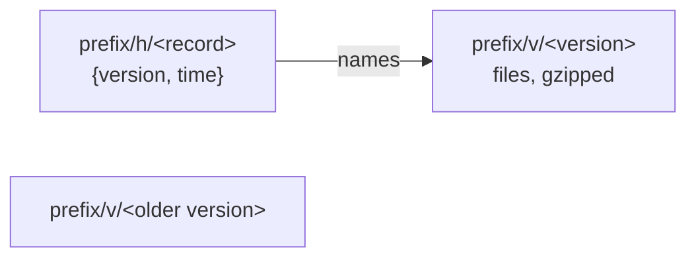

# s3-store

s3-store is a store plugin for
[pipelinegen](https://github.com/sideways-works/pipelinegen), which runs
only the test slices a change can break. It keeps pipelinegen's records
(plans, run and slice states, rounds, recordings and lists, the plugins'
answers) in an S3 bucket instead of the repository's refs. AWS S3,
SeaweedFS and any service that honours `If-Match` and `If-None-Match` on
PUT will do.

```yaml
plugins:
  - name: s3
    kind: store
    repository: https://github.com/sideways-works/pipelinegen-plugins
    path: store/s3
    release: {version: <tag>, sums: <the checksum of its SHA256SUMS>}
    config:
      endpoint: https://s3.eu-central-1.amazonaws.com
      region: eu-central-1
      bucket: ci-records
      prefix: shop/
store: {backend: plugin, plugin: s3}
```

| Setting | What it is |
|---|---|
| `endpoint` | The service's URL, http or https |
| `region` | The bucket's region, which signs every request |
| `bucket` | The bucket |
| `prefix` | Where the records go in it; several repositories can share a bucket under prefixes of their own |
| `path_style` | Puts the bucket in the path instead of the host, as SeaweedFS and MinIO usually want |

The key comes in `PIPELINEGEN_STORE_ACCESS_KEY_ID` and
`PIPELINEGEN_STORE_SECRET_ACCESS_KEY`, with
`PIPELINEGEN_STORE_SESSION_TOKEN` for a temporary one; the runner gives
them to the steps that read or write records, and a key that only reads to
the steps that only read.

Where a CI system knows the store only at run time, as piperun's services
do, `PIPELINEGEN_STORE_ENDPOINT`, `PIPELINEGEN_STORE_REGION`,
`PIPELINEGEN_STORE_BUCKET` and `PIPELINEGEN_STORE_PREFIX` take over the
config's. A prefix from there comes before the config's own, so a grant of
one prefix can hold several repositories' records, and requests go path
style.

## How it keeps records



- Each version of a record is an object of its own, `<prefix>v/<version>`,
  written once (`If-None-Match: *`) and never changed: the record's name,
  the writer's time and its files, gzipped JSON.
- A record's head, `<prefix>h/<name>`, names its newest version. A write
  replaces a head only while its ETag is the one the write read
  (`If-Match`), and creates one only where none is, so of two writers of
  one record one wins and the other is told the record moved.
- A delete writes a head that says so, guarded the same way.
- A listing lists the heads with their ETags and reads only the heads
  whose ETag it hasn't seen: the plugin keeps the heads it read in its
  cache directory between calls.

A write of several records applies them in order and stops at the first
whose record moved, as pipelinegen's store protocol says; the records
before it stand. It passes pipelinegen's store conformance suite against
SeaweedFS.

Old versions stay in the bucket. Give the prefix a lifecycle rule that
expires objects under `<prefix>v/` well after `keep.runs`, or leave them:
nothing reads a version no head names.
